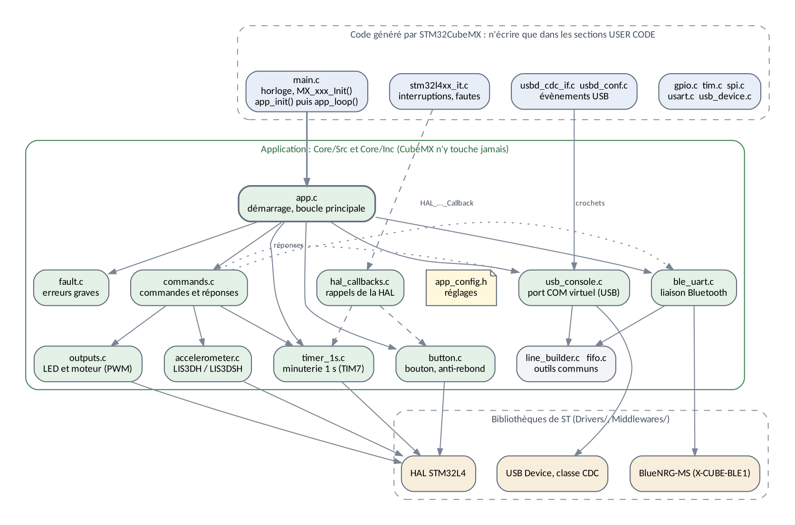
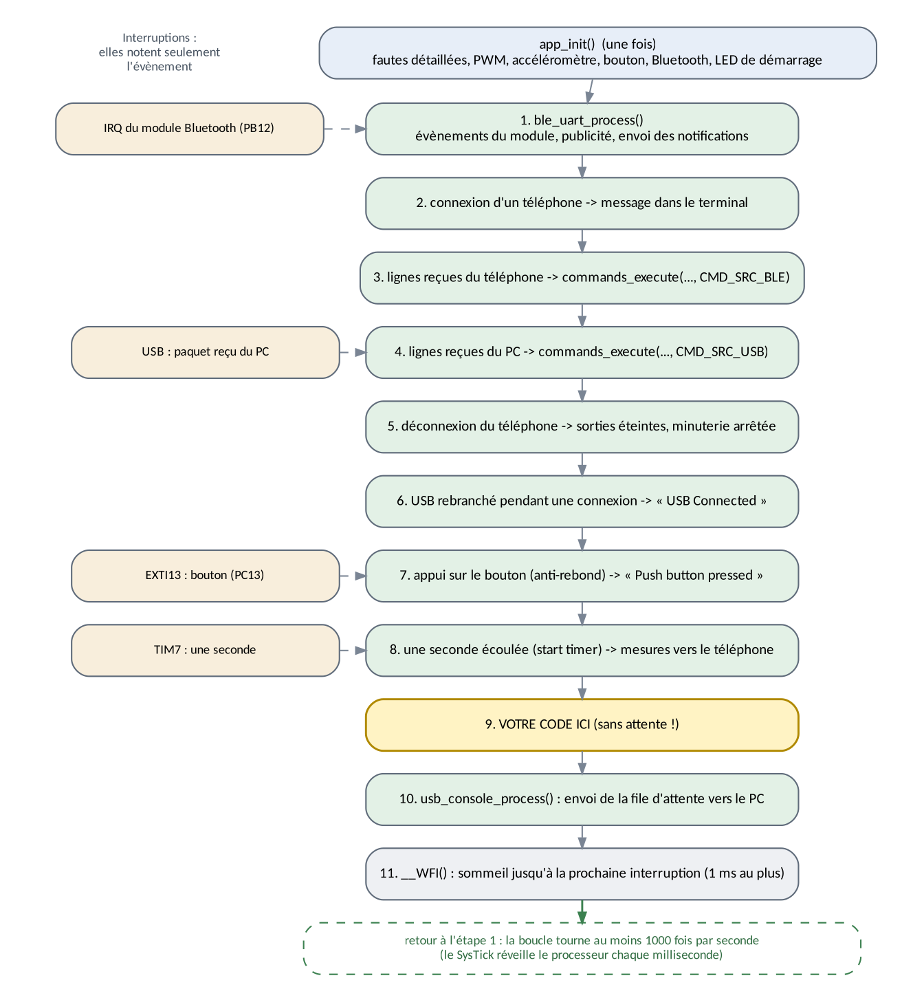
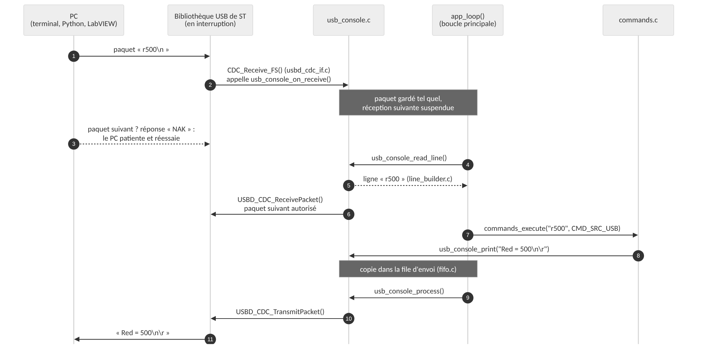
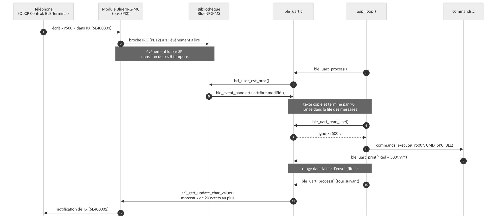
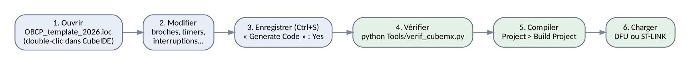

# OBCP_template_2026 — programme modèle de l'ObCP (version 2.0.0)

Programme de démonstration de la carte **ObCP** (Objet Connecté Personnel, SUPMICROTECH-ENSMM, option CROC) : microcontrôleur **STM32L476RG**, module Bluetooth Low Energy **BlueNRG-M0** (ou SPBTLE-RF sur les cartes d'avant 2024), accéléromètre **LIS3DH**. Le programme pilote la LED tricolore et la sortie PWM du bornier, lit l'accélération et la température, et dialogue avec un **PC** (port COM virtuel par le câble USB) et un **téléphone** (Bluetooth).

Cette version 2 est une réécriture complète de `OBCP_template_2024` :

- **mêmes commandes, mêmes réponses, au caractère près** : les scripts Python, le VI LabVIEW et les applications Android fonctionnent sans changement (vérifié par une comparaison automatique des deux versions, voir [§ 10](#10-tests-sur-pc-sans-carte)) ;
- **plus de 30 défauts corrigés** : messages perdus, débordement de tableau, valeurs mal lues, Bluetooth qui ne revenait pas après certains incidents… (voir [§ 11](#11-ce-qui-change-par-rapport-à-la-version-2024)) ;
- **code découpé en modules courts**, commentés pour des débutants, avec des liens vers la documentation ;
- **régénérable par STM32CubeMX** sans rien perdre, avec un outil qui vérifie le projet après chaque génération.

> La documentation complète du programme (principes, fonctionnement de chaque module, référence des fonctions, exercices guidés) est dans [`Doc/Documentation_Programme_OBCP_2026.docx`](Doc/Documentation_Programme_OBCP_2026.docx).

## Sommaire

1. [Prise en main](#1-prise-en-main)
2. [Les commandes](#2-les-commandes)
3. [Messages envoyés par la carte](#3-messages-envoyés-par-la-carte)
4. [Le service Bluetooth](#4-le-service-bluetooth)
5. [Matériel utilisé](#5-matériel-utilisé)
6. [Organisation du programme](#6-organisation-du-programme)
7. [Ajouter son propre code](#7-ajouter-son-propre-code)
8. [Modifier la configuration avec STM32CubeMX](#8-modifier-la-configuration-avec-stm32cubemx)
9. [Compiler](#9-compiler)
10. [Tests sur PC, sans carte](#10-tests-sur-pc-sans-carte)
11. [Ce qui change par rapport à la version 2024](#11-ce-qui-change-par-rapport-à-la-version-2024)
12. [Codes de la LED](#12-codes-de-la-led)
13. [Contenu du dossier et versions des outils](#13-contenu-du-dossier-et-versions-des-outils)
14. [Documentation et liens](#14-documentation-et-liens)

---

## 1. Prise en main

### Charger le programme

Le programme compilé est dans [`BIN/`](BIN/) (`OBCP_template_2026.bin`, `.hex`, `.elf`). Pour le charger par le câble USB (mode DFU) avec [STM32CubeProgrammer](https://www.st.com/en/development-tools/stm32cubeprog.html) :

1. brancher l'ObCP au PC ; interrupteur **SW4 sur « Prog »**, **SW2 sur « On »**, appui sur **SW3 (reset)** ;
2. dans STM32CubeProgrammer : **USB** (en haut à droite), bouton de rafraîchissement, **Connect** ;
3. **Erasing & programming** : *Browse* → `OBCP_template_2026.bin` (adresse `0x08000000`), **Start Programming** ;
4. **SW4 sur « Run »**, appui sur **SW3** : le programme démarre.

Procédure illustrée : [`Datasheets/Procedure_Programmation_OBCP_CROC.pdf`](Datasheets/Procedure_Programmation_OBCP_CROC.pdf). On peut aussi programmer et déboguer avec la sonde ST-LINK d'une carte Nucleo branchée sur le connecteur **J17** (même document).

### Au démarrage

La LED tricolore indique l'état de la carte : **1 éclat vert** = tout est prêt ; **2 éclats rouges** = accéléromètre absent ou muet ; **3 éclats rouges** = module Bluetooth absent ou muet (le reste du programme fonctionne quand même). Voir [§ 12](#12-codes-de-la-led).

### Depuis un PC : le port COM virtuel

Branchée par USB, la carte apparaît comme un port série (« Périphérique série USB (COMx) » dans le gestionnaire de périphériques de Windows, `/dev/ttyACM0` sous Linux). On l'ouvre avec :

- un terminal (PuTTY, Tera Term…) : **la vitesse choisie n'a pas d'importance** (les données voyagent à la vitesse de l'USB) ; la touche Entrée peut envoyer CR, LF ou CR+LF ;
- les scripts du dossier [`Python/`](Python/) (`OBCP_Control.py`, `OBCP_LED_RVB.py`, `OBCP_acceleration2.py`, `Terminal_port_com.py`, il faut `pip install pyserial matplotlib`) ;
- le VI LabVIEW du dossier [`Labview/`](Labview/) (`OBCP.vi`, ou `Application_OBCP.exe` sans LabVIEW).

Tapez `?` puis Entrée : la carte répond par la liste des commandes.

### Depuis un téléphone : Bluetooth

La carte se présente sous le nom **`OBCP-CROC`**. Applications Android du dépôt (dossier `Android/` du dépôt [LAB_ObCP_L476_STM32CubeIDE](https://github.com/jimbaud/LAB_ObCP_L476_STM32CubeIDE)) :

- **ObCP Control** : curseurs pour les LED et la sortie PWM, courbes de l'accélération et de la température ;
- **BLE Terminal JILAB** : terminal texte générique.

Avec une application « UART BLE » générique, il faut parfois désigner les caractéristiques à la main (voir [§ 4](#4-le-service-bluetooth)). Si le téléphone demande un code d'appairage : **123456** (aucun appairage n'est nécessaire en temps normal).

---

## 2. Les commandes

Les mêmes commandes sont acceptées par le port COM virtuel et par Bluetooth. Une commande se termine par Entrée (CR, LF ou CR+LF) ; un programme qui envoie une commande d'un seul bloc (paquet USB de plusieurs caractères, écriture Bluetooth) peut omettre la fin de ligne.

| Commande | Effet | Réponse |
|---|---|---|
| `r` *n* ou `R` *n* | LED **rouge**, *n* de 0 (éteinte) à 65535 (pleine lumière) | `Red = n` |
| `v` *n* ou `V` *n* | LED **verte** | `Green = n` |
| `b` *n* ou `B` *n* | LED **bleue** | `Blue = n` |
| `m` *n* ou `M` *n* | sortie **PWM du bornier J13** (moteur, 5 V) | `PWM = n` |
| `a` ou `A` | lit l'**accéléromètre** (en g) | `Acceleration : X=0.01 Y=-0.02 Z=1.00` |
| `t` ou `T` | lit la **température** du capteur (°C, ordre de grandeur) | `T = 27` |
| `?` | **aide** (envoyée seulement à l'interface qui la demande) | liste des commandes |
| `cls` | **efface l'écran** du terminal (USB seulement) | séquence ANSI `ESC[1;1H ESC[2J` |
| `start timer` | envoi au téléphone, **chaque seconde**, de l'accélération et de la température | aucune |
| `stop timer` | arrête cet envoi | aucune |
| `#rst` | **tout éteint** (LED, PWM) et arrête la minuterie | aucune |

Règles :

- toutes les réponses se terminent par `\n\r` (saut de ligne puis retour chariot), comme en 2024 ;
- la réponse est aussi **recopiée sur l'autre interface** si elle est active : on voit dans le terminal du PC les commandes envoyées par le téléphone, et inversement (l'aide n'est pas recopiée) ;
- *n* est un nombre **décimal** de 0 à 65535, éventuellement précédé d'espaces (`r 500`) ;
- les espaces au début et à la fin de la ligne sont ignorés, une ligne vide aussi ; `start timer`, `stop timer`, `#rst`, `cls` s'écrivent en minuscules ;
- erreurs : `False command` (commande inconnue, ligne de plus de 64 caractères, `cls` par Bluetooth) ; `False value (0-65535)` (valeur absente, négative, trop grande ou suivie d'autre chose : `r`, `r-1`, `r70000`, `r50x`) ; `Accelerometer error` (capteur absent ou muet).

Exemple de session dans un terminal :

```
r20000          ->  Red = 20000
v 500           ->  Green = 500
a               ->  Acceleration : X=0.01 Y=-0.02 Z=1.00
r70000          ->  False value (0-65535)
hello           ->  False command
#rst            ->  (rien : tout est éteint)
```

---

## 3. Messages envoyés par la carte

| Quand | Vers le terminal (USB) | Vers le téléphone (BLE) |
|---|---|---|
| un téléphone se connecte | `Generated BLE Address: C1:23:45:67:89:AB` (adresse de la carte)<br>`Connected to device: …` (adresse du téléphone) | — |
| le téléphone se déconnecte (LED et PWM s'éteignent, la minuterie s'arrête) | `BLE disconnected :p` | — |
| l'USB et le Bluetooth sont connectés tous les deux (une fois après chaque branchement du câble USB) | — | `USB Connected` |
| appui sur le bouton utilisateur SW1 | `Push button pressed` | `PButton pressed` |
| chaque seconde après `start timer` | — | `X0.01Y-0.02Z1.00` puis `T = 27` |

Chaque message part dans sa propre notification Bluetooth : l'application ObCP Control reconnaît ainsi les mesures (`X…Y…Z…`, `T = …`).

---

## 4. Le service Bluetooth

| Élément | UUID | Propriétés | Rôle |
|---|---|---|---|
| service « UART » | `6E400001-B5A3-F393-E0A9-E50E24DCCA9E` | — | — |
| TX | `6E400002-B5A3-F393-E0A9-E50E24DCCA9E` | notification, lecture | carte → téléphone (réponses, mesures) |
| RX | `6E400003-B5A3-F393-E0A9-E50E24DCCA9E` | écriture, écriture sans réponse | téléphone → carte (commandes) |

- Ce sont les UUID du *Nordic UART Service* (NUS), mais **avec TX et RX inversés** par rapport à [la norme Nordic](https://developer.nordicsemi.com/nRF_Connect_SDK/doc-legacy/2.6.1/nrf/libraries/bluetooth_services/services/nus.html) (chez Nordic, `…02` reçoit et `…03` émet). C'était déjà le cas en 2024 et l'application ObCP Control en dépend : ne pas le changer. Avec nRF Connect : écrire dans `…03`, s'abonner à `…02`.
- Les messages de plus de 20 octets sont envoyés en plusieurs notifications de 20 octets au plus (taille de base d'un paquet BLE) ; une commande écrite dans RX fait au plus 20 octets.
- Adresse : l'adresse « statique aléatoire » propre à chaque module (lue dans sa mémoire, comme en 2024) ; si le module n'en a pas encore, une adresse tirée de l'identifiant unique du STM32. Elle est affichée dans le terminal à chaque connexion.
- Puissance d'émission : environ −2 dBm (comme en 2024).

---

## 5. Matériel utilisé

| Fonction | Broche | Périphérique du STM32 | Nom dans le code (CubeMX) |
|---|---|---|---|
| LED rouge / verte / bleue (D5, transistors Q1 à Q3) | PC6 / PC8 / PC9 | TIM3 voies 1 / 3 / 4 (PWM) | `LED_RED`, `LED_GREEN`, `LED_BLUE` |
| sortie PWM du bornier J13 (MOSFET M1, 5 V) | PB1 | TIM1 voie 3N (PWM) | `PWM_MOTOR` |
| bouton utilisateur SW1 | PC13 | EXTI13, front descendant | `USER_BUTTON` |
| accéléromètre U4 (LIS3DH) | PC10 / PC11 / PC12, CS = PC5 | SPI3 | `ACC_SCK`, `ACC_MISO`, `ACC_MOSI`, `ACC_CS` |
| module Bluetooth BLE1 | PB13 / PB14 / PB15, CS = PB2, IRQ = PB12, RESET = PC2 | SPI2, EXTI12 | `BLE_SCK`, `BLE_MISO`, `BLE_MOSI`, `BLE_CS`, `BLE_IRQ`, `BLE_RST` |
| mémoire EEPROM U7 (M95640), sur le bus du module Bluetooth | CS = PC3 | SPI2 (non utilisée par le programme) | `EEPROM_CS` |
| port COM virtuel | PA11 / PA12 | USB OTG FS, classe CDC | — |
| liaison série libre (J5, J7) | PA2 / PA3 | USART2, 115200 bauds (non utilisée) | `USART_TX`, `USART_RX` |
| débogage (J17) | PA13 / PA14 | SWD | `TMS`, `TCK` |

Horloge : quartz de 8 MHz (HSE) → PLL → **64 MHz** pour le processeur et les minuteries ; 48 MHz pour l'USB (PLLSAI1).
Minuteries : **TIM3** (LED) et **TIM1** (moteur) comptent de 0 à 65535 à 64 MHz, soit une PWM à 977 Hz ; **TIM7** produit une interruption par seconde (64 MHz ÷ 6400 ÷ 10000).

> Accéléromètre : la nomenclature et le schéma indiquent un LIS3DSH, mais la liste d'achat (`LIS3DHTR`) et la fiche fournie correspondent au LIS3DH, au même boîtier. Le programme lit le registre d'identité du capteur au démarrage et sait piloter les deux.

---

## 6. Organisation du programme



Le code de l'application est rangé dans des fichiers que **STM32CubeMX ne touche jamais** (`Core/Src`, `Core/Inc`). Les fichiers générés (`main.c`, `stm32l4xx_it.c`, `usbd_cdc_if.c`, `usbd_conf.c`) ne contiennent que quelques lignes « crochets », dans leurs sections `USER CODE`, qui appellent l'application.

| Fichier | Rôle | Lignes |
|---|---|---|
| `main.c` (généré) | configure l'horloge et les périphériques, puis appelle `app_init()` et `app_loop()` | — |
| [`app.c`](Core/Src/app.c) | démarrage et **boucle principale** : c'est ici qu'on lit le programme | 300 |
| [`commands.c`](Core/Src/commands.c) | **analyse et exécution des commandes**, textes des réponses | 340 |
| [`outputs.c`](Core/Src/outputs.c) | LED et moteur : réglage des rapports cycliques PWM | 75 |
| [`accelerometer.c`](Core/Src/accelerometer.c) | pilote de l'accéléromètre (SPI, registres, conversion en g) | 290 |
| [`button.c`](Core/Src/button.c) | bouton utilisateur, anti-rebond sans attente | 100 |
| [`timer_1s.c`](Core/Src/timer_1s.c) | minuterie d'une seconde (`start timer`) | 70 |
| [`usb_console.c`](Core/Src/usb_console.c) | port COM virtuel : réception des lignes, file d'envoi | 330 |
| [`ble_uart.c`](Core/Src/ble_uart.c) | Bluetooth : démarrage du module, service UART, connexions, notifications | 810 |
| [`line_builder.c`](Core/Src/line_builder.c) | assemble les caractères reçus en lignes de commande | 100 |
| [`fifo.c`](Core/Src/fifo.c) | tampon circulaire (file d'attente d'octets) | 90 |
| [`hal_callbacks.c`](Core/Src/hal_callbacks.c) | fonctions de rappel des interruptions de la HAL (bouton, TIM7) | 50 |
| [`fault.c`](Core/Src/fault.c) | erreurs graves : arrêt et clignotement de la LED rouge | 80 |
| [`app_config.h`](Core/Inc/app_config.h) | **tous les réglages** (nom Bluetooth, tailles des tampons, délais…) | 110 |

**Ordre de lecture conseillé** : `app.h` → `app.c` → `commands.h` / `commands.c` → `outputs.c` → `button.c` → `timer_1s.c` → `accelerometer.c` → `usb_console.h` → `ble_uart.h`. Chaque fichier commence par un en-tête qui explique son principe ; les fichiers `.h` décrivent chaque fonction (paramètres, valeur rendue).

### La boucle principale



Le programme n'a pas de système d'exploitation : c'est une **« super boucle »**. Deux règles la font fonctionner :

1. **aucune étape n'attend** : une attente (`HAL_Delay`, boucle qui guette un évènement) bloquerait toutes les autres, et l'USB ou le Bluetooth ne seraient plus servis ;
2. **les interruptions ne font que noter** l'évènement (un drapeau, un paquet mis de côté) ; le travail est fait dans la boucle.

Le chemin d'une commande, du PC à la LED et retour :



Et par Bluetooth :



---

## 7. Ajouter son propre code

**Un traitement à chaque tour de boucle** : étape 9 de `app_loop()` dans [`app.c`](Core/Src/app.c) (« Votre code ici »). L'exemple fourni allume la LED bleue quand la carte est retournée, en lisant l'accéléromètre toutes les 100 ms sans jamais attendre :

```c
static uint32_t last_ms;                     // dernière action
if ((HAL_GetTick() - last_ms) >= 100U)       // 100 ms écoulées ?
{
  accel_g_t g;
  last_ms = HAL_GetTick();
  if (accel_read(&g))
  {
    outputs_set(OUTPUT_BLUE, (g.z < -0.5f) ? 20000U : 0U);
  }
}
```

**Une nouvelle commande** (exemple : `x`), voir l'en-tête de [`commands.c`](Core/Src/commands.c) :

1. dans `commands.h`, ajouter `CMD_X` à l'énumération `cmd_id_t` ;
2. dans `commands_parse()`, reconnaître le texte : `else if (strcmp(text, "x") == 0) { cmd.id = CMD_X; }` ;
3. dans `commands_execute()`, ajouter `case CMD_X:` avec l'action et la réponse (`snprintf(reply, sizeof(reply), "...\n\r")`) ;
4. compléter le texte d'aide `s_help` et ce README ; ajouter un test dans `Tests/test_unit.c`.

**Fonctions utiles** :

| Pour… | Appeler |
|---|---|
| allumer une LED, régler le moteur | `outputs_set(OUTPUT_RED, 30000);` (`OUTPUT_GREEN`, `OUTPUT_BLUE`, `OUTPUT_MOTOR`) |
| lire l'accélération (g) | `accel_g_t g; if (accel_read(&g)) { … g.x, g.y, g.z … }` |
| lire la température (°C) | `int t; if (accel_read_temperature(&t)) { … }` |
| écrire dans le terminal du PC | `usb_console_printf("x = %d\n\r", x);` |
| envoyer au téléphone | `ble_uart_printf("x = %d\n\r", x);` (20 caractères par notification) |
| savoir si le PC / le téléphone est là | `usb_console_is_ready()`, `ble_uart_is_connected()` |
| mesurer le temps | `HAL_GetTick()` : millisecondes depuis le démarrage |
| étalonner un axe de l'accéléromètre | `accel_set_calibration(ACCEL_AXIS_Z, -980.0f, 1020.0f);` (valeurs en mg relevées avec `a`, axe vers le bas puis vers le haut) |

`CDC_Transmit_FS()`, utilisée dans les anciens sujets de TP, marche toujours : elle range maintenant le texte dans la file d'envoi au lieu de le perdre quand l'USB est occupé.

**Changer un réglage** (nom Bluetooth, tailles de tampon, durée de l'anti-rebond, mise en veille) : [`Core/Inc/app_config.h`](Core/Inc/app_config.h), où chaque valeur est expliquée.

**Déboguer** : configuration *Debug*, sonde ST-LINK sur J17. Les variables d'état (`s_connected`, `s_conn_handle`… dans `ble_uart.c`) se suivent dans la fenêtre *Live Expressions*.

---

## 8. Modifier la configuration avec STM32CubeMX



1. Ouvrir `OBCP_template_2026.ioc` (double-clic dans STM32CubeIDE), modifier (broches, minuteries, interruptions…), enregistrer : CubeIDE propose de générer le code, répondre **Yes**.
2. Lancer l'outil de vérification, depuis le dossier du projet :
   ```
   python Tools/verif_cubemx.py
   ```
   Il contrôle que les crochets des sections `USER CODE` sont en place, que les réglages dont dépend le programme n'ont pas changé (noms des broches, minuteries, interruptions, options de génération), que chaque nom de broche utilisé par l'application existe dans `main.h`, et qu'aucune fonction de rappel de la HAL n'est écrite deux fois. Chaque erreur est expliquée, avec la manière de la corriger. Résultat attendu : `Bilan : 0 erreur(s), 0 avertissement(s)`.
3. Compiler et charger.

Ce que CubeMX réécrit à chaque génération : `main.c`, `gpio.c`, `tim.c`, `spi.c`, `usart.c`, `stm32l4xx_it.c`, `usbd_cdc_if.c`, `usbd_conf.c`… **sauf le texte placé entre `/* USER CODE BEGIN xxx */` et `/* USER CODE END xxx */`**. Ce qu'il ne touche jamais : les fichiers de l'application (`app.c`, `commands.c`…).

Pièges courants (tous détectés par l'outil) :

- renommer une broche (*User Label*) : le code ne trouve plus `LED_RED_Pin`… ;
- changer la base de temps de la HAL (*SYS > Timebase Source*) : CubeMX écrit alors dans `main.c` un second `HAL_TIM_PeriodElapsedCallback()` → erreur « multiple definition » ;
- décocher *Keep User Code when re-generating* : les crochets sont effacés ;
- remettre `USBD_CDC_ReceivePacket()` dans la section 6 de `usbd_cdc_if.c` (code par défaut de CubeMX) : les paquets USB peuvent s'écraser.

Le fichier `.ioc` a été enregistré avec STM32CubeMX 6.11.1. Une version plus récente de CubeMX ou de CubeIDE propose de « migrer » le projet : accepter, générer le code, puis lancer l'outil de vérification.

---

## 9. Compiler

**Avec STM32CubeIDE** : *File > Import > General > Existing Projects into Workspace*, choisir le dossier du projet, *Finish*. Puis *Project > Build Project*. Deux configurations :

- **Debug** (`-O0 -g3`) : pour déboguer pas à pas (la sonde reste connectée pendant la mise en veille du processeur) ;
- **Release** (`-Os`) : programme optimisé, celui du dossier `BIN/`.

Les fichiers `.bin` et `.hex` sont produits automatiquement à côté du `.elf` (dossier `Debug/` ou `Release/`).
Le dossier `Tests/` est masqué dans CubeIDE (filtre de ressources du projet) : ces fichiers sont faits pour le PC, et ils auraient brouillé la navigation dans le code (F3, *Open Declaration*). Pour les afficher : *Properties > Resource > Resource Filters*.

**En ligne de commande** (Linux, macOS, WSL), avec la chaîne GNU Arm Embedded (`arm-none-eabi-gcc`) : `make` (Release) ou `make DEBUG=1`, résultat dans `build/`.

Taille : environ 55 ko de flash sur 1024 ko, 12 ko de RAM sur 96 ko (plus 2 ko de tas et 4 ko de pile réservés). Le projet se compile sans aucun avertissement ; les fichiers de l'application passent aussi les options strictes `-Wall -Wextra -Wconversion -Wshadow -Wcast-qual…` et l'analyseur statique cppcheck.

---

## 10. Tests sur PC, sans carte

Le dossier [`Tests/`](Tests/) compile le code de l'application **pour le PC**, le matériel étant remplacé par des « doublures » (dossier `Tests/fakes/` : HAL, module Bluetooth, USB et accéléromètre simulés). Il faut `gcc`, `make` et `python3` (Linux, macOS, WSL ou MSYS2 sous Windows) :

```
cd Tests
make
```

Trois séries de tests, compilées avec AddressSanitizer et UndefinedBehaviorSanitizer (détection des débordements de mémoire et des calculs non définis) :

| Série | Contenu | Résultat |
|---|---|---|
| `make unit` | tampon circulaire, assemblage des lignes, analyse de toutes les commandes (cas normaux et erreurs) | 103 vérifications |
| `make app` | programme complet sur la carte simulée : démarrage, USB en paquets et au clavier, contrôle de flux, PC qui ne lit pas, Bluetooth (connexion, commandes, aide découpée, déconnexion, module saturé, connexion échouée, publicité refusée, redémarrage du module), bouton, minuterie, accéléromètre LIS3DH / LIS3DSH / absent | 202 vérifications |
| `make compare` | **le même scénario joué par la version 2024 (code d'origine) et la version 2026** ; compare tout ce qui est envoyé au PC et au téléphone, et l'état des sorties | 61 étapes d'usage normal identiques ; cas d'erreur affichés côte à côte |

`make demo2024` montre en plus un débordement de tableau de la version 2024 (voir § 11).

---

## 11. Ce qui change par rapport à la version 2024

### Ce qui ne change pas

Les commandes, les textes des réponses et des messages, le nom Bluetooth, le service et ses UUID, l'adresse Bluetooth, le code d'appairage, les broches, la sortie moteur (TIM1). La comparaison automatique (`make compare`) le vérifie pour 61 étapes d'usage normal : commandes en paquets et au clavier, par USB et par Bluetooth, aide, minuterie, bouton, connexions et déconnexions.

### Ce que l'on peut voir (cas d'erreur seulement)

| Situation | Version 2024 | Version 2026 |
|---|---|---|
| `r5` envoyé sans fin de ligne juste après `r65535` | `Red = 55535` | `Red = 5` |
| `r5` écrit par le téléphone (tampon de la bibliothèque réutilisé) | `Red = 55535` | `Red = 5` |
| `b9` tapé au clavier, Entrée = CR+LF | `False command` | `Blue = 9` |
| `start timer` tapé touche par touche | débordement du tableau `UsbBuffer2[10]` | minuterie lancée |
| `r010` | `Red = 8` (lu en octal !) | `Red = 10` |
| `r-1` | `Red = -1`, LED à fond | `False value (0-65535)` |
| `r70000` | `Red = 70000`, mais le registre 16 bits reçoit 4464 | `False value (0-65535)` |
| `r` seul | `Red = 0` | `False value (0-65535)` |
| `r50x` | `Red = 50` | `False value (0-65535)` |
| `blue` | `Blue = 0` | `False command` |
| ligne vide (Entrée seule) | `False command` | rien |
| `a`, carte posée à plat | `Z=0.96` (4 % trop faible) | `Z=1.00` |
| `start timer`, `stop timer`, `#rst` | une notification Bluetooth vide | rien |
| capteur absent | valeurs sans signification | `Accelerometer error` |
| LED, `r` *n* avec *n* > 6399 | pleine lumière dès 6399 | réglage progressif jusqu'à 65535 |

### Défauts corrigés

| Domaine | Défaut de la version 2024 | Correction (fichier) |
|---|---|---|
| USB | le paquet reçu était lu sans fin de texte (`'\0'`) dans un tampon réutilisé : restes de la commande précédente | copie terminée par `'\0'` (`usb_console.c`) |
| USB | frappe au clavier : tableau de 10 cases sans contrôle de place, débordement dès 11 caractères (`start timer`) | ligne limitée à 64 caractères, rejet propre (`line_builder.c`) |
| USB | seul CR terminait une ligne ; le LF d'Entrée (CR+LF) restait au début de la commande suivante | CR, LF et CR+LF acceptés, effacement (Backspace) géré (`line_builder.c`) |
| USB | réception du paquet suivant autorisée avant la fin du traitement : un paquet pouvait écraser la commande en cours | contrôle de flux : paquet suivant autorisé après traitement (`usb_console.c`, `usbd_cdc_if.c`) |
| USB | `CDC_Transmit_FS()` appelée directement : message perdu si l'envoi précédent n'était pas fini, texte d'une variable locale envoyé après la fin de la fonction | file d'envoi de 1 ko (`usb_console.c`) ; `CDC_Transmit_FS()` passe par elle |
| BLE | texte reçu lu au-delà de sa longueur, dans un tampon réutilisé par la bibliothèque | copie terminée par `'\0'` (`ble_uart.c`) |
| BLE | connexion échouée prise pour une connexion réussie : plus de publicité, carte introuvable jusqu'au reset | état vérifié, publicité relancée |
| BLE | publicité refusée par le module (juste après une déconnexion) jamais réessayée | nouvel essai toutes les 200 ms |
| BLE | redémarrage inattendu du module (chien de garde) non traité : service perdu | module remis en service automatiquement |
| BLE | commandes exécutées dans la fonction d'évènement du module, avec des attentes actives (10 ms par morceau, 20 ms tous les 5 morceaux) | exécution dans la boucle principale, envoi sans attente |
| BLE | morceau de notification abandonné après 10 ms si le module était saturé | nouvel essai dès qu'un tampon se libère : rien n'est perdu |
| BLE | notification vide après `start timer`, `stop timer`, `#rst` et après un message d'exactement 20 octets | supprimée |
| BLE | risque de blocage : si les 5 tampons de la bibliothèque sont pleins, la broche IRQ reste à 1 et ne produit plus d'interruption | lecture relancée par la boucle principale |
| BLE | adresse lue dans le module sans contrôle : au premier démarrage d'un module neuf, elle n'existe pas encore et la carte prenait une adresse vide | adresse vérifiée, sinon adresse de secours propre à chaque STM32 |
| BLE | caractéristique *Device Name* laissée à « BlueNRG » | « OBCP-CROC » |
| BLE | aucun résultat des commandes au module vérifié | chaque étape vérifiée, panne signalée par la LED |
| Bouton | anti-rebond par attentes (`HAL_Delay(50)`, puis attente du relâchement) : boucle bloquée tant que le bouton est enfoncé | anti-rebond sans attente (`button.c`) |
| Minuterie | `Prescaler = 6400` : période de 1,0001 s | 6399 : 1 s exactement |
| Minuterie | toute interruption de minuterie déclenchait les mesures | seule TIM7 compte (`hal_callbacks.c`) |
| Minuterie | après `stop timer` puis `start timer`, la première seconde était incomplète | comptage repris à zéro (`timer_1s.c`) |
| Accéléromètre | sensibilité du LIS3DSH (0,06 mg) appliquée au LIS3DH (0,0625 mg) : 4 % trop faible | sensibilité du circuit détecté (`accelerometer.c`) |
| Accéléromètre | X, Y et Z lus en trois échanges : axes de deux mesures différentes possibles | lecture des 6 octets en une fois |
| Accéléromètre | structure de gestion du SPI copiée (deux états pour un seul bus) ; présence du capteur jamais vérifiée | pointeur vers `hspi3` ; registre d'identité lu au démarrage |
| Commandes | `sscanf("%c%i")` : octal (`r010`), négatif, trop grand, valeur absente ou suivie d'autre chose acceptés | analyse stricte, `False value (0-65535)` (`commands.c`) |
| Commandes | comparaison du début seulement : `start timerXYZ`, `#rst123` acceptées | comparaison exacte |
| Commandes | aide : « b50 for red » pour la LED bleue | « b50 for blue » |
| Sorties | LED : TIM3 comptait jusqu'à 6399 alors que les commandes vont jusqu'à 65535 (90 % des curseurs Python et Android inutiles) | TIM3 jusqu'à 65535 (voir ci-dessous) |
| Sorties | TIM1 sans mise à jour synchronisée (*preload*) : une impulsion fausse possible à chaque changement | *preload* activé |
| Broches | PB2 (sélection du module Bluetooth) nommée `BLE_Reset_Line` et mise à 0 au démarrage (module sélectionné) | `BLE_CS`, à 1 au démarrage |
| Broches | PC3 (sélection de l'EEPROM, sur le bus du module) non configurée | sortie à 1 (`EEPROM_CS`) |
| Système | tas de 512 octets et pile de 1 ko : peu de marge pour `snprintf("%f")` | 2 ko et 4 ko |
| Système | erreur grave : boucle infinie silencieuse, carte « morte » sans explication | LED rouge clignotante, nombre d'éclats = cause (`fault.c`) |
| Système | processeur toujours à pleine vitesse | veille entre deux tours de boucle (`__WFI`, réglable dans `app_config.h`) |
| Code | un en-tête `includes.h` inclus partout, variables globales partagées, logique dans les fonctions d'interruption | modules indépendants avec une interface `.h` documentée |

### Un choix à valider : l'échelle des LED

En 2024, TIM3 (LED) comptait de 0 à 6399 (PWM à 1 kHz) : au-delà de 6399, la LED était déjà à pleine lumière, alors que l'aide, les curseurs des scripts Python (0 à 65535) et l'application ObCP Control (0 à 65535, courbe « perceptive ») utilisent toute l'échelle 16 bits. La version 2026 fait compter TIM3 de 0 à 65535 (PWM à 977 Hz) : **la réponse est la même, mais une même valeur éclaire moins** (`r6399` donne maintenant un rapport cyclique de 10 % au lieu de 100 %). Si un sujet de TP ou le VI LabVIEW suppose l'échelle 0 à 6399, remettre dans CubeMX *TIM3 > Prescaler = 9, Counter Period = 6399* (l'outil de vérification affichera alors un simple avertissement). La sortie moteur (TIM1) n'a pas changé.

### Correspondance des noms

| Version 2024 | Version 2026 |
|---|---|
| `processCommand()`, `USBCmd()`, `BLE_command_received()` (Driver_OBCP.c) | `commands_parse()`, `commands_execute()` (commands.c) |
| `receiveDataUSB()`, `UsbBuffer`, `UsbBuffer2`, `RxUSB_OK` | `usb_console_read_line()` (usb_console.c), `line_builder.c` |
| `CDC_Transmit_FS()` | `usb_console_print()`, `usb_console_printf()` (`CDC_Transmit_FS()` reste utilisable) |
| `Printf_BLE()`, `sendDataDef()` | `ble_uart_print()`, `ble_uart_printf()` |
| `Bluetooh_LE_Process()`, `User_Process()` | `app_loop()` (app.c) |
| `reset_OBCP_functions()` | `outputs_all_off()` et `timer_1s_stop()` |
| `__HAL_TIM_SET_COMPARE(&htim3, TIM_CHANNEL_1, v)` | `outputs_set(OUTPUT_RED, v)` |
| `user_button_pressed`, `Acc_timer` | `button_poll_pressed()`, `timer_1s_take_tick()` |
| `HAL_GPIO_EXTI_Callback()`, `HAL_TIM_PeriodElapsedCallback()` (Driver_OBCP.c) | hal_callbacks.c |
| `MX_BlueNRG_MS_Init()`, `Add_UART_BLE_Service()`, `Make_Connection()` (BLE_service.c) | `ble_uart_init()` (ble_uart.c) |
| `user_notify()`, `Attribute_Modified_CB()`, `GAP_ConnectionComplete_CB()`… | `ble_event_handler()` (ble_uart.c) |
| `BLE_connected`, `USB_Connected` | `ble_uart_is_connected()`, `usb_console_is_ready()` |
| `LIS3DSH_Init()`, `LIS3DSH_GetDataScaled()`, `LIS3DSH_GetTemperature()`, `LIS3DSH_X_calibrate()` | `accel_init()`, `accel_read()`, `accel_read_temperature()`, `accel_set_calibration()` |
| étiquettes `B1`, `BLE_Reset`, `BLE_Reset_Line`, `BLE_EXTI_Line`, `PWM_Motor`, `Led_Red`… | `USER_BUTTON`, `BLE_RST`, `BLE_CS`, `BLE_IRQ`, `PWM_MOTOR`, `LED_RED`… (+ `EEPROM_CS`) |

---

## 12. Codes de la LED

**Au démarrage** (un seul signal, puis le programme fonctionne) :

| Signal | Signification |
|---|---|
| 1 éclat vert | tout est prêt |
| 2 éclats rouges | accéléromètre absent ou muet (`a` et `t` répondent `Accelerometer error`) |
| 3 éclats rouges | module Bluetooth absent ou muet (l'USB fonctionne) |
| 2 éclats rouges, pause, 3 éclats rouges | les deux |

**Erreur grave** (clignotement rouge sans fin, LED et moteur coupés ; seul un reset par SW3 fait repartir) :

| Éclats | Cause |
|---|---|
| 1 | `Error_Handler()` : une initialisation générée par CubeMX a échoué (horloge, SPI, USB…) |
| 2 | HardFault : faute grave qu'aucun gestionnaire plus précis n'a pu traiter |
| 3 | MemManage : exécution de code dans une zone interdite |
| 4 | BusFault : lecture ou écriture à une adresse où il n'y a rien (pointeur non initialisé…) |
| 5 | UsageFault : instruction invalide, appel d'un pointeur de fonction NULL, division entière par zéro |
| 6 | NMI : interruption non masquable inattendue |

Avec une sonde ST-LINK, mettre le programme en pause montre qu'il tourne dans `fault_signal()` ; la fenêtre *Fault Analyzer* de STM32CubeIDE détaille la faute.

---

## 13. Contenu du dossier et versions des outils

```
OBCP_template_2026/
├── OBCP_template_2026.ioc   configuration STM32CubeMX
├── Core/Src, Core/Inc       application (app.c, commands.c...) et code généré (main.c...)
├── USB_DEVICE/              USB généré par CubeMX (crochets dans usbd_cdc_if.c, usbd_conf.c)
├── BlueNRG-MS/Target/       interface du module Bluetooth générée par X-CUBE-BLE1
├── Drivers/, Middlewares/   bibliothèques de ST (HAL, CMSIS, USB, BlueNRG-MS)
├── BIN/                     programme compilé (.bin, .hex, .elf) et LISEZMOI.txt
├── Doc/                     documentation du programme (Word), schémas et leurs sources
├── Tests/                   tests sur PC, comparaison avec la version 2024
├── Tools/verif_cubemx.py    vérification du projet après une génération par CubeMX
├── Python/, Labview/        programmes PC d'exemple (inchangés)
├── Datasheets/              documentation des composants et procédure de programmation
├── Makefile                 compilation en ligne de commande (facultatif)
└── README.md                ce fichier
```

| Outil | Version |
|---|---|
| STM32CubeMX (fichier .ioc) | 6.11.1 |
| paquet STM32Cube FW_L4 | 1.18.1 |
| paquet X-CUBE-BLE1 (BlueNRG-MS) | 6.2.3 |
| compilateur | GNU Arm Embedded (celui de STM32CubeIDE), C11 avec extensions GNU |

Les textes des fichiers `Datasheets/Readme_Template_ObCP.*` décrivent la version 2024 (avec elle, la fin de ligne devait être CR ; ce n'est plus nécessaire).

---

## 14. Documentation et liens

- Documentation du programme : [`Doc/Documentation_Programme_OBCP_2026.docx`](Doc/Documentation_Programme_OBCP_2026.docx) ; schémas : [`Doc/images/`](Doc/images/) (sources Graphviz et Mermaid dans `Doc/diagrammes/`).
- Composants : dossier [`Datasheets/`](Datasheets/) — module Bluetooth (BlueNRG-M0, SPBTLE-RF), accéléromètre ([LIS3DH](https://www.st.com/resource/en/datasheet/lis3dh.pdf)), programmation BlueNRG-MS (PM0237), commandes ACI (UM1865), adresse Bluetooth (DT0070).
- Minuteries et PWM : [wiki ST « Getting started with TIM »](https://wiki.st.com/stm32mcu/wiki/Getting_started_with_TIM) ; interruptions externes : [« Getting started with EXTI »](https://wiki.st.com/stm32mcu/wiki/Getting_started_with_EXTI).
- Bibliothèque USB de ST : [UM1734](https://www.st.com/resource/en/user_manual/um1734-stm32cube-usb-device-library-stmicroelectronics.pdf) ; processeur Cortex-M4 (fautes, veille) : [PM0214](https://www.st.com/resource/en/programming_manual/pm0214-stm32-cortexm4-mcus-and-mpus-programming-manual-stmicroelectronics.pdf).
- Service UART Bluetooth de Nordic (référence des UUID) : [NUS](https://developer.nordicsemi.com/nRF_Connect_SDK/doc-legacy/2.6.1/nrf/libraries/bluetooth_services/services/nus.html).
- Dépôt de l'ObCP : [LAB_ObCP_L476_STM32CubeIDE](https://github.com/jimbaud/LAB_ObCP_L476_STM32CubeIDE).

---

Joël IMBAUD — SUPMICROTECH-ENSMM. Version 2.0.0 du programme modèle (octobre 2026), qui remplace OBCP_template_2024.
