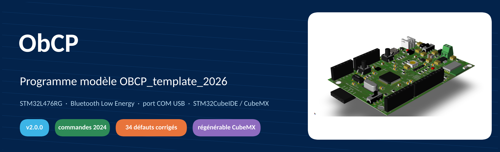
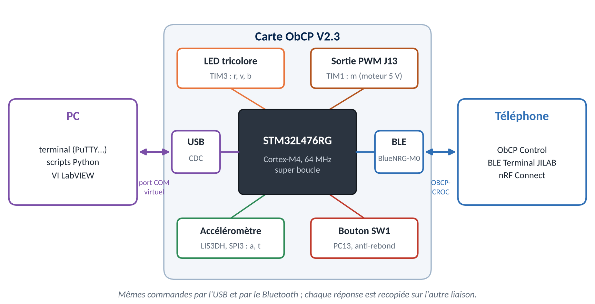
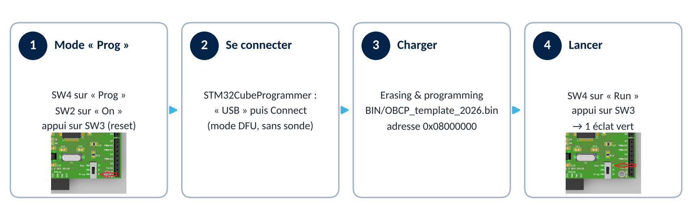
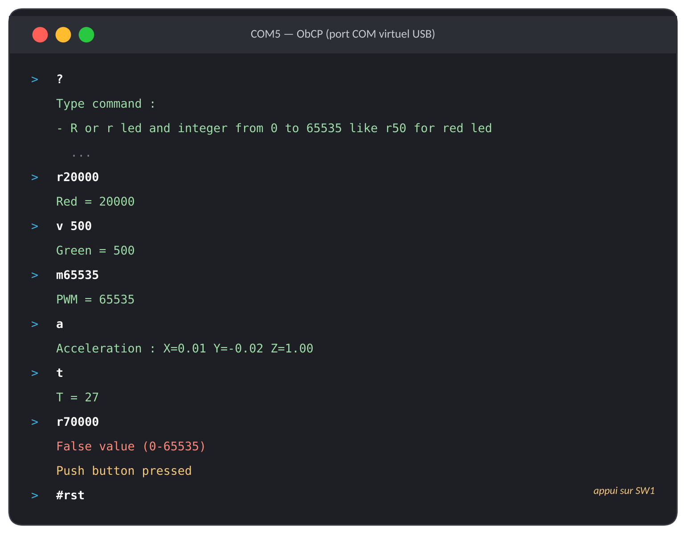
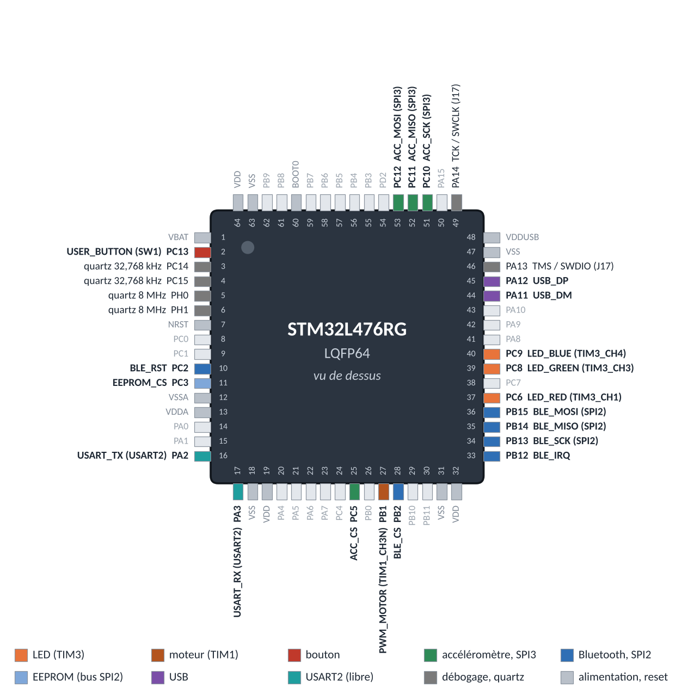
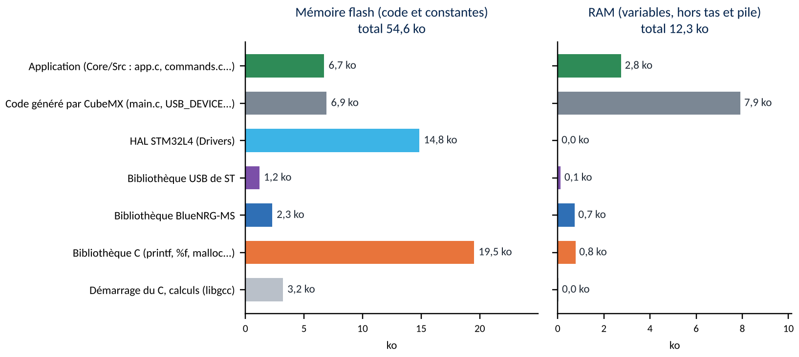
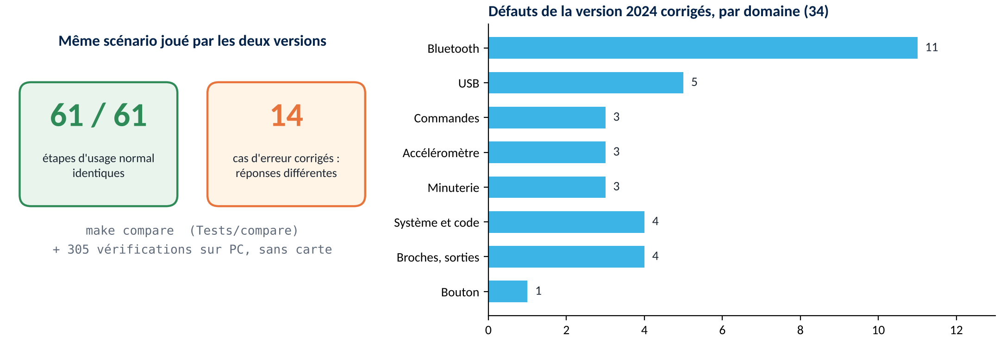

<div align="center">




**Programme modèle de la carte ObCP** : LED tricolore, sortie PWM, accéléromètre, bouton,<br/>
port COM virtuel USB et Bluetooth Low Energy — écrit pour être lu, modifié et régénéré par des débutants.

[Prise en main](#-prise-en-main) · [Commandes](#-commandes) · [Organisation du code](#-organisation-du-programme) · [Modifier avec CubeMX](#-modifier-la-configuration-avec-stm32cubemx) · [Nouveautés 2026](#-ce-qui-change-par-rapport-à-2024) · [Documentation complète](Doc/Documentation_Programme_OBCP_2026.docx)

</div>

---

## ✨ En bref



| | |
|---|---|
| 🎛️ **Sorties** | LED RVB (TIM3) et sortie de puissance J13 (TIM1), réglables de 0 à 65535 |
| 📈 **Capteurs** | accélération 3 axes en g et température (LIS3DH, LIS3DSH détecté aussi) |
| 💬 **Deux liaisons** | port COM virtuel USB (terminal, Python, LabVIEW) et Bluetooth `OBCP-CROC` (ObCP Control) |
| 🔁 **Compatible 2024** | mêmes commandes, mêmes réponses au caractère près : vos outils fonctionnent sans changement |
| 🧩 **Pédagogique** | modules courts et commentés, une seule responsabilité par fichier, liens vers la documentation |
| ♻️ **Régénérable** | code de l'application hors des fichiers CubeMX, outil `verif_cubemx.py` après chaque génération |

Cette version **2.0.0** remplace `OBCP_template_2024` : elle a été réécrite entièrement et corrige **34 défauts** (messages perdus, débordement de tableau, valeurs mal lues, Bluetooth qui ne revenait pas…).

---

## 🚀 Prise en main

### 1. Charger le programme compilé

Le programme prêt à charger est dans [`BIN/`](BIN/). Avec [STM32CubeProgrammer](https://www.st.com/en/development-tools/stm32cubeprog.html), par le câble USB (mode DFU) :



> [!TIP]
> Au démarrage, la LED dit si tout va bien : **1 éclat vert** = prêt, **2 éclats rouges** = accéléromètre muet, **3 éclats rouges** = module Bluetooth muet. Procédure illustrée : [`Datasheets/Procedure_Programmation_OBCP_CROC.pdf`](Datasheets/Procedure_Programmation_OBCP_CROC.pdf).

### 2. Ouvrir le projet dans STM32CubeIDE

1. Copier le dossier `OBCP_template_2026` dans votre workspace.
2. *File → Import → Existing Projects into Workspace*, choisir le dossier, *Finish*.
3. *Project → Build Project* : les fichiers `.bin` et `.hex` sont produits automatiquement (dossier `Debug/` ou `Release/`).

### 3. Dialoguer avec la carte

- **PC** : la carte apparaît comme un port série (« Périphérique série USB (COMx) »). Ouvrir un terminal (PuTTY, Tera Term…), **la vitesse n'a pas d'importance**, fin de ligne CR, LF ou CR+LF. Tapez `?` puis Entrée.
- **Téléphone** : rechercher **`OBCP-CROC`** avec l'application [ObCP Control ou BLE Terminal JILAB](../Android/). Code d'appairage si demandé : `123456`.

---

## 💬 Commandes

<table>
<tr><td width="55%" valign="top">

| Commande | Effet | Réponse |
|---|---|---|
| `r`*n* / `R`*n* | LED rouge (0 à 65535) | `Red = n` |
| `v`*n* / `V`*n* | LED verte | `Green = n` |
| `b`*n* / `B`*n* | LED bleue | `Blue = n` |
| `m`*n* / `M`*n* | sortie PWM J13 | `PWM = n` |
| `a` / `A` | accélération (g) | `Acceleration : X=… Y=… Z=…` |
| `t` / `T` | température (°C) | `T = 27` |
| `?` | aide | liste des commandes |
| `cls` | efface le terminal (USB) | — |
| `start timer` | mesures au téléphone chaque seconde | — |
| `stop timer` | arrête l'envoi | — |
| `#rst` | tout éteint, minuterie arrêtée | — |

</td><td width="45%" valign="top">



</td></tr>
</table>

- Les réponses finissent par `\n\r` et sont **recopiées sur l'autre liaison** (on voit dans le terminal les commandes du téléphone).
- Erreurs : `False command` (commande inconnue), `False value (0-65535)` (valeur absente, négative, trop grande : `r`, `r-1`, `r70000`), `Accelerometer error` (capteur absent).

<details>
<summary><b>Messages envoyés spontanément et service Bluetooth</b></summary>

| Quand | Terminal (USB) | Téléphone (BLE) |
|---|---|---|
| un téléphone se connecte | `Generated BLE Address: …` / `Connected to device: …` | — |
| le téléphone se déconnecte (sorties éteintes) | `BLE disconnected :p` | — |
| USB et Bluetooth connectés tous les deux | — | `USB Connected` |
| appui sur SW1 | `Push button pressed` | `PButton pressed` |
| chaque seconde après `start timer` | — | `X0.01Y-0.02Z1.00` puis `T = 27` |

| Élément | UUID | Propriétés |
|---|---|---|
| service UART | `6E400001-B5A3-F393-E0A9-E50E24DCCA9E` | — |
| TX (carte → téléphone) | `6E400002-B5A3-F393-E0A9-E50E24DCCA9E` | notification, lecture |
| RX (téléphone → carte) | `6E400003-B5A3-F393-E0A9-E50E24DCCA9E` | écriture, écriture sans réponse |

> [!NOTE]
> Ce sont les UUID du *Nordic UART Service*, mais **TX et RX sont inversés** par rapport à la norme Nordic (comme en 2024 ; l'application ObCP Control en dépend). Notifications de 20 octets au plus : les messages plus longs sont découpés.

</details>

---

## 🧭 Organisation du programme


Le code de l'application vit dans **ses propres fichiers** (`Core/Src`, `Core/Inc`), que CubeMX ne touche jamais. Les fichiers générés (`main.c`, `stm32l4xx_it.c`, `usbd_cdc_if.c`, `usbd_conf.c`) ne contiennent que quelques lignes « crochets » dans leurs sections `USER CODE`.

| Fichier | Rôle |
|---|---|
| [`app.c`](Core/Src/app.c) | démarrage et **boucle principale** — c'est par là qu'on commence la lecture |
| [`commands.c`](Core/Src/commands.c) | analyse et exécution des commandes, textes des réponses |
| [`outputs.c`](Core/Src/outputs.c) | LED et sortie moteur (rapports cycliques PWM) |
| [`accelerometer.c`](Core/Src/accelerometer.c) | pilote SPI du LIS3DH / LIS3DSH, conversion en g |
| [`button.c`](Core/Src/button.c) · [`timer_1s.c`](Core/Src/timer_1s.c) | bouton (anti-rebond sans attente) · minuterie 1 s |
| [`usb_console.c`](Core/Src/usb_console.c) | port COM virtuel : lignes reçues, file d'envoi, contrôle de flux |
| [`ble_uart.c`](Core/Src/ble_uart.c) | Bluetooth : module, service UART, connexions, notifications |
| [`line_builder.c`](Core/Src/line_builder.c) · [`fifo.c`](Core/Src/fifo.c) | outils : assemblage des lignes · tampon circulaire |
| [`fault.c`](Core/Src/fault.c) · [`hal_callbacks.c`](Core/Src/hal_callbacks.c) | erreurs graves (code LED) · rappels des interruptions |
| [`app_config.h`](Core/Inc/app_config.h) | **tous les réglages** commentés (nom Bluetooth, tampons, délais) |

<details>
<summary><b>La super boucle et le trajet d'une commande</b></summary>

Pas de système d'exploitation : `main()` appelle `app_loop()` sans fin. **Aucune étape n'attend**, et les interruptions ne font que noter l'évènement.


Du PC à la LED et retour (le paquet suivant n'est autorisé qu'après traitement : contrôle de flux USB) :


Par Bluetooth (texte copié et terminé par `'\0'`, envoi par notifications de 20 octets) :


</details>

<details>
<summary><b>Brochage et mémoire</b></summary>



| Fonction | Broches | Périphérique |
|---|---|---|
| LED rouge / verte / bleue | PC6 / PC8 / PC9 | TIM3 voies 1 / 3 / 4 |
| sortie PWM J13 | PB1 | TIM1 voie 3N |
| bouton SW1 | PC13 | EXTI13 |
| accéléromètre | PC10, PC11, PC12, CS = PC5 | SPI3 |
| module Bluetooth | PB13–PB15, CS = PB2, IRQ = PB12, RESET = PC2 | SPI2 |
| EEPROM M95640 (bus du module) | CS = PC3 | SPI2 |
| USB | PA11 / PA12 | OTG FS, classe CDC |



Environ 55 ko de flash sur 1024 et 12 ko de RAM sur 96 (+ 2 ko de tas, 4 ko de pile).

</details>

---

## ✍️ Ajouter son code

La place prévue est l'**étape 9 de `app_loop()`** dans [`app.c`](Core/Src/app.c). Le code doit être court et **sans attente** : pour agir toutes les *N* ms, on compare `HAL_GetTick()` à l'instant de la dernière action.

```c
static uint32_t last_ms;                     // dernière action
if ((HAL_GetTick() - last_ms) >= 100U)       // 100 ms écoulées ?
{
  accel_g_t g;
  last_ms = HAL_GetTick();
  if (accel_read(&g))
  {
    outputs_set(OUTPUT_BLUE, (g.z < -0.5f) ? 20000U : 0U);   // LED bleue si carte retournée
  }
}
```

| Pour… | Appeler |
|---|---|
| régler une LED ou le moteur | `outputs_set(OUTPUT_RED, 30000);` |
| lire l'accélération / la température | `accel_read(&g)` / `accel_read_temperature(&t)` |
| écrire au PC / au téléphone | `usb_console_printf("x = %d\n\r", x);` / `ble_uart_printf(…)` |
| savoir si le PC / le téléphone est là | `usb_console_is_ready()` / `ble_uart_is_connected()` |

Ajouter une commande : 4 étapes décrites en tête de [`commands.c`](Core/Src/commands.c). Des exercices guidés sont proposés au chapitre 9 de la [documentation](Doc/Documentation_Programme_OBCP_2026.docx).

---

## ♻️ Modifier la configuration avec STM32CubeMX


```bash
python Tools/verif_cubemx.py
```

L'outil vérifie les crochets `USER CODE`, les réglages du `.ioc` dont dépend le programme, les noms de broches de `main.h` et l'unicité des fonctions de rappel, puis explique chaque erreur. Résultat attendu : `Bilan : 0 erreur(s), 0 avertissement(s)`.

> [!WARNING]
> Pièges courants (tous détectés par l'outil) : renommer une broche (*User Label*), changer la base de temps de la HAL (*SYS → Timebase Source*), décocher *Keep User Code when re-generating*, remettre `USBD_CDC_ReceivePacket()` dans la section 6 de `usbd_cdc_if.c`.

---

## 🧪 Tests sur PC, sans carte

Le dossier [`Tests/`](Tests/) compile le code de l'application pour le PC, le matériel étant simulé (HAL, module Bluetooth, USB, accéléromètre). Avec `gcc`, `make` et `python3` (Linux, macOS, WSL, MSYS2) :

```bash
cd Tests
make            # 103 tests unitaires + 202 tests du programme complet + comparaison avec 2024
make demo2024   # montre le débordement de tableau de la version 2024
```

---

## 🆕 Ce qui change par rapport à 2024



Les **commandes et réponses ne changent pas** : la comparaison automatique le vérifie sur 61 étapes d'usage normal. Seuls les cas d'erreur répondent autrement :

| Situation | 2024 | 2026 |
|---|---|---|
| `r5` envoyé juste après `r65535` (USB ou Bluetooth) | `Red = 55535` | `Red = 5` |
| `start timer` tapé touche par touche | débordement de `UsbBuffer2[10]` | minuterie lancée |
| `b9` + Entrée en CR+LF | `False command` | `Blue = 9` |
| `r010` · `r-1` · `r70000` | `Red = 8` · `Red = -1` · `Red = 70000` | `Red = 10` · `False value (0-65535)` ×2 |
| `a`, carte à plat | `Z=0.96` (4 % trop faible) | `Z=1.00` |
| connexion Bluetooth échouée | carte introuvable jusqu'au reset | publicité relancée |
| bouton maintenu enfoncé | tout le programme bloqué | rien ne bloque |

> [!IMPORTANT]
> **Échelle des LED** : TIM3 compte maintenant jusqu'à 65535 (au lieu de 6399), pour que les curseurs 0–65535 des scripts Python et de l'application Android servent sur toute leur course. Une même valeur éclaire donc moins (`r6399` = 10 % au lieu de 100 %). Pour revenir à l'ancienne échelle : CubeMX → *TIM3 → Prescaler = 9, Counter Period = 6399*.

<details>
<summary><b>Correspondance des noms 2024 → 2026</b></summary>

| 2024 | 2026 |
|---|---|
| `processCommand()`, `USBCmd()`, `BLE_command_received()` | `commands_parse()`, `commands_execute()` |
| `CDC_Transmit_FS()`, `Printf_BLE()`, `sendDataDef()` | `usb_console_print/printf()`, `ble_uart_print/printf()` (`CDC_Transmit_FS()` reste utilisable) |
| `Bluetooh_LE_Process()`, `User_Process()` | `app_loop()` |
| `reset_OBCP_functions()` | `outputs_all_off()` + `timer_1s_stop()` |
| `__HAL_TIM_SET_COMPARE(&htim3, TIM_CHANNEL_1, v)` | `outputs_set(OUTPUT_RED, v)` |
| `MX_BlueNRG_MS_Init()`, `user_notify()`… | `ble_uart_init()`, `ble_event_handler()` |
| `LIS3DSH_GetDataScaled()`, `LIS3DSH_GetTemperature()` | `accel_read()`, `accel_read_temperature()` |
| étiquettes `B1`, `Led_Red`, `BLE_Reset_Line`, `BLE_EXTI_Line`… | `USER_BUTTON`, `LED_RED`, `BLE_CS`, `BLE_IRQ`… |

La liste complète des 34 corrections est dans le [CHANGELOG](CHANGELOG.md).

</details>

---

## 📁 Contenu du dossier

```
OBCP_template_2026/
├── OBCP_template_2026.ioc   configuration STM32CubeMX
├── Core/                    application (app.c, commands.c…) et code généré (main.c…)
├── USB_DEVICE/, BlueNRG-MS/ USB et interface Bluetooth générés par CubeMX
├── Drivers/, Middlewares/   bibliothèques de ST (HAL, USB, BlueNRG-MS)
├── BIN/                     programme compilé (.bin, .hex, .elf)
├── Doc/                     documentation Word, schémas et leurs sources
├── Tests/                   tests sur PC et comparaison avec 2024
├── Tools/verif_cubemx.py    vérification après génération CubeMX
├── Python/, Labview/        programmes PC d'exemple
└── Datasheets/              composants et procédure de programmation
```

**Outils** : STM32CubeMX 6.11.1 · FW_L4 1.18.1 · X-CUBE-BLE1 6.2.3 · STM32CubeIDE (une version plus récente propose de migrer le projet : accepter, générer, puis lancer `verif_cubemx.py`).

---

<div align="center">

📘 **[Documentation complète du programme (Word, 47 pages)](Doc/Documentation_Programme_OBCP_2026.docx)** — architecture, chaque module expliqué, référence des fonctions, exercices guidés

Joël IMBAUD — SUPMICROTECH-ENSMM, option CROC

</div>
