<picture>
  <source media="(prefers-color-scheme: dark)" srcset="Doc/images/banniere-sombre.png">
  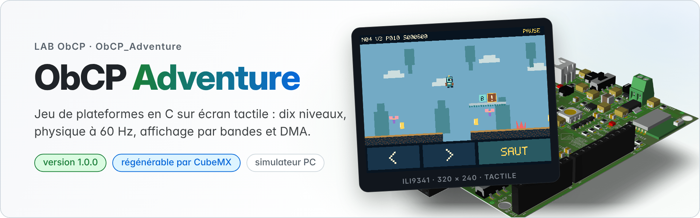
</picture>

# ObCP Adventure — jeu de plateformes sur écran tactile (version 1.0.0)

[](#14-état-de-validation-versions-et-licences)
[](https://www.st.com/en/microcontrollers-microprocessors/stm32l476rg.html)
[](#2-matériel-et-montage)
[](#6-organisation-du-programme)
[](#9-modifier-la-configuration-avec-stm32cubemx)
[](#10-tests-sur-pc-sans-carte)

Jeu de plateformes écrit en C pour la carte **ObCP** (Objet Connecté Personnel, SUPMICROTECH-ENSMM, option CROC : microcontrôleur **STM32L476RG**) équipée d'un **shield Adafruit 2,8″** : écran **ILI9341** de 320 × 240 pixels et dalle tactile capacitive (**FT62xx**) ou résistive (**TSC2007** ou **STMPE610**).

Un petit automate traverse **dix niveaux** pour réactiver un atelier abandonné : marche, course, sauts de hauteur variable, fragments d'énergie, ennemis, bonus, plateformes mobiles, salles secrètes, points de reprise et **trois combats** contre une sentinelle. On joue au doigt sur l'écran, ou en **inclinant la carte** (accéléromètre de l'ObCP) ; la partie est **sauvegardée** dans l'EEPROM de la carte.

Le projet sert aussi de support de cours de C embarqué : bus SPI et I2C, DMA, interruptions, machine à états, arithmétique en virgule fixe, physique à pas fixe, collisions, mémoire limitée (l'image entière ne tient pas en RAM : elle est dessinée par bandes). Le **même code** tourne sur PC dans un **simulateur** et dans des **tests** : on peut travailler sans la carte.

> [!NOTE]
> Documentation complète : [**guide d'utilisation**](Doc/Guide_ObCP_Adventure.pdf) (montage du shield, programmation, jeu, réglages, dépannage, essais sur carte) et [**documentation du programme**](Doc/Documentation_Programme_ObCP_Adventure.pdf) (organisation du code, algorithmes, référence des fonctions, exercices guidés). Sources Word modifiables : [`Doc/Guide_ObCP_Adventure.docx`](Doc/Guide_ObCP_Adventure.docx), [`Doc/Documentation_Programme_ObCP_Adventure.docx`](Doc/Documentation_Programme_ObCP_Adventure.docx).

> [!TIP]
> **Pressé ?** Charger le jeu → [§ 1](#1-prise-en-main) · brancher le shield → [§ 2](#2-matériel-et-montage) · jouer sans carte → [§ 5](#5-simulateur-pc) · lire le code → [§ 6](#6-organisation-du-programme) · régénérer avec CubeMX → [§ 9](#9-modifier-la-configuration-avec-stm32cubemx) · ça ne marche pas → [§ 11](#11-dépannage).

## Sommaire

1. [Prise en main](#1-prise-en-main)
2. [Matériel et montage](#2-matériel-et-montage)
3. [Jouer](#3-jouer)
4. [Réglages, sauvegarde et console](#4-réglages-sauvegarde-et-console)
5. [Simulateur PC](#5-simulateur-pc)
6. [Organisation du programme](#6-organisation-du-programme)
7. [Modifier le jeu](#7-modifier-le-jeu)
8. [Compiler](#8-compiler)
9. [Modifier la configuration avec STM32CubeMX](#9-modifier-la-configuration-avec-stm32cubemx)
10. [Tests sur PC, sans carte](#10-tests-sur-pc-sans-carte)
11. [Dépannage](#11-dépannage)
12. [Nouveautés de la version 1.0](#12-nouveautés-de-la-version-10)
13. [Contenu du dossier et versions des outils](#13-contenu-du-dossier-et-versions-des-outils)
14. [État de validation, versions et licences](#14-état-de-validation-versions-et-licences)

---

## 1. Prise en main

### Charger le programme

Le programme compilé est dans [`Binaries/`](Binaries/) (`ObCP_Adventure.hex`, `.bin`, `.elf`). Pour le charger par le câble USB (mode DFU, sans sonde) avec [STM32CubeProgrammer](https://www.st.com/en/development-tools/stm32cubeprog.html) :

1. brancher l'ObCP au PC ; interrupteur **SW4 sur « Prog »**, **SW2 sur « On »**, appui sur **SW3 (reset)** ;
2. dans STM32CubeProgrammer : **USB** (en haut à droite), bouton de rafraîchissement, **Connect** ;
3. **Erasing & programming** : *Browse* → `ObCP_Adventure.hex` (ou le `.bin` à l'adresse `0x08000000`), **Start Programming** ;
4. **SW4 sur « Run »**, appui sur **SW3** : un éclair vert, puis le menu s'affiche.

En ligne de commande : `STM32_Programmer_CLI -c port=usb1 -w Binaries/ObCP_Adventure.hex -v`. Procédure illustrée : [`Procedure_Programmation_OBCP_CROC.pdf`](https://github.com/jimbaud/LAB_ObCP_L476_STM32CubeIDE/blob/main/OBCP_template_2026/Datasheets/Procedure_Programmation_OBCP_CROC.pdf) (dossier `OBCP_template_2026/Datasheets` du dépôt). On peut aussi programmer et déboguer avec la sonde ST-LINK d'une carte Nucleo branchée sur le connecteur **J17** (SWD).

### Au démarrage

| Ce que l'on voit | Signification |
|---|---|
| un éclair vert de 60 ms, puis LED éteinte | démarrage normal (la LED ne clignote plus ensuite) |
| le menu : NOUVELLE PARTIE, CONTINUER, RÉGLAGES, ÉCRAN / DIAGNOSTIC | écran et tactile reconnus |
| l'écran de diagnostic | tactile non reconnu ou écran muet : voir [§ 11](#11-dépannage) |
| LED rouge fixe, plus rien ne répond | erreur grave (initialisation ou faute du processeur) : reset par SW3 |

**Écran résistif (TSC2007, STMPE610) : étalonner une première fois.** Dans le menu, **maintenir le doigt 1,5 s n'importe où**, puis le relever : l'assistant affiche cinq croix ; pour chacune, poser le doigt sur la croix, le **maintenir environ 0,2 s**, puis le relever (le point est validé au relâchement). Le résultat est appliqué et sauvegardé. Un nouvel appui long de 1,5 s annule à tout moment. La dalle capacitive (FT62xx) n'a pas besoin d'étalonnage.

<picture>
  <source media="(prefers-color-scheme: dark)" srcset="Doc/images/carte-reperes-sombre.png">
  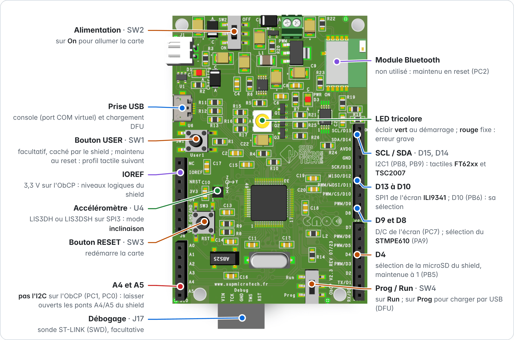
</picture>

---

## 2. Matériel et montage

- une carte **ObCP** : le brochage suit les schémas de la révision 2.3 du dossier [Fabrication ObCP](https://github.com/jimbaud/LAB_ObCP_L476_STM32CubeIDE/tree/main/Fabrication%20ObCP) (fichiers nommés V24) ; vérifier la révision de sa carte avant de brancher le shield ;
- un **shield Adafruit 2,8″ TFT Touch Shield v2** : réf. **1947** (tactile capacitif FT62xx) ou réf. **1651** (tactile résistif : TSC2007 sur les versions récentes, STMPE610 sur les anciennes) ;
- un câble USB **de données** ; facultatif : une batterie lithium sur J1 pour jouer sans câble.

<picture>
  <source media="(prefers-color-scheme: dark)" srcset="Doc/images/montage-sombre.png">
  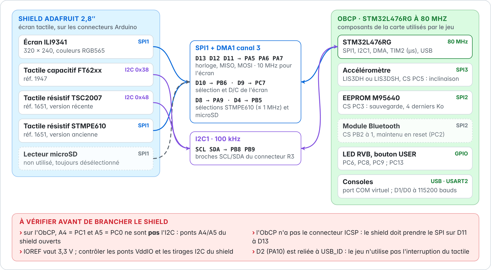
</picture>

> [!WARNING]
> **Avant de brancher le shield**, vérifier sur son schéma : le SPI doit arriver sur **D11 à D13** (l'ObCP n'a pas le connecteur ICSP 2 × 3 d'Arduino ; selon sa révision, le shield prend le SPI sur l'ICSP ou sur D11 à D13, choix fait par des ponts du shield) ; l'I2C du tactile doit arriver sur les broches **SCL/SDA du connecteur R3** (sur l'ObCP, **A4 = PC1 et A5 = PC0 ne sont pas l'I2C** : laisser ouverts les ponts A4/A5 des anciens shields) ; IOREF vaut **3,3 V** (contrôler les ponts VddIO et les tirages I2C, rétroéclairage allumé). Le rétroéclairage reste permanent.

<details>
<summary><b>Brochage utilisé</b></summary>

| Fonction | Arduino | STM32L476 | Étiquette CubeMX |
|----------|---------|-----------|------------------|
| SPI1 horloge / MISO / MOSI (écran, STMPE610) | D13 / D12 / D11 | PA5 / PA6 / PA7 | `LCD_SCK` / `LCD_MISO` / `LCD_MOSI` |
| Sélection de l'écran (active à 0) | D10 | PB6 | `LCD_CS` |
| Commande / donnée de l'écran | D9 | PC7 | `LCD_DC` |
| Sélection du STMPE610 (ancien 1651) | D8 | PA9 | `TOUCH_CS` |
| Sélection de la microSD du shield (maintenue à 1) | D4 | PB5 | `SD_CS` |
| I2C1 SCL / SDA (FT62xx `0x38`, TSC2007 `0x48`) | SCL / SDA (R3) | PB8 / PB9 | `TOUCH_SCL` / `TOUCH_SDA` |
| Accéléromètre U4 (LIS3DH ou LIS3DSH), SPI3 | – | PC10 / PC11 / PC12, CS PC5 | `ACC_SCK` / `ACC_MISO` / `ACC_MOSI`, `ACC_CS` |
| EEPROM U7 (M95640, 8 Ko), SPI2 | – | PB13 / PB14 / PB15, CS PC3 | `EEPROM_SCK` / `EEPROM_MISO` / `EEPROM_MOSI`, `EEPROM_CS` |
| Module Bluetooth : sélection à 1, maintenu en reset | – | PB2, PC2 | `BLE_CS`, `BLE_RST` |
| LED RVB D5 | – | PC6 / PC8 / PC9 | `LED_RED` / `LED_GREEN` / `LED_BLUE` |
| Bouton User1 (SW1) | – | PC13 | `USER_BUTTON` |
| Console : port COM virtuel | – | PA11 / PA12 (USB OTG FS) | – |
| Console de secours, 115200 bauds, 8N1 | D1 / D0 | PA2 / PA3 (USART2) | `USART_TX` / `USART_RX` |
| Base de temps (1 MHz, 32 bits) | – | TIM2 | – |
| Envoi des bandes vers l'écran | – | DMA1 canal 3 (SPI1_TX) | – |

Horloge : quartz 8 MHz (HSE) → PLL → **80 MHz** pour le processeur et les bus ; 48 MHz pour l'USB (PLLSAI1). L'écran est écrit à **10 MHz** (cycle minimal de 100 ns de l'ILI9341) ; la commande console `F` essaie **40 MHz**, hors spécification de l'ILI9341. Le STMPE610 est lu à 625 kHz (1 MHz au plus), l'accéléromètre à 5 MHz, l'EEPROM à 2,5 MHz, l'I2C à 100 kHz.

**Trois tactiles, une seule interface.** Au démarrage, le jeu interroge les trois candidats connus et retient celui qui répond de façon certaine :

| Profil | Shield | Identification |
|---|---|---|
| 1 | 1947, capacitif | FT62xx en I2C `0x38` : fabricant `0x11` (registre `0xA8`), circuit `0x06`, `0x36` ou `0x64` (registre `0xA3`) |
| 2 | 1651 récent, résistif | TSC2007 en I2C `0x48` : pas de registre d'identité, trois conversions valides (« compatible ») |
| 3 | 1651 ancien, résistif | STMPE610 en SPI1, sélection D8 : signature `0x0811` |

Si plusieurs répondent, ou aucun, l'écran de diagnostic s'affiche : choisir le profil avec la console (`1`, `2`, `3`, `A` = automatique) ; il est conservé à la sauvegarde suivante (ENREGISTRER dans les réglages, point de reprise). Si le bouton USER (SW1) est accessible malgré le shield, le maintenir pendant un reset passe au profil suivant. Le jeu ne se sert pas de la broche PENIRQ du shield (D2 / PA10, aussi reliée à USB_ID sur l'ObCP) : les tactiles sont interrogés régulièrement.
</details>

---

## 3. Jouer

<picture>
  <source media="(prefers-color-scheme: dark)" srcset="Doc/images/commandes-sombre.png">
  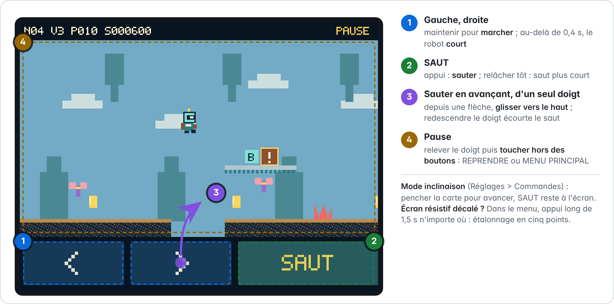
</picture>

Le menu se pilote au doigt : un bouton s'active **au relâchement**, si le doigt est resté dessus. En pause, **REPRENDRE** continue la partie ; **MENU PRINCIPAL** la garde en mémoire (le menu propose alors REPRENDRE LA PARTIE). Après une coupure, **CONTINUER** repart du dernier point de reprise sauvegardé ; **NOUVELLE PARTIE** repart du niveau 1 avec trois vies.

| Niveau | Décor et nouveauté | Longueur |
|---|---|---:|
| 1 — Clairière des capteurs | déplacements, sauts, premiers ennemis | 96 tuiles |
| 2 — Terrasses suspendues | plateformes traversables, bonus | 112 |
| 3 — Galeries de cuivre | blocs, sauteurs, trajets verticaux | 128 |
| 4 — Canaux d'engrenages | plateformes mobiles, ennemis volants | 144 |
| 5 — Serre de la Sentinelle | **premier combat** | 128 |
| 6 — Verrières du vent | contrôle en l'air, chemins hauts | 160 |
| 7 — Fonderie des étincelles | tourelles, pièges | 176 |
| 8 — Horloge souterraine | **deuxième combat**, plateformes | 176 |
| 9 — Crêtes nocturnes | enchaînements précis | 192 |
| 10 — Cœur de l'atelier | **dernier combat**, fin | 208 |

Chaque niveau cache une salle secrète : sauter dans le **portail violet** ; le portail de la salle ramène sur le parcours. Les **points de reprise** deviennent jaunes une fois activés (et la partie est sauvegardée). Les **fragments** rapportent des points et une vie tous les cent ; **S** protège d'un coup pendant dix secondes (un bloc **?** frappé par-dessous aussi, pendant six secondes), **B** (bottes) fait courir et sauter plus loin pendant dix secondes, **+** donne une vie (neuf au plus). Les ennemis se battent en leur retombant dessus, sauf les tourelles, qu'il faut éviter. La sentinelle annonce sa charge avant de foncer et demande plusieurs coups ; la sortie reste fermée tant qu'elle vit.

<table>
<tr>
<td width="50%"><b>Niveau 1</b><br>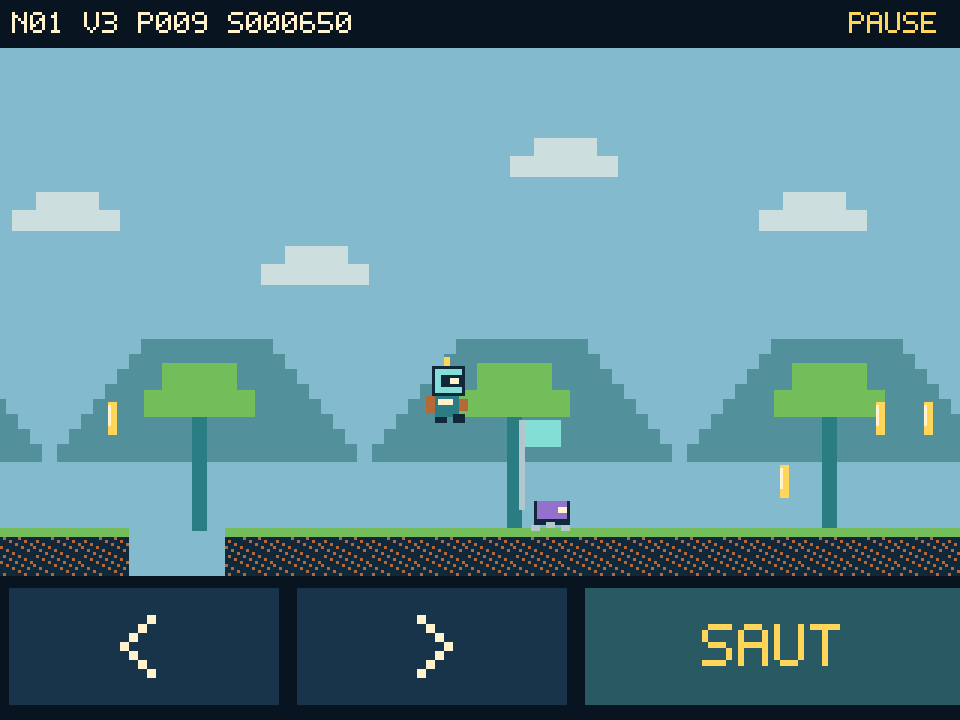</td>
<td width="50%"><b>Niveau 7</b><br>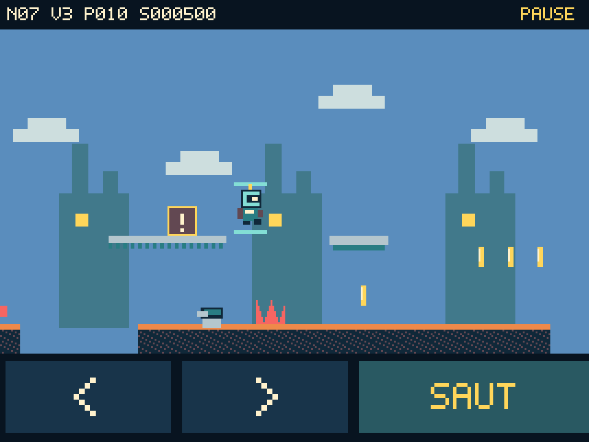</td>
</tr>
<tr>
<td><b>Combat final (niveau 10)</b><br>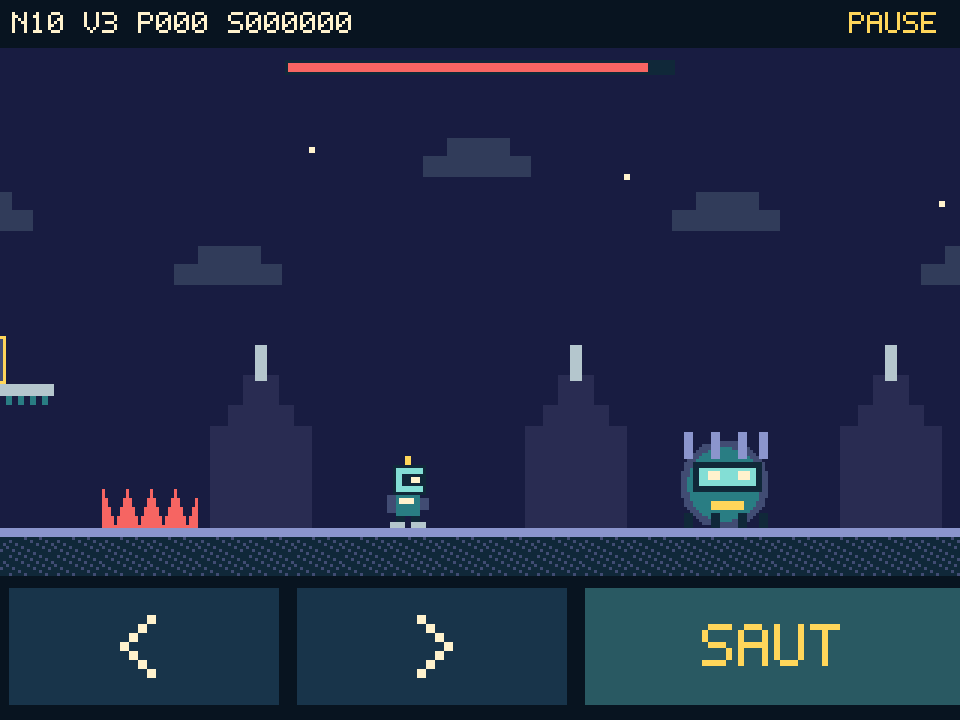</td>
<td><b>Pause</b><br>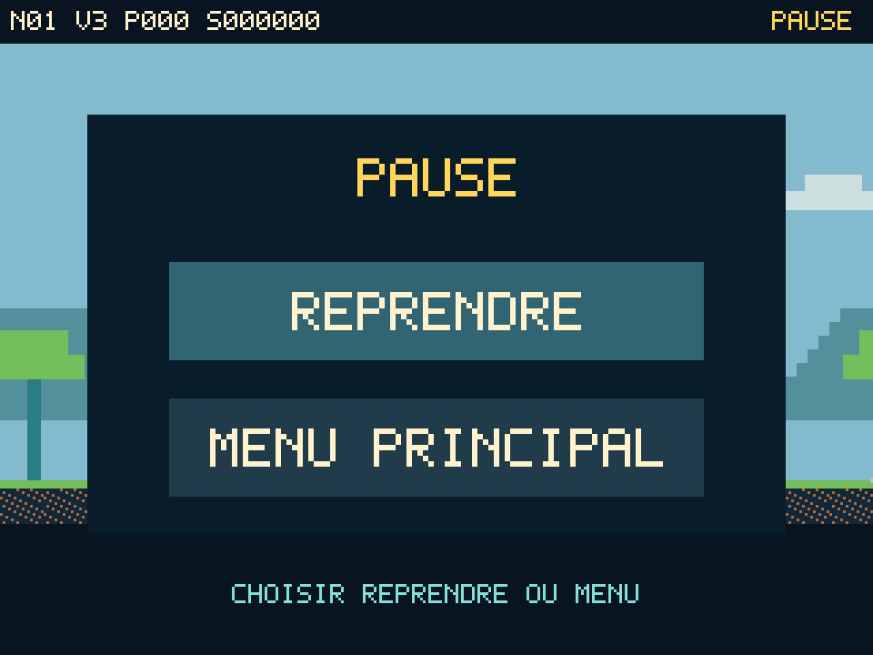</td>
</tr>
</table>

*Toutes les images d'écran de ce dossier sont produites par le rendu C du jeu, compilé sur PC (simulateur et tests), agrandies trois fois sans lissage : ce ne sont pas des photos de l'écran de la carte.*

---

## 4. Réglages, sauvegarde et console

**RÉGLAGES** a trois onglets ; les boutons `−` / `+` font défiler des valeurs nommées. **ANNULER** revient au menu sans rien changer, **ENREGISTRER** applique et sauvegarde.

| Onglet | Contenu |
|---|---|
| COMMANDES | mode **TACTILE** ou **INCLINAISON** ; étalonnages **ÉCRAN** (cinq points, écran résistif) et **NEUTRE** (garder la carte immobile environ une seconde) |
| INCLINAISON | sensibilité, zone neutre, axe et sens de l'inclinaison |
| TACTILE | taille des flèches, amplitude du geste de saut |

<table>
<tr>
<td width="33%">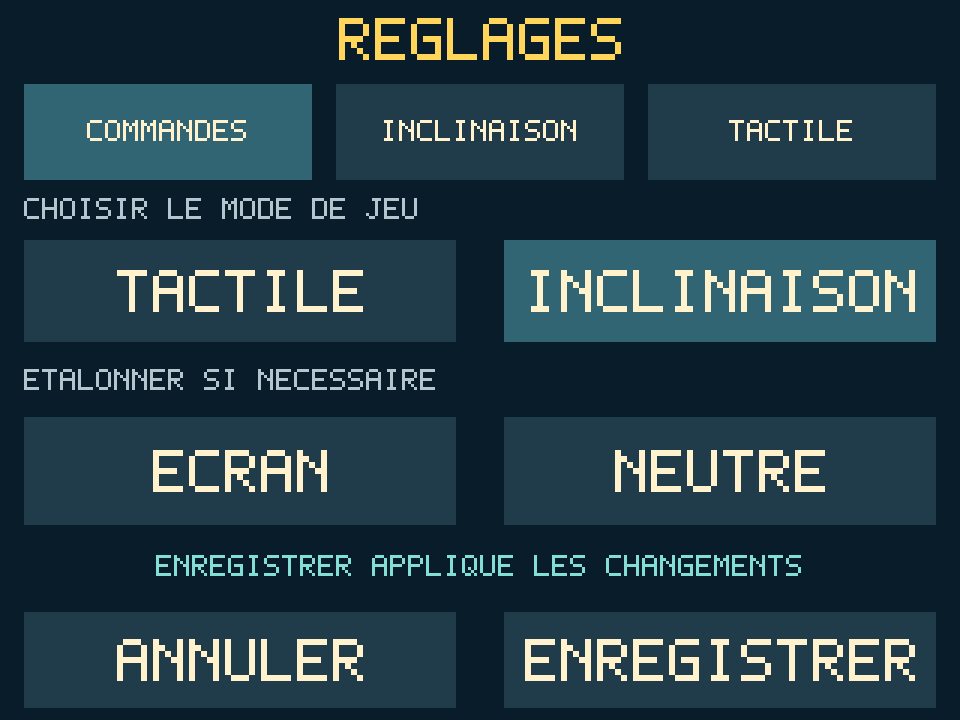</td>
<td width="33%">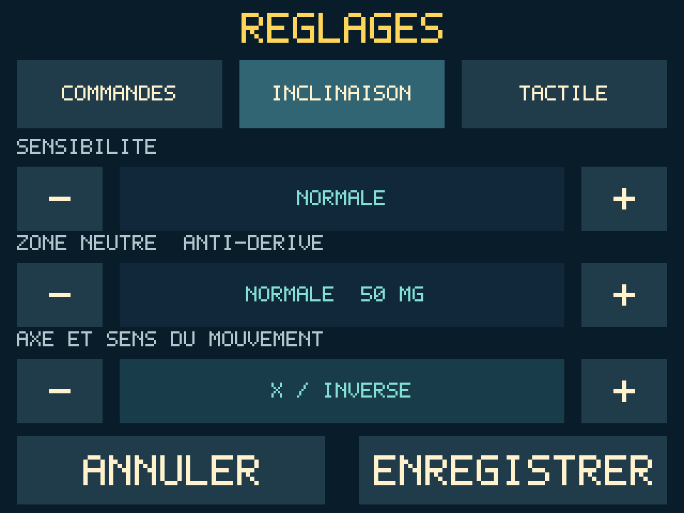</td>
<td width="33%">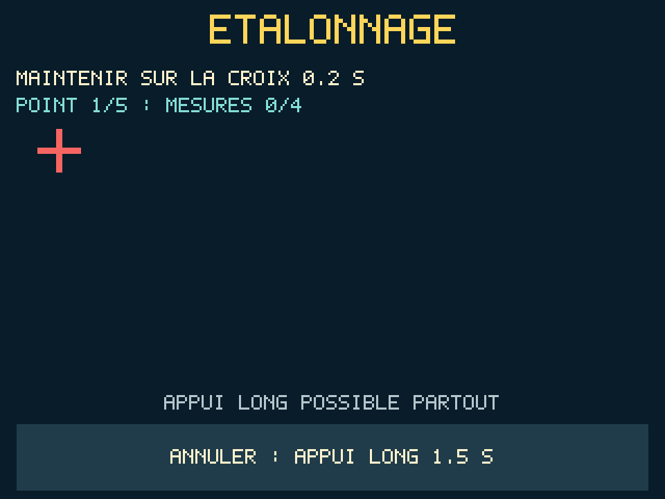</td>
</tr>
</table>

**Sauvegarde.** Réglages, niveau, point de reprise, objets ramassés, score et vies sont enregistrés dans les **4 derniers Ko** de l'EEPROM M95640 (adresses `0x1000` à `0x1FFF`), sous forme d'un journal de seize emplacements de 256 octets protégés par CRC : une coupure pendant l'écriture laisse toujours la copie précédente intacte. Le jeu fonctionne sans EEPROM (il ne sauvegarde plus). Si cette zone contient déjà des données d'un autre programme, le jeu refuse d'y écrire : la commande console `W` l'y autorise, en connaissance de cause.

**Console.** Branchée par USB, l'ObCP apparaît comme un port série (« Périphérique série USB (COMx) » sous Windows, `/dev/ttyACM0` sous Linux ; vitesse indifférente). Le jeu y écrit une ligne de mesures chaque seconde et accepte des commandes d'**une lettre**, sans appuyer sur Entrée. L'USART2 (D1 / D0, 115200 bauds, 8N1) accepte les mêmes commandes mais n'affiche rien : c'est un secours si l'USB ne fonctionne pas.

| Touche | Effet |
|---|---|
| `?` | aide |
| `1` / `2` / `3` | profil tactile FT62xx / TSC2007 / STMPE610 ; `A` : détection automatique |
| `C` | étalonnage de l'écran tactile ; `N` : neutre de l'inclinaison |
| `M`, `P`, `D` | menu ; pause (retour depuis les réglages ou le diagnostic) ; diagnostic |
| `F` | écran à 40 MHz (essai, hors spécification) ou retour à 10 MHz |
| `W` | autoriser la sauvegarde dans une zone EEPROM déjà écrite |

```text
ObCP Adventure v1.0.0 tick=5423 level=1 state=1 fps10=240 bytes=1843200 overrun=0 touch=3 proof=3 accel=33 save=0 raw=1830,2210 down=0 valid=1 seq=8121 cal=0/0
```

`state` : 0 menu, 1 partie, 2 pause, 3 perte d'une vie, 4 niveau terminé, 5 partie terminée, 6 victoire, 7 réglages, 8 diagnostic, 9 étalonnage ; `fps10` : images par seconde × 10 ; `bytes` : octets de pixels envoyés à l'écran depuis le démarrage ; `overrun` : retards de plus de quatre pas de physique ; `touch` / `proof` : profil tactile (0 à 3) et niveau de preuve (0 aucune, 1 réponse électrique, 2 fonctionnement compatible, 3 identité reconnue) ; `accel` : identité de l'accéléromètre (`33` LIS3DH, `3F` LIS3DSH, `00` absent) ; `save` : 1 si la dernière écriture de la sauvegarde a échoué ; `raw` : dernière mesure brute de la dalle ; `cal` : point et nombre de mesures de l'étalonnage en cours.

---

## 5. Simulateur PC

Le simulateur compile **les mêmes fichiers** que la carte (moteur, niveaux, rendu par bandes) avec la bibliothèque SDL2 ; la souris joue le rôle du doigt.

- **Windows** : [`Binaries/Simulateur_Windows/ObCP_Adventure_Simulateur.exe`](Binaries/Simulateur_Windows/), un seul fichier, double-clic. Programme non signé : si SmartScreen l'arrête, *Informations complémentaires* → *Exécuter quand même*.
- **Linux, macOS, Windows avec MSYS2** : installer SDL2 (`libsdl2-dev`, `brew install sdl2`, `mingw-w64-ucrt-x86_64-SDL2`), puis `make -C Simulator run`.

| Action | Clavier | Souris |
|---|---|---|
| marcher | flèches gauche / droite (ou Q / D en AZERTY) | maintenir une flèche à l'écran |
| courir | Maj gauche + direction | maintenir la flèche plus de 0,4 s |
| sauter | Espace (relâcher tôt : saut court) | bouton SAUT, ou glisser vers le haut depuis une flèche |
| pause, retour | Échap | relever le doigt puis toucher hors des boutons |
| menus et réglages | flèches haut / bas et Entrée ; gauche / droite : changer une valeur ; Tab : onglet suivant | clic sur les boutons |
| réglages, diagnostic, sauvegarde | F2, F3, F5 | — |
| inclinaison simulée (mode INCLINAISON) | J / L | — |
| niveau suivant (mise au point) | F7 | — |

La sauvegarde est le fichier `obcp_adventure.sav`, créé dans le dossier de lancement : c'est l'image des 8 Ko de l'EEPROM. Le simulateur émet de courts sons (la carte, elle, est muette : l'ObCP n'a pas de haut-parleur). Il ne remplace pas l'étalonnage d'une vraie dalle : il le signale au lieu de l'imiter.

Options utiles pour les TP : `--headless` (sans fenêtre), `--level N`, `--autoplay` (pilote automatique), `--spawn-boss` (place le joueur devant l'arène du niveau choisi), `--frames N` (nombre de pas de 1/60 s), `--screenshot image.ppm`, `--metrics trajectoire.csv` (une ligne par image : pas, niveau, temps de rendu, position, état), `--save fichier.sav`. Exemple :

```bash
cd Simulator/build
./obcp_adventure_sim --headless --level 4 --autoplay --frames 1800 --metrics scene.csv --save essai.sav
```

---

## 6. Organisation du programme

<picture>
  <source media="(prefers-color-scheme: dark)" srcset="Doc/images/architecture-sombre.png">
  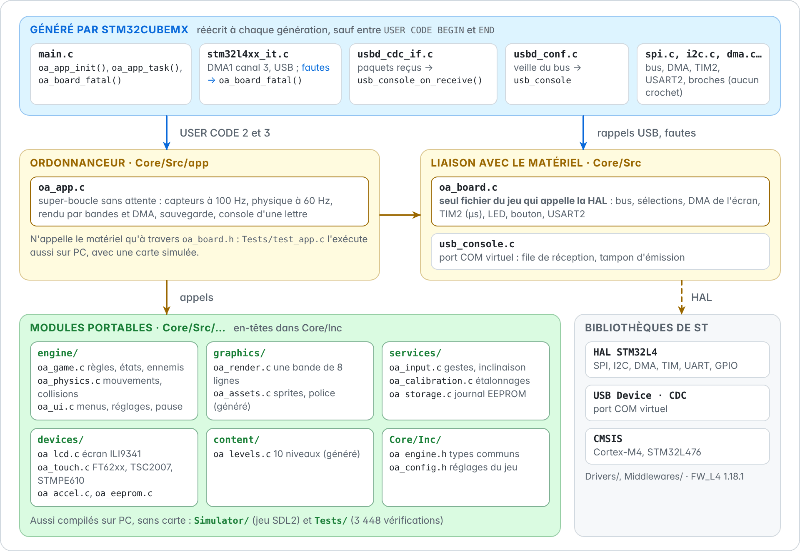
</picture>

Tout le code du jeu est sous **`Core/`**, dans des fichiers que **STM32CubeMX ne touche jamais** ; les fichiers générés (`main.c`, `stm32l4xx_it.c`, `usbd_cdc_if.c`, `usbd_conf.c`) ne contiennent que quelques lignes « crochets », dans leurs sections `USER CODE`. Seul **`oa_board.c`** appelle la HAL : les autres modules se compilent tels quels sur PC.

| Fichier | Rôle | Lignes |
|---|---|---:|
| `main.c` (généré) | horloge et périphériques, puis `oa_app_init()` et `oa_app_task()` | — |
| [`app/oa_app.c`](Core/Src/app/oa_app.c) | **ordonnanceur** : capteurs, pas de physique, sauvegarde, console, rendu par bandes et DMA | 400 |
| [`engine/oa_game.c`](Core/Src/engine/oa_game.c) | **règles** : objets, ennemis, boss, points de reprise, portails, vies, états | 400 |
| [`engine/oa_physics.c`](Core/Src/engine/oa_physics.c) | déplacements en virgule fixe Q16.16, **collisions**, sauts | 190 |
| [`engine/oa_ui.c`](Core/Src/engine/oa_ui.c) | boutons, menus, réglages (brouillon), pause, étalonnage | 380 |
| [`graphics/oa_render.c`](Core/Src/graphics/oa_render.c) | dessin d'une **bande de 8 lignes** RGB565 : décor, sprites, textes | 410 |
| [`services/oa_input.c`](Core/Src/services/oa_input.c) | geste à un doigt, filtre de l'inclinaison | 130 |
| [`services/oa_calibration.c`](Core/Src/services/oa_calibration.c) | assistants d'étalonnage (cinq points, neutre) | 140 |
| [`services/oa_storage.c`](Core/Src/services/oa_storage.c) | **journal** de sauvegarde dans l'EEPROM (CRC, reprise après coupure) | 220 |
| [`devices/oa_touch.c`](Core/Src/devices/oa_touch.c) | pilotes FT62xx, TSC2007, STMPE610 et leur détection | 250 |
| [`devices/oa_lcd.c`](Core/Src/devices/oa_lcd.c), [`oa_accel.c`](Core/Src/devices/oa_accel.c), [`oa_eeprom.c`](Core/Src/devices/oa_eeprom.c) | écran ILI9341, accéléromètres LIS3DH / LIS3DSH, EEPROM M95640 | 110 |
| [`oa_board.c`](Core/Src/oa_board.c) | **liaison avec le matériel** : bus, sélections, DMA de l'écran, TIM2, LED, bouton, USART2 | 260 |
| [`usb_console.c`](Core/Src/usb_console.c) | port COM virtuel : file de réception, tampon d'émission | 60 |
| [`content/oa_levels.c`](Core/Src/content/oa_levels.c), [`graphics/oa_assets.c`](Core/Src/graphics/oa_assets.c) | niveaux, sprites et police, **générés** depuis `Assets/` | — |
| [`oa_engine.h`](Core/Inc/oa_engine.h), [`oa_config.h`](Core/Inc/oa_config.h) | types communs du jeu ; **réglages de la physique**, avec leurs unités | 220 |

**Ordre de lecture conseillé** : `main.c` → `oa_app.h` / `oa_app.c` → `oa_engine.h` → `oa_game.c` (`oa_game_step()`) → `oa_physics.c` → `oa_render.c` → `oa_board.c`. Chaque en-tête `.h` décrit ses fonctions (paramètres, unités, valeur rendue).

### La super-boucle

<picture>
  <source media="(prefers-color-scheme: dark)" srcset="Doc/images/boucle-sombre.png">
  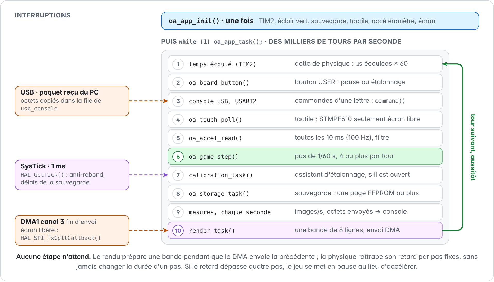
</picture>

Le programme n'a pas de système d'exploitation. La physique avance par **pas fixes de 1/60 s**, quelle que soit la vitesse de l'affichage : la même suite de commandes donne toujours la même partie (c'est ce qui permet de la tester sur PC). L'affichage vise 30 images par seconde.

### L'affichage par bandes

<picture>
  <source media="(prefers-color-scheme: dark)" srcset="Doc/images/rendu-sombre.png">
  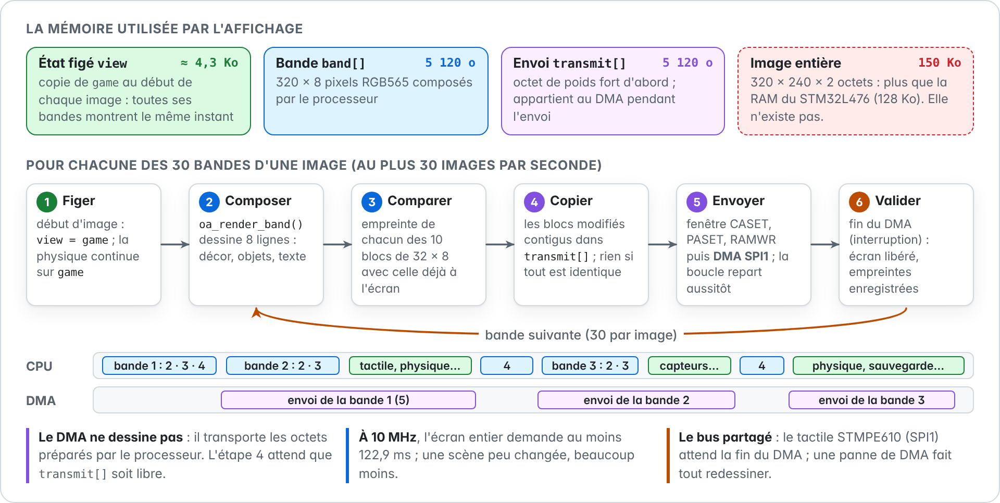
</picture>

Une image complète (320 × 240 × 2 = 153 600 octets) ne tient pas dans la RAM du STM32L476 : le jeu dessine l'écran **huit lignes à la fois**, n'envoie que les blocs qui ont changé, et laisse le **DMA** transmettre une bande pendant que le processeur prépare la suivante. Ressources : environ **89 Ko de flash** sur 1 Mo et **39 Ko de RAM** sur 96 Ko (pile de 8 Ko comprise).

---

## 7. Modifier le jeu

**La physique** : [`Core/Inc/oa_config.h`](Core/Inc/oa_config.h) regroupe vitesses (pixels/s), accélérations (pixels/s²), impulsion de saut, durées en pas de 1/60 s (*coyote time*, mémoire du saut, bonus). Relancer ensuite les tests (`make -C Tests`) : ils vérifient sauts, collisions et franchissement des dix niveaux.

**Un niveau** : [`Assets/levels.json`](Assets/levels.json) décrit chaque niveau par onze lignes de caractères (`.` vide, `#` sol, `B` brique, `=` plateforme traversable, `^` pics, `?` bloc à bonus, `~` eau, `C` bloc réservé) et une liste d'objets `[type, variante, x, y, a, b, période]` en pixels. Puis :

```bash
python Tools/build_levels.py      # régénère Core/Src/content/oa_levels.c
make -C Tests                     # dimensions, objets, franchissement automatique
make -C Simulator run             # essayer
```

**Un sprite, une tuile, la police** : [`Assets/pixel_art.json`](Assets/pixel_art.json) (un chiffre hexadécimal par pixel = indice de couleur), puis `python Tools/build_assets.py`. Ces deux générateurs n'utilisent que la bibliothèque standard de Python ; les fichiers C produits sont déjà dans le dossier : Python n'est pas nécessaire pour compiler.

**Une commande de console** : ajouter un cas dans `command()` de [`oa_app.c`](Core/Src/app/oa_app.c) et une ligne dans `help_text`. **Un nouvel ennemi, une nouvelle règle** : `enemies_step()` et `oa_game_step()` dans [`oa_game.c`](Core/Src/engine/oa_game.c), son dessin dans [`oa_render.c`](Core/Src/graphics/oa_render.c) ; le guide de programmation propose des exercices progressifs.

**Les captures de la documentation** se refont depuis le rendu C : `python Tools/captures_doc.py` (Pillow et SDL2 nécessaires).

---

## 8. Compiler

**Avec STM32CubeIDE** : *File > Import > General > Existing Projects into Workspace*, choisir le dossier `ObCP_Adventure`, *Finish*, puis *Project > Build Project*. Deux configurations :

- **Debug** (`-O0 -g3`) : pour déboguer pas à pas avec une sonde sur J17 ; l'affichage y est plus lent ;
- **Release** (`-Os`) : programme optimisé, celui du dossier [`Binaries/`](Binaries/) : **la configuration pour jouer**.

Les fichiers `.bin` et `.hex` sont produits à côté du `.elf` (dossier `Debug/` ou `Release/`). Pour charger par USB depuis CubeIDE, voir la configuration *External Tools* décrite dans le [README du dépôt](https://github.com/jimbaud/LAB_ObCP_L476_STM32CubeIDE#configuration-avec-stm32cubeide-et-cubeprogrammer). Les dossiers `Tests/` et `Simulator/` (programmes pour PC) sont masqués dans CubeIDE par un filtre de ressources du projet.

**En ligne de commande** (Linux, macOS, WSL, MSYS2), avec la chaîne GNU Arm Embedded (`arm-none-eabi-gcc`, celle de CubeIDE convient) :

```bash
make              # build/ObCP_Adventure.elf, .hex, .bin (-Os, comme Release)
make DEBUG=1      # -O0 -g3, comme Debug
make flash        # chargement par USB DFU (STM32_Programmer_CLI)
make test         # tests sur PC        make sim    # simulateur
make check        # Tools/verif_cubemx.py
```

Le projet se compile **sans aucun avertissement** (`-Wall -Wextra`) ; les fichiers du jeu passent aussi `-Wpedantic -Wshadow -Wundef -Wdouble-promotion`.

---

## 9. Modifier la configuration avec STM32CubeMX

<picture>
  <source media="(prefers-color-scheme: dark)" srcset="Doc/images/regeneration-sombre.png">
  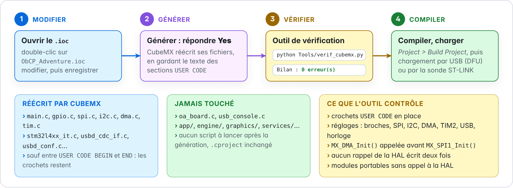
</picture>

1. Ouvrir `ObCP_Adventure.ioc` (double-clic dans STM32CubeIDE), modifier, enregistrer : répondre **Yes** à la génération du code.
2. Lancer l'outil de vérification, depuis le dossier du projet :
   ```
   python Tools/verif_cubemx.py
   ```
   Résultat attendu : `Bilan : 0 erreur(s), 0 avertissement(s)`. Chaque erreur est expliquée, avec la manière de la corriger.
3. Compiler et charger.

**Aucun script n'est à lancer après la génération et le `.cproject` reste celui de CubeMX** : le jeu n'ajoute ni dossier source ni chemin d'inclusion (ses sources sont dans des sous-dossiers de `Core/Src`, compilés automatiquement, et ses en-têtes dans `Core/Inc`).

<details>
<summary><b>Crochets dans les fichiers générés et règles à respecter</b></summary>

| Fichier généré | Section USER CODE | Contenu |
|----------------|-------------------|---------|
| `Core/Src/main.c` | `Includes` | `#include "oa_app.h"`, `#include "oa_board.h"` |
| | `2` | `oa_app_init();` |
| | `3` | `oa_app_task();` (dans `while (1)`) |
| | `Error_Handler_Debug` | `oa_board_fatal();` (LED rouge fixe) |
| `Core/Src/stm32l4xx_it.c` | `Includes`, `NonMaskableInt_IRQn 0`, `HardFault_IRQn 0`, `MemoryManagement_IRQn 0`, `BusFault_IRQn 0`, `UsageFault_IRQn 0` | `oa_board_fatal();` |
| `USB_DEVICE/App/usbd_cdc_if.c` | `INCLUDE`, `3`, `4`, `6`, `7` | appels de `usb_console.c` |
| `USB_DEVICE/Target/usbd_conf.c` | `Includes`, `2`, `3` | veille / reprise de l'USB |

- n'écrire dans les fichiers générés qu'entre `USER CODE BEGIN` et `USER CODE END` ; garder *Keep User Code when re-generating* coché ;
- garder les **étiquettes** des broches (`LCD_CS`, `LCD_DC`, `TOUCH_CS`, `ACC_CS`, `EEPROM_CS`, `USER_BUTTON`, `LED_RED`…) et le **niveau 1 au démarrage** de toutes les sélections (`SD_CS` compris : la microSD est sur le même bus que l'écran) ;
- garder **`MX_DMA_Init()` avant `MX_SPI1_Init()`** (*Project Manager > Advanced Settings*) : sinon le DMA de l'écran n'est pas relié ;
- garder TIM2 à 1 MHz (`Prescaler = 79`, période maximale) et l'horloge à 80 MHz ; ne pas désactiver SPI1, SPI2, SPI3, I2C1, DMA, TIM2, USART2 ni USB_DEVICE.

Le fichier `.ioc` a été enregistré pour STM32CubeMX **6.11.1** et le paquet **STM32Cube FW_L4 1.18.1**, comme les autres projets ObCP 2026. Une version plus récente propose de « migrer » le projet : accepter, générer le code, puis lancer l'outil de vérification.
</details>

---

## 10. Tests sur PC, sans carte

Le dossier [`Tests/`](Tests/) compile les modules du jeu **pour le PC** ; le matériel est remplacé par des doublures (bus SPI et I2C simulés, temps, écran). Il faut `gcc` et `make` (Linux, macOS, WSL ou MSYS2) :

```bash
make -C Tests        # ou : make test
```

Quatre programmes, compilés avec AddressSanitizer et UndefinedBehaviorSanitizer (détection des débordements de mémoire et des calculs non définis), puis l'outil de vérification CubeMX :

| Programme | Vérifie | Vérifications |
|-----------|---------|--------------:|
| `test_engine` | physique, collisions, dix niveaux franchissables, états, entrées, journal EEPROM avec 288 coupures simulées, pilotes tactiles et accéléromètres sur bus simulés, protection des tampons | 2 828 |
| `test_calibration` | assistants d'étalonnage : points, doublons, annulation, délais, capteur absent | 32 |
| `test_ui` | navigation au doigt, brouillon des réglages, pause sans clic traversant, appui long, centrage des textes au pixel près | 89 |
| `test_app` | **ordonnanceur `oa_app.c` complet** avec un STMPE610 simulé : étalonnage, pause, menu, reprise, éclair de 60 ms, console | 499 |

`make -C Tests captures` refait les captures des menus ; `make -C Tests bench` mesure le trafic SPI que demanderait chaque image des dix niveaux (fichier CSV). Ces tests ne remplacent pas l'essai sur carte : un bus simulé ne valide aucun signal électrique.

---

## 11. Dépannage

| Symptôme | À vérifier |
|---|---|
| écran blanc | alimentation du shield, D10 / PB6 et D9 / PC7, ponts SPI D11 à D13, sens du shield |
| diagnostic « COMMANDES OK » mais rien à l'écran | le SPI n'a pas d'accusé de réception : ce message prouve l'envoi, pas la présence de l'écran |
| tactile FT62xx ou TSC2007 absent | SCL/SDA du connecteur R3 (PB8 / PB9), tirages I2C, VddIO, ponts A4/A5 ouverts |
| plusieurs tactiles détectés | choisir le profil du shield : console `1`, `2` ou `3` |
| STMPE610 non reconnu | D8 / PA9, MISO, signature `0x0811` |
| point touché décalé ou inversé (résistif) | refaire l'étalonnage : appui long 1,5 s dans le menu, ou console `C` |
| le robot avance seul (inclinaison) | refaire le neutre à l'arrêt (`N`), vérifier axe, sens et zone neutre |
| sauvegarde indisponible | EEPROM U7, CS PC3, SPI2 ; zone déjà utilisée : `W` |
| couleurs fausses | ordre RGB/BGR (registre MADCTL), octet de poids fort envoyé en premier |
| affichage lent | utiliser la configuration Release ; à 10 MHz, un défilement continu demande de 32 à 44 ms de transfert par image selon le niveau (estimation) : 23 à 30 images par seconde au mieux |
| jeu mis en pause tout seul | la boucle a pris plus de quatre pas de retard (`overrun` dans la console) |
| projet qui ne compile plus après CubeMX | `python Tools/verif_cubemx.py`, puis corriger ce qu'il signale |
| LED rouge fixe | erreur grave : quartz, initialisation d'un périphérique ou faute du processeur ; débogueur sur J17 |

---

## 12. Nouveautés de la version 1.0

Cette version reprend le jeu 0.3.0 (même moteur, mêmes niveaux, mêmes pilotes) et le range **au format des projets ObCP 2026** (`OBCP_template_2026`, `ObCP_WiFi_Demo`) :

- **régénérable par STM32CubeMX sans script** : code du jeu déplacé sous `Core/` (`Core/Src/app`, `engine`, `graphics`, `services`, `devices`, `content`) ; fichiers générés remis au format de CubeMX 6.11.1, avec le jeu seulement dans les sections `USER CODE` ; `.cproject` d'origine CubeMX, sans dossier ni chemin ajouté ; suppression de `after_cubemx.py`, du projet `CubeIDE_Make` et de l'exclusion de `syscalls.c` / `sysmem.c` ; nouvel outil `Tools/verif_cubemx.py` ;
- **`oa_board.c` utilise les noms de broches de CubeMX** (`LCD_CS_Pin`…) au lieu des numéros, et devient le seul fichier qui appelle la HAL : `oa_app.c` passe par `oa_board.h` (temps, bouton, liaison série), ce qui le rend testable sur PC sans fausse HAL ;
- erreur grave visible : **LED rouge fixe** (`Error_Handler()` et fautes du processeur) ; console USART2 lue sans attente, débordement effacé ;
- commande console **`?`** (aide) ; l'écran n'affiche la cadence qu'une fois mesurée ;
- une seule chaîne de compilation par cible : `Makefile` (carte), `Tests/Makefile`, `Simulator/Makefile` (Linux, MSYS2, compilation croisée Windows) au lieu de CMake, des préréglages et des scripts ; **simulateur Windows en un seul `.exe`** ;
- documentation au format des autres projets : ce README, le guide d'utilisation et la documentation du programme (Word et PDF), illustrations en thèmes clair et sombre ;
- retirés du dossier : journaux de validation, exécutables de test, workflow GitHub (il ne s'exécute pas dans un sous-dossier du dépôt), configuration VS Code, études et notes de développement (leur contenu est repris dans la documentation).

---

## 13. Contenu du dossier et versions des outils

```text
ObCP_Adventure/
├── ObCP_Adventure.ioc        configuration STM32CubeMX
├── Core/Src, Core/Inc        code généré (main.c, spi.c…) et liaison du jeu (oa_board.c, usb_console.c)
│   ├── Src/app/              ordonnanceur oa_app.c
│   ├── Src/engine/           règles, physique, interface
│   ├── Src/graphics/         rendu par bandes, sprites et police (générés)
│   ├── Src/services/         gestes, étalonnage, journal de sauvegarde
│   ├── Src/devices/          pilotes : écran, tactiles, accéléromètres, EEPROM
│   └── Src/content/          dix niveaux (générés)
├── USB_DEVICE/               USB généré par CubeMX (crochets dans usbd_cdc_if.c, usbd_conf.c)
├── Drivers/, Middlewares/    bibliothèques de ST (HAL, CMSIS, USB Device)
├── Assets/                   sources éditables des niveaux et du pixel art (JSON)
├── Simulator/                simulateur PC (SDL2) et son Makefile
├── Tests/                    tests sur PC et leur Makefile
├── Tools/                    verif_cubemx.py, build_levels.py, build_assets.py, captures_doc.py
├── Binaries/                 programme compilé (.hex, .bin, .elf), simulateur Windows, LISEZMOI.txt
├── Doc/                      guide et documentation du programme (Word, PDF), images et leurs sources
├── Makefile                  compilation en ligne de commande (facultatif)
├── LICENSE                   licence MIT du code du jeu
└── README.md                 ce fichier
```

| Outil | Version |
|---|---|
| STM32CubeMX (fichier `.ioc`) | 6.11.1 |
| paquet STM32Cube FW_L4 | 1.18.1 |
| compilateur | GNU Arm Embedded (celui de STM32CubeIDE), C11 avec extensions GNU |
| simulateur | SDL2 2.x (2.30.9 intégrée à l'exécutable Windows) |

---

## 14. État de validation, versions et licences

| Version | État |
|---------|------|
| 0.2.1 | essayée sur ObCP : fonctionne |
| 0.3.0 | compilée et testée sur PC ; pas essayée sur carte |
| 1.0.0 | compilée sans avertissement (Makefile, Debug et Release), 3 448 vérifications sur PC réussies, `verif_cubemx.py` : 0 erreur ; simulateur Windows exécuté hors Windows (Wine) avec un rendu identique à la version Linux ; **import dans STM32CubeIDE, régénération effective par CubeMX et essai sur carte à confirmer** |

La liste des essais à faire sur la carte (démarrage, trois shields, étalonnage, inclinaison, cadence, sauvegarde, coupures) est dans le guide d'utilisation, chapitre « Essais sur carte ».

| Version | Contenu |
|---------|---------|
| 0.1.0 | étude : brochage vérifié sur les schémas, contraintes SPI et mémoire, architecture |
| 0.2.0 | première version jouable : moteur C11 commun carte et PC, dix niveaux, rendu par bandes et DMA, trois tactiles, inclinaison, sauvegarde |
| 0.2.1 | corrections de l'étalonnage et de la compilation dans STM32CubeIDE |
| 0.3.0 | interface entièrement tactile : pause, réglages en trois onglets avec ANNULER / ENREGISTRER, appui long |
| 1.0.0 | projet au format des projets ObCP 2026, régénérable par CubeMX sans script, documentation (voir [§ 12](#12-nouveautés-de-la-version-10)) |

| Composant | Licence |
|-----------|---------|
| code écrit pour le jeu (`Core/Src/app`, `engine`, `graphics`, `services`, `devices`, `content`, `oa_board.c`, `usb_console.c`, en-têtes `oa_*.h`, sections USER CODE, `Assets/`, `Simulator/`, `Tests/`, `Tools/`) | MIT, voir [`LICENSE`](LICENSE) |
| fichiers générés par STM32CubeMX, HAL STM32L4 | BSD-3-Clause (STMicroelectronics), [`Core/LICENSE_ST.md`](Core/LICENSE_ST.md) |
| STM32 USB Device Library, fichiers générés de `USB_DEVICE/` | SLA0044 (STMicroelectronics) |
| CMSIS | Apache 2.0 |
| SDL2, intégrée au simulateur Windows | zlib, [`Binaries/Simulateur_Windows/LICENCE_SDL2.txt`](Binaries/Simulateur_Windows/LICENCE_SDL2.txt) |

Les personnages, niveaux, graphismes et sons du simulateur sont des créations propres au projet. Les rendus 3D de l'ObCP viennent du dossier `Images/` du dépôt. Documents de fabrication et programme modèle de l'ObCP : [LAB_ObCP_L476_STM32CubeIDE](https://github.com/jimbaud/LAB_ObCP_L476_STM32CubeIDE). Composants : [STM32L476RG](https://www.st.com/resource/en/datasheet/stm32l476rg.pdf), [shields Adafruit 2,8″](https://learn.adafruit.com/adafruit-2-8-tft-touch-shield-v2?view=all), [ILI9341](https://www.adafruit.com/datasheets/ILI9341.pdf), [TSC2007](https://www.ti.com/lit/ds/symlink/tsc2007.pdf), [LIS3DH](https://www.st.com/resource/en/datasheet/lis3dh.pdf), [LIS3DSH](https://www.st.com/resource/en/datasheet/lis3dsh.pdf), [M95640](https://www.st.com/resource/en/datasheet/m95640-w.pdf) ; DMA et périphériques du STM32L4 : [RM0351](https://www.st.com/resource/en/reference_manual/rm0351-stm32l47xxx-stm32l48xxx-stm32l49xxx-and-stm32l4axxx-advanced-armbased-32bit-mcus-stmicroelectronics.pdf).

---

Joël IMBAUD — SUPMICROTECH-ENSMM. Version 1.0.0 d'ObCP Adventure (novembre 2026).
