<p align="center">
  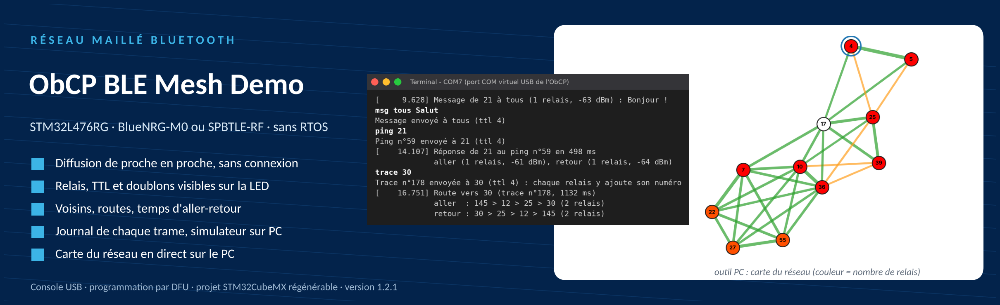
</p>

<p align="center">
  
  
  
  
  
  
</p>

# Réseau maillé Bluetooth LE — ObCP BLE Mesh Demo

Programme de démonstration « bare-metal » pour l'**ObCP** (Objet Connecté Personnel de
SUPMICROTECH-ENSMM, STM32L476RG) : chaque carte devient un **nœud d'un réseau maillé**
Bluetooth Low Energy. Les messages passent de carte en carte, relayés par les cartes
intermédiaires, jusqu'à des cartes hors de portée de l'émetteur. Il n'y a ni téléphone, ni
connexion, ni routeur : chaque carte **diffuse** ses trames en publicité Bluetooth et **relaie
une fois** celles qu'elle entend (inondation contrôlée, le principe du *Bluetooth Mesh*).

Le programme fonctionne avec les deux versions de la carte, module **BlueNRG-M0** (cartes de
2024 et après) ou **SPBTLE-RF** (cartes d'avant 2024), mélangées ou non dans un même réseau. Il
se pilote depuis un simple terminal série, sans recompiler. Le projet se **découvre en
autonomie** : une carte suffit pour commencer, deux ou trois montrent les relais sur une table,
et un simulateur sur PC montre ce que deviennent des réseaux de dizaines de cartes.

> 📘 **Documentation** : [guide de découverte](Doc/Guide_Decouverte_BLE_Mesh_ObCP.pdf)
> (matériel, programmation, six découvertes guidées avec questions et réponses, référence des
> commandes, dépannage) et
> [documentation du programme](Doc/Documentation_Programme_BLE_Mesh_ObCP.pdf) (organisation du
> code, déroulement, protocole, dialogue avec le module Bluetooth, référence des 187 fonctions
> publiques, recettes).

## Sommaire

- [Les découvertes](#les-découvertes)
- [Nouveautés des versions 1.2 et 1.2.1](#nouveautés-des-versions-12-et-121)
- [Matériel](#matériel)
- [Démarrage rapide](#démarrage-rapide)
- [Tour d'horizon](#tour-dhorizon)
- [Le réseau maillé en bref](#le-réseau-maillé-en-bref)
- [Compiler et modifier le projet](#compiler-et-modifier-le-projet)
- [Lire le code](#lire-le-code)
- [Tests sur PC](#tests-sur-pc)
- [Contenu du dépôt](#contenu-du-dépôt)
- [État de validation](#état-de-validation) · [Versions](#versions) · [Licences](#licences)

## Les découvertes

| Découverte | Ce que l'on observe | Il faut |
|------------|---------------------|---------|
| **Prise en main** | terminal, bannière, `info`, `aide`, réglages, numéro de la carte et EEPROM | 1 carte |
| **1. Une carte seule** | la publicité Bluetooth : ce que la carte entend, ce qu'elle diffuse, une trame octet par octet | 1 carte (+ téléphone) |
| **2. Deux cartes** | voisins, messages, `ping`, mesures à distance, premier relais et son écho, RSSI | 2 cartes |
| **3. Trois cartes** | plusieurs sauts sur une table : route (`trace`), vague de couleurs, TTL, panne d'un relais | 3 cartes |
| **4. Le prix de l'inondation** | coût d'une diffusion, doublons, collisions, suppression des relais inutiles | le PC (simulateur) |
| **5. Le réseau vu du PC** | carte du réseau en direct, lignes JSON, enregistrement d'une séance | le PC (+ 1 carte) |
| **6. Programmer le réseau** | lire le code, ajouter un type de message, le tester sur PC puis sur les cartes | STM32CubeIDE |

Chaque découverte fixe un objectif, décrit les manipulations avec ce que la carte doit afficher
(copies du terminal faites avec le vrai programme), puis pose des questions dont les réponses
commentées sont en annexe du guide.

## Nouveautés des versions 1.2 et 1.2.1

**1.2.1 — correction après un premier essai sur carte.** Avec la version 1.2.0, le module
refusait chaque émission (`!! refusée par la radio HELLO …`) : en « mode 4 », le BlueNRG-MS
partage son temps entre écoute et publicité selon deux règles de ST (PM0237, § 4.2), que les
temps choisis ne respectaient pas.

- **Mode alterné par défaut** : la carte écoute sans interruption, sauf pendant ses propres
  émissions (320 ms) ; les réponses attendent 370 ms, le temps que le demandeur finisse
  d'émettre. Toutes les piles et les deux modules fonctionnent de la même façon.
- `radio simultane` essaie le mode 4 avec des temps conformes aux règles de ST ; en cas de refus
  du module, quel que soit le code, retour automatique au mode alterné, signalé dans le
  terminal. `radio` affiche la base de temps du module.
- Code du refus affiché (`!! refusée par la radio … (code 0x12 du module)`, `stats`) ; le module
  simulé des tests applique la règle de ST.

**1.2**

- **Projet à découvrir en autonomie** : le
  [guide de découverte](Doc/Guide_Decouverte_BLE_Mesh_ObCP.pdf) (41 pages) remplace le sujet de
  TP et le guide de l'enseignant.
- **Documentation du programme** (70 pages) : carte des fichiers, déroulement, protocole,
  dialogue avec le module, mémoire, brochage, référence des fonctions, recettes.
- **Dépôt organisé comme les autres démonstrateurs** : `Binaries/`, `Doc/`, `Tools/`.
- **Projet STM32CubeIDE aligné sur le programme modèle** : configurations Debug et Release ; le
  programme reconnaît seul sa version, USB ou OTA (adresse de sa table des vecteurs), et la
  version OTA se compile avec `make OTA=1`. `Tools/verif_cubemx.py` vérifie aussi le projet
  STM32CubeIDE.
- **Code commenté pour un lecteur débutant** : chaque fichier résume son rôle, chaque fonction
  est décrite (publique dans son en-tête, interne juste avant elle).
- Affichage revu : réponse au `ping` sur deux lignes, liaisons directes signalées dans les
  routes (`trace`), compteurs de `stats` présentés « nom valeur ».

## Matériel

<p align="center">
  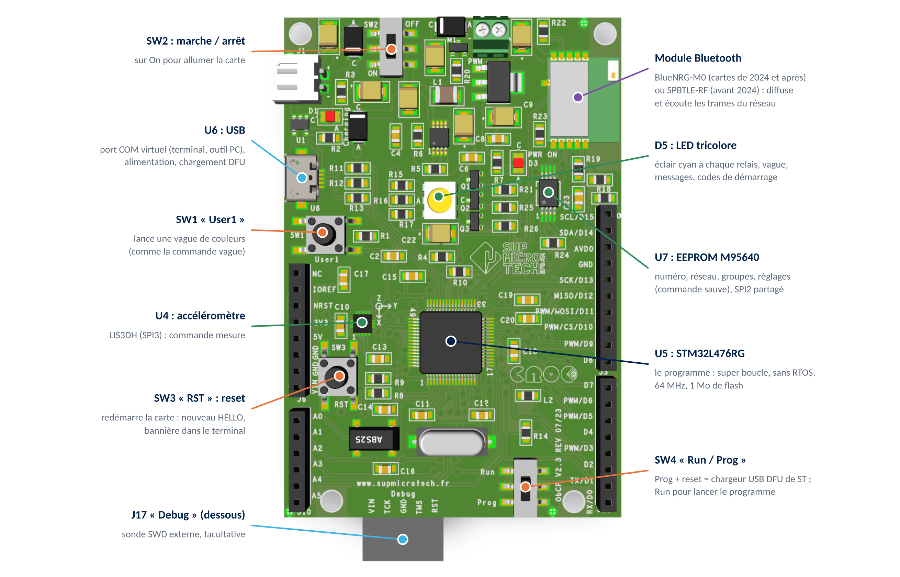
</p>

- une à trois cartes **ObCP**, module BlueNRG-M0 ou SPBTLE-RF (un seul programme pour les
  deux) ;
- un câble USB **de données** (seule la carte reliée au terminal a besoin du PC : les autres
  peuvent être alimentées par une batterie ou un chargeur USB) ;
- sur le PC : [STM32CubeProgrammer](https://www.st.com/en/development-tools/stm32cubeprog.html)
  et un terminal série (PuTTY, Tera Term, picocom…) ;
- pour le simulateur et les tests : `gcc` et `make` (Linux, macOS, WSL ou MSYS2) ; pour l'outil
  de supervision : Python 3.8 ou plus récent, `pip install pyserial matplotlib` ;
- facultatif : un téléphone avec *nRF Connect* pour voir passer les trames, STM32CubeIDE pour
  modifier le programme.

<p align="center">
  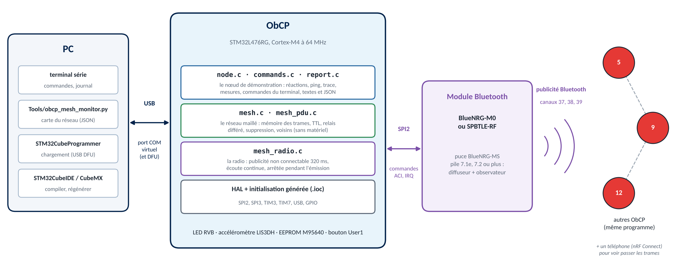
</p>

Le PC dialogue avec la carte par le **port COM virtuel** de son câble USB (classe CDC). Le STM32
pilote le module Bluetooth par le bus **SPI2**, avec les commandes « ACI » de ST (bibliothèque
BlueNRG-MS du paquet X-CUBE-BLE1) ; le module diffuse les trames sur les trois canaux de
publicité (37, 38 et 39) et rapporte au STM32 chaque publicité qu'il entend.

<details>
<summary><b>Les deux modules Bluetooth de l'ObCP</b></summary>

| | SPBTLE-RF (avant 2024) | BlueNRG-M0 (2024 et après) |
|---|---|---|
| Puce | BlueNRG-MS | BlueNRG-MS |
| Pile Bluetooth livrée | 7.1e (Bluetooth 4.1) | 7.2 ou plus récente (7.3 vue sur une carte) |
| Puissance au réglage maximal | +4 dBm (fiche technique) | +8 dBm conduits, +6 dBm rayonnés |
| « Mode 4 » (émettre sans arrêter d'écouter) | oui (pile 7.1b et plus) | oui |

`info` affiche la version de la pile (ligne `module`). Quelle que soit la pile, la carte écoute
sans interruption sauf pendant ses propres émissions (mode **alterné**) : anciennes et nouvelles
cartes forment un même réseau. Le mode 4 ne sert qu'à `radio simultane`.

<p align="center">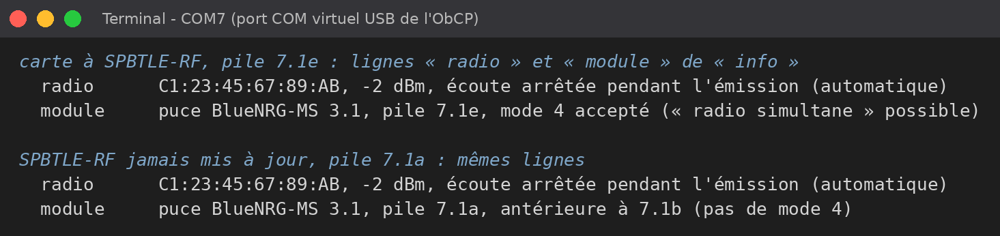</p>
</details>

<details>
<summary><b>Brochage utilisé</b></summary>

| Fonction | STM32L476 | Étiquette CubeMX |
|----------|-----------|------------------|
| Module Bluetooth : SPI2 SCK / MISO / MOSI (mode 0, 4 MHz) | PB13 / PB14 / PB15 | `BLE_SCK` / `BLE_MISO` / `BLE_MOSI` |
| Module Bluetooth : CS, IRQ (EXTI12, front montant), reset | PB2, PB12, PC2 | `BLE_CS`, `BLE_IRQ`, `BLE_RST` |
| EEPROM M95640 (U7), sur le même bus SPI2 | PC3 | `EEPROM_CS` |
| Accéléromètre U4 (LIS3DH) : SPI3, CS | PC10 / PC11 / PC12, PC5 | `ACC_SCK` / `ACC_MISO` / `ACC_MOSI`, `ACC_CS` |
| LED tricolore D5 (TIM3 CH1 / CH3 / CH4) | PC6 / PC8 / PC9 | `LED_RED` / `LED_GREEN` / `LED_BLUE` |
| Bouton SW1 « User1 » (vague) | PC13 | `USER_BUTTON` |
| Console (port COM virtuel) | PA11 / PA12 (USB OTG FS) | – |
| Débogage SWD, connecteur J17 | PA13 / PA14 | `TMS` / `TCK` |
| Sortie PWM, bornier J13 (TIM1_CH3N, non utilisée par la démo) | PB1 | `PWM_MOTOR` |
| USART2 (initialisée, non utilisée) | PA2 / PA3 | `USART_TX` / `USART_RX` |

TIM7 cadence la seconde (interruption toutes les secondes, horloge du système à 64 MHz).
</details>

## Démarrage rapide

**1. Programmer l'ObCP** par USB DFU (aucune sonde nécessaire) : interrupteurs **SW4 sur Prog**
et **SW2 sur On**, appui sur **SW3 (RST)**, puis :

```bash
STM32_Programmer_CLI -c port=usb1 -w Binaries/ObCP_BLE_Mesh_Demo.hex -v -s
```

Remettre SW4 sur **Run** et appuyer sur RST : un éclat vert, la carte est prête. Avec l'interface
graphique de STM32CubeProgrammer : interface **USB**, *Connect*, *Erasing & programming*,
fichier `.hex`. Pour une carte équipée du chargeur Bluetooth ObCP-OTA :
`Binaries/ObCP_BLE_Mesh_Demo_OTA.elf` (voir [`Binaries/LISEZMOI.txt`](Binaries/LISEZMOI.txt)).

**2. Ouvrir le terminal** : « Périphérique série USB (COMx) » sous Windows, `/dev/ttyACM0` sous
Linux ; débit indifférent, UTF-8, au moins 100 colonnes. La bannière s'affiche à l'ouverture ;
`info` présente la carte :

<p align="center">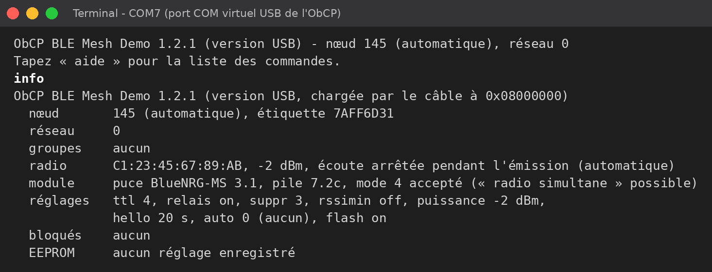</p>

**3. Essayer**, avec deux cartes ou plus :

```text
aide                       liste des commandes
voisins                    cartes entendues en direct, avec leur RSSI
msg tous Bonjour           message à toutes les cartes, même hors de portée
ping 21 · trace 21         temps d'aller-retour · route, relais par relais
vague                      (ou bouton SW1) couleur de chaque carte selon les relais traversés
journal on                 une ligne par trame émise, reçue, doublée ou relayée
regle tous rssimin -60     portée réduite sur toutes les cartes : plusieurs sauts sur une table
id 1 · sauve               numéro fixé, puis enregistré dans l'EEPROM de la carte
```

## Tour d'horizon

<p align="center">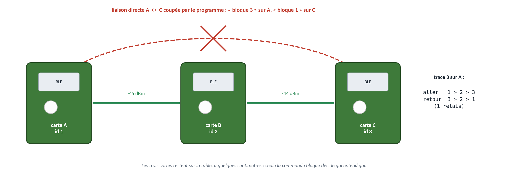</p>

Trois cartes sur une table suffisent pour voir un relais : `bloque` coupe la liaison A ↔ C,
et la route passe alors par B (découverte 3). Ce que montre le terminal :

<table>
<tr>
<td width="50%"><b>Aide</b><br>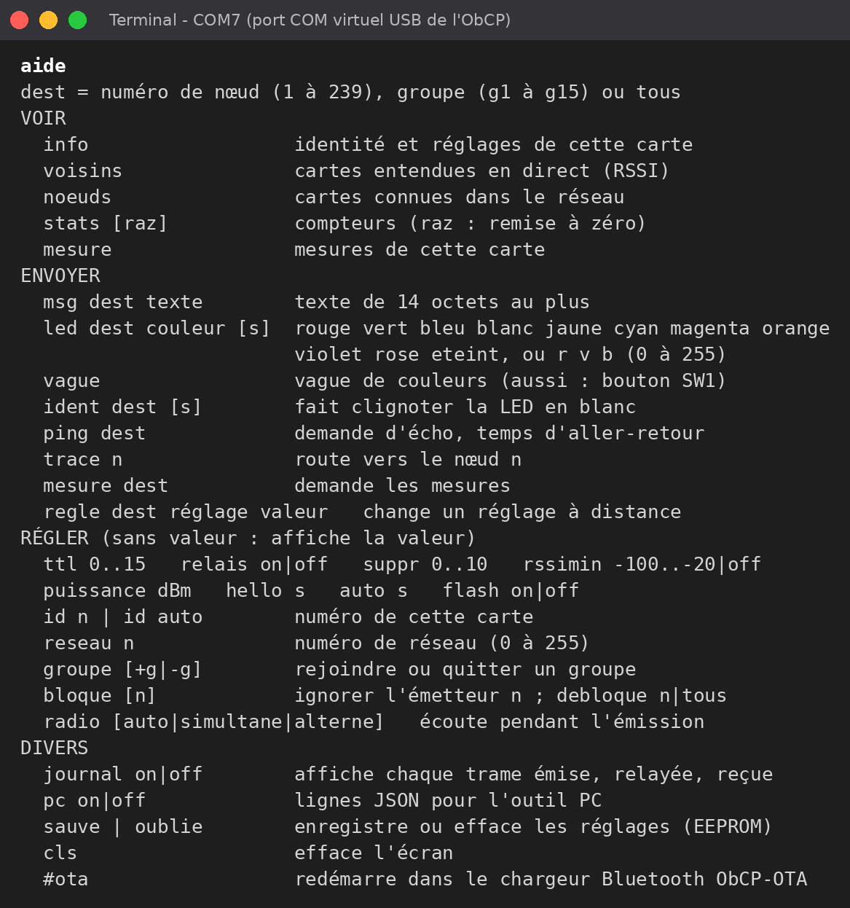</td>
<td width="50%"><b>Trois cartes : route directe, liaison coupée, route par un relais</b><br>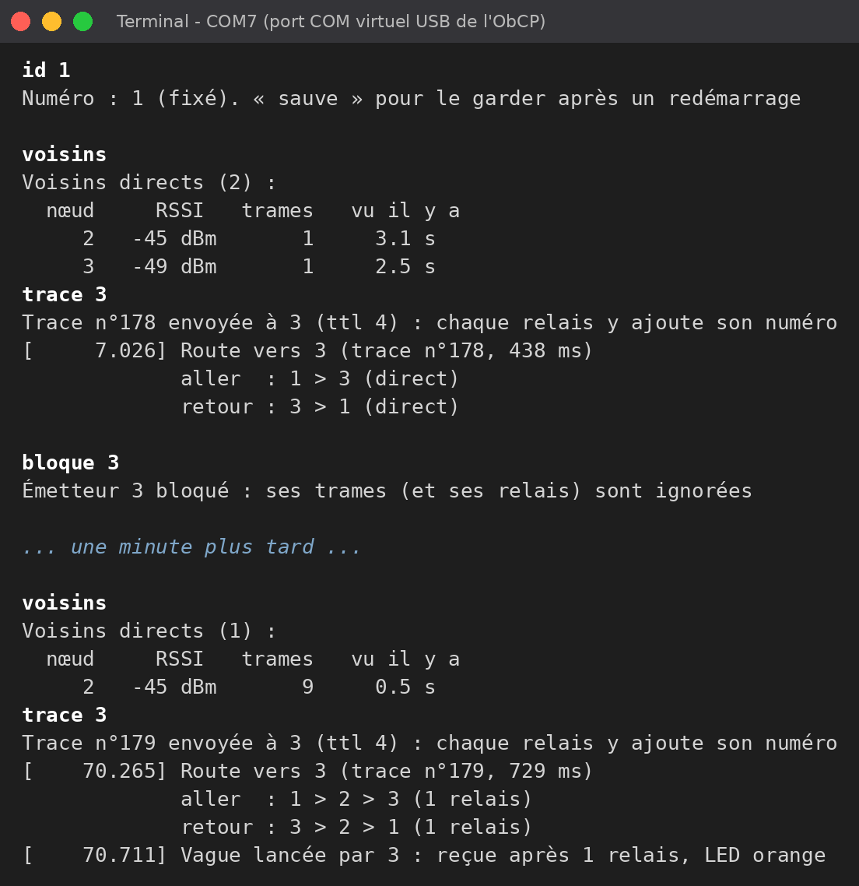</td>
</tr>
<tr>
<td><b>Voisins directs et nœuds connus</b><br>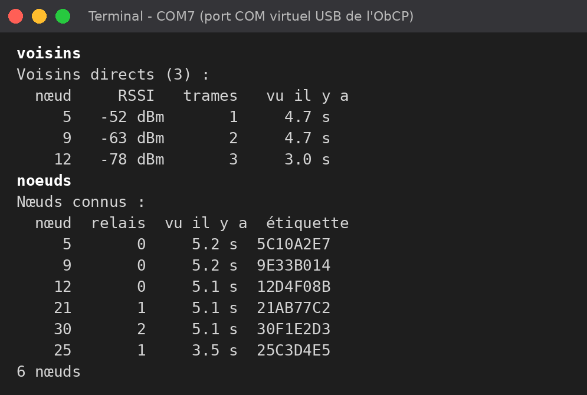</td>
<td><b>Journal des trames</b><br>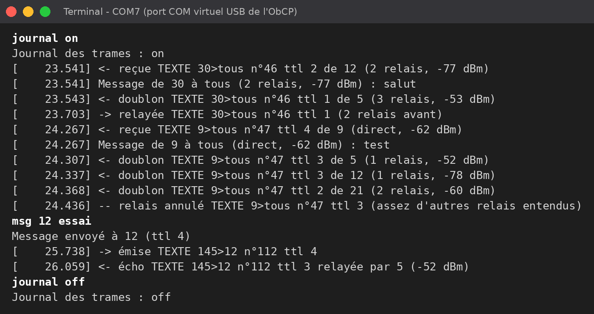</td>
</tr>
<tr>
<td><b>Message, ping et route</b><br>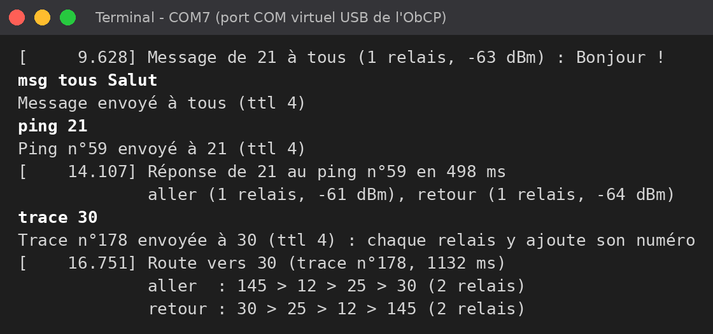</td>
<td><b>Compteurs du réseau et de la radio</b><br>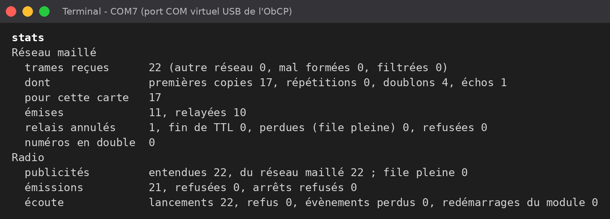</td>
</tr>
<tr>
<td><b>Réglages, sur cette carte et à distance</b><br>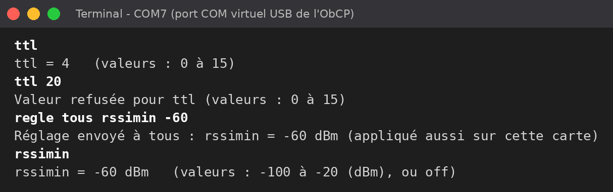</td>
<td><b>Mesures de toutes les cartes</b><br>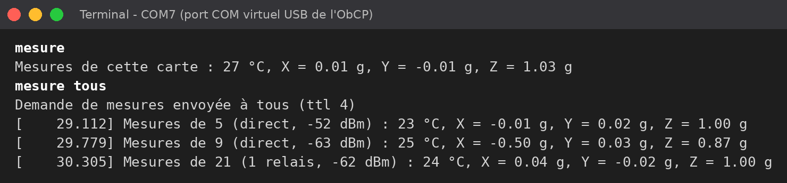</td>
</tr>
</table>

### La LED

| Effet | Signification |
|-------|---------------|
| éclair **cyan** bref | la carte vient de relayer une trame |
| éclair **magenta** bref | la carte vient d'émettre une de ses trames (sauf HELLO) |
| éclair **bleu** | un message texte est arrivé |
| **blanc** 1,5 s | la carte a lancé une vague |
| rouge, orange, jaune, vert, cyan, bleu, violet, rose (1,5 s) | vague reçue après 0, 1, 2, 3, 4, 5, 6, 7 relais et plus |
| **blanc clignotant** | identification (`ident`) |
| **rouge clignotant** 2 s | numéro en double détecté, ou numéro changé |
| couleur fixe | demandée par `led` |
| éclat vert très faible toutes les 3 s | rien d'autre à afficher : la carte fonctionne |

<p align="center">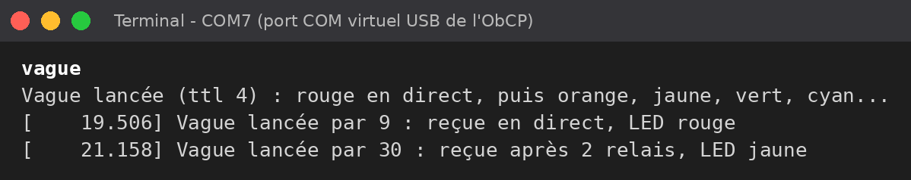</p>

### L'outil de supervision (découverte 5)

<p align="center">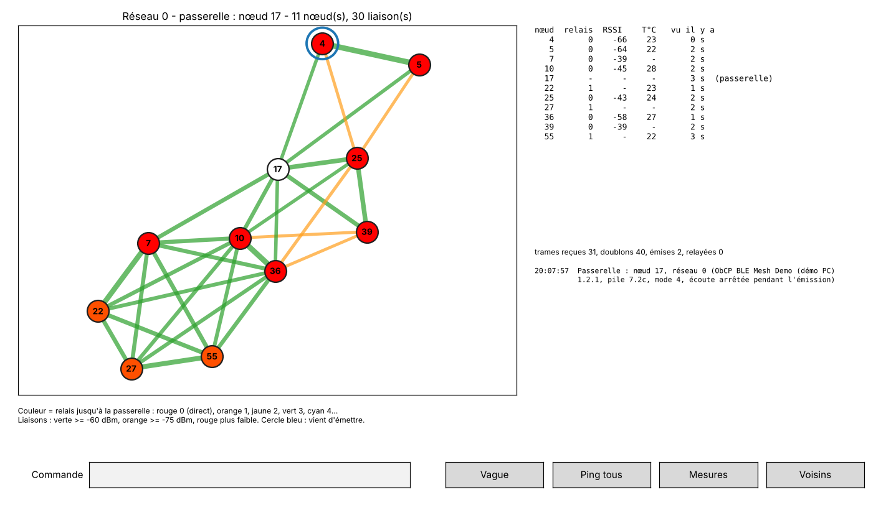</p>

Une carte branchée en USB sert de passerelle : l'outil la passe en mode JSON (`pc on`), dessine
la carte du réseau (couleur d'un nœud = nombre de relais jusqu'à la passerelle), le tableau des
nœuds et le journal ; la zone de commande et les boutons Vague, Ping tous, Mesures et Voisins
agissent par la passerelle.

```text
pip install pyserial matplotlib
python Tools/obcp_mesh_monitor.py --demo        sans carte : réseau simulé
python Tools/obcp_mesh_monitor.py               cherche l'ObCP sur les ports USB (ou : ... COM7)
python Tools/obcp_mesh_monitor.py --enregistre seance.jsonl     garde chaque ligne JSON reçue
```

## Le réseau maillé en bref

<p align="center">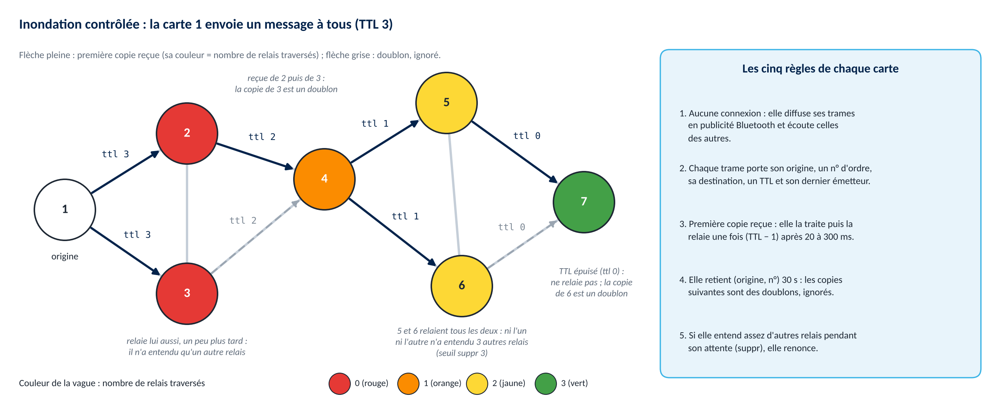</p>

Une carte n'établit aucune connexion : elle diffuse ses trames dans des paquets de publicité
Bluetooth non connectables et écoute en permanence ceux des autres. Une carte qui reçoit une
trame pour la première fois la traite, puis la **relaie une fois**, avec un **TTL** diminué de
1, après une attente tirée au hasard entre 20 et 300 ms. Elle retient pendant 30 s le couple
(origine, numéro d'ordre) : les copies suivantes sont des **doublons**, ignorés. Si elle entend
assez d'autres relais de la même trame pendant son attente (`suppr`, 3 par défaut), elle
**renonce** : ses voisins ont déjà la trame.

<p align="center">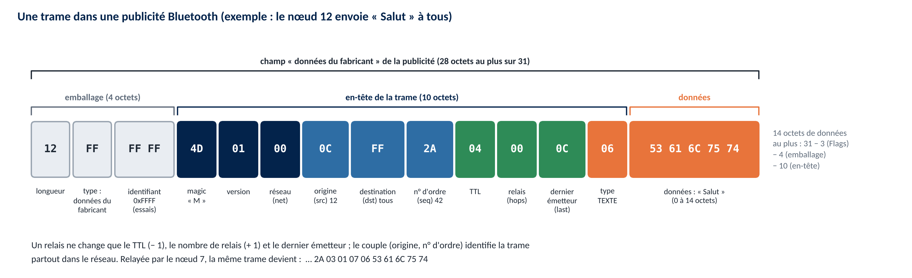</p>

Une trame : 10 octets d'en-tête et 0 à 14 octets de données, dans le champ « données du
fabricant » (identifiant `0xFFFF`) d'une publicité émise pendant 320 ms, à raison d'un
évènement toutes les 100 ms. Destination : un nœud (1 à 239), un groupe (`g1` à `g15`) ou toutes
les cartes ; des réseaux séparés (`reseau n`) permettent de travailler à plusieurs dans une
même salle.

> Ce n'est pas le *Bluetooth Mesh* officiel du Bluetooth SIG (chiffré, normalisé, livré par ST
> sous forme de bibliothèque compilée), mais un réseau maillé **simplifié et lisible**, fait pour
> comprendre et expérimenter. Le guide de découverte compare les deux (§ 13.2) ; la
> documentation du programme décrit le protocole complet (chapitre 4).

## Compiler et modifier le projet

- **STM32CubeIDE** : *File › Import › General › Existing Projects into Workspace*, puis compiler
  (Debug ou Release). Le débogage pas à pas demande une sonde SWD externe sur le connecteur
  J17.
- **Ligne de commande** (GCC Arm) : `make` (`build/Release/ObCP_BLE_Mesh_Demo.elf`, `.hex`,
  `.bin`), `make DEBUG=1`, `make flash` (USB DFU), `make test` (tests sur PC), `make binaires`
  (programmes du dossier `Binaries/`).

Le projet est décrit par **`ObCP_BLE_Mesh_Demo.ioc`** (celui du programme modèle
OBCP_template_2026) et se **régénère avec STM32CubeMX sans casser la démo** : le code de la
démo est dans ses propres fichiers sous `Core/`, relié au code généré par quelques lignes
placées dans des sections `USER CODE`. Après chaque régénération :

```bash
python3 Tools/verif_cubemx.py
```

<details>
<summary><b>Accroches dans les fichiers générés et règles à respecter</b></summary>

<p align="center">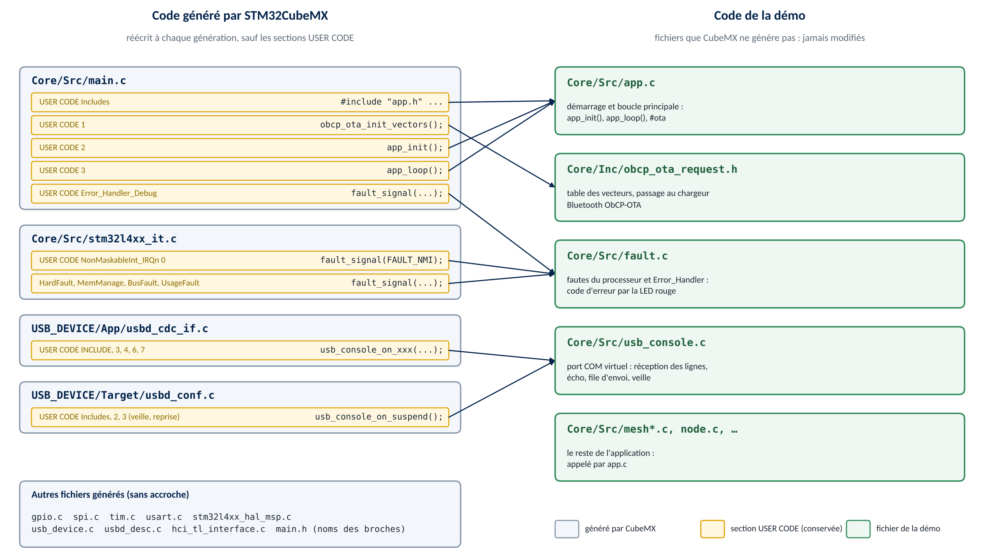</p>

| Fichier généré | Section USER CODE | Contenu |
|----------------|-------------------|---------|
| `Core/Src/main.c` | `Includes` | `#include "app.h"`, `"fault.h"`, `"obcp_ota_request.h"` |
| | `1` | `obcp_ota_init_vectors();` |
| | `2` | `app_init();` |
| | `3` | `app_loop();` (dans `while (1)`) |
| | `Error_Handler_Debug` | `fault_signal(FAULT_ERROR_HANDLER);` |
| `Core/Src/stm32l4xx_it.c` | `Includes`, `NonMaskableInt_IRQn 0`, `HardFault_IRQn 0`, `MemoryManagement_IRQn 0`, `BusFault_IRQn 0`, `UsageFault_IRQn 0` | `fault_signal(...)` : code d'erreur par la LED |
| `USB_DEVICE/App/usbd_cdc_if.c` | `INCLUDE`, `3`, `4`, `6`, `7` | appels de `usb_console.c` (ouverture, fermeture, réception, envoi) |
| `USB_DEVICE/Target/usbd_conf.c` | `Includes`, `2`, `3` | veille et reprise de l'USB |

- n'écrire dans les fichiers générés qu'entre `USER CODE BEGIN` et `USER CODE END` ;
- garder les **étiquettes** des broches (`BLE_CS`, `BLE_IRQ`, `LED_RED`, `USER_BUTTON`…) ;
- garder la base de temps de la HAL sur SysTick, l'option *Keep User Code when
  re-generating*, la génération des fichiers par paires .c/.h et la classe USB CDC ;
- ne pas donner à un fichier de la démo le nom d'un fichier que CubeMX génère.
</details>

**Version OTA** (programme à `0x08080000`, derrière le chargeur Bluetooth ObCP-OTA) : seul le
script d'édition de liens change, `STM32L476RGTX_FLASH_OTA.ld` ; `make OTA=1`, ou ce script
choisi dans STM32CubeIDE (*Properties › C/C++ Build › Settings › MCU GCC Linker › General ›
Linker Script*). Le programme reconnaît seul sa version, que `info` affiche.

Ressources (Release) : environ 81 Ko de flash sur 1 Mo, 22 Ko de RAM sur 96 Ko (pile et tas
compris).

## Lire le code

Ordre de lecture conseillé, chaque fichier commençant par un en-tête qui explique son
principe :

1. `Core/Src/main.c` — initialisation générée par CubeMX, puis `app_init()` et `app_loop()` ;
2. `Core/Src/app.c` — démarrage et **boucle principale**, en 11 étapes dont aucune n'attend ;
3. `Core/Inc/mesh_pdu.h` — **format des trames** et types de messages ;
4. `Core/Inc/mesh.h` puis `Core/Src/mesh.c` — **règles du réseau** (réception, mémoire, relais,
   suppression), sans aucun accès au matériel ;
5. `Core/Src/node.c` — **réactions** de la carte aux messages (`on_message()`) ;
6. `Core/Src/mesh_radio.c` — le **module Bluetooth** ; `Core/Src/commands.c` — les commandes du
   terminal.

<table>
<tr>
<td width="50%"><b>Carte du programme</b><br>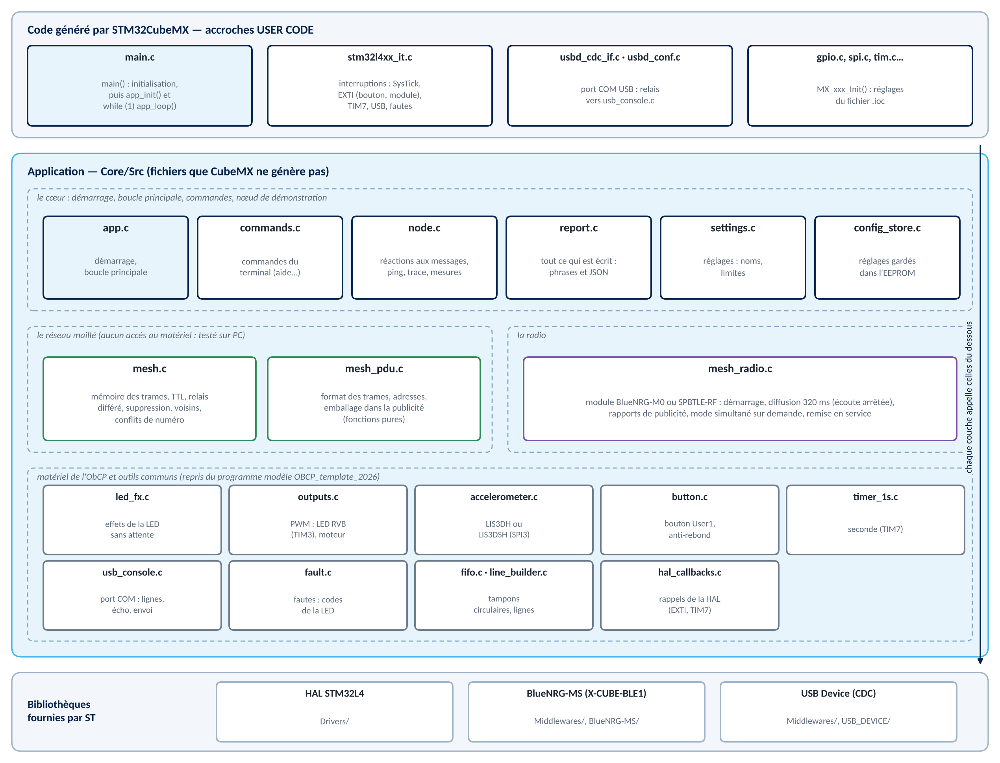</td>
<td width="50%"><b>Boucle principale</b><br>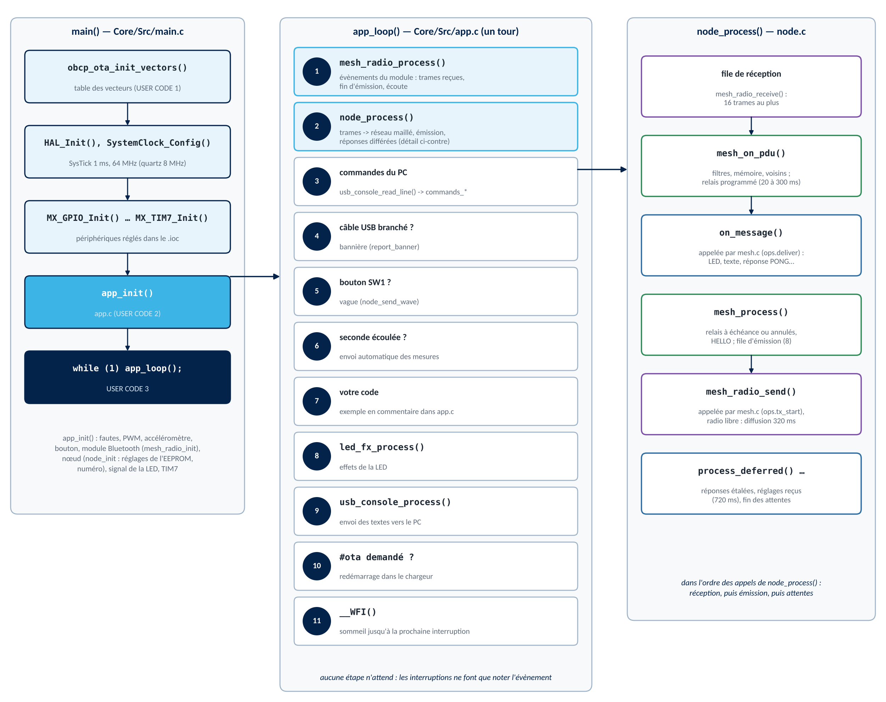</td>
</tr>
<tr>
<td><b>Réception d'une trame</b><br>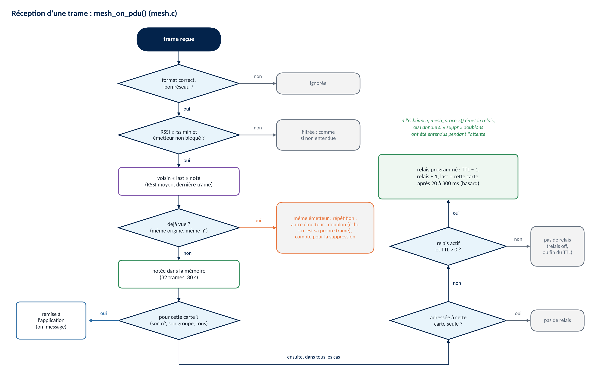</td>
<td><b>Trajet d'un ping à travers un relais</b><br>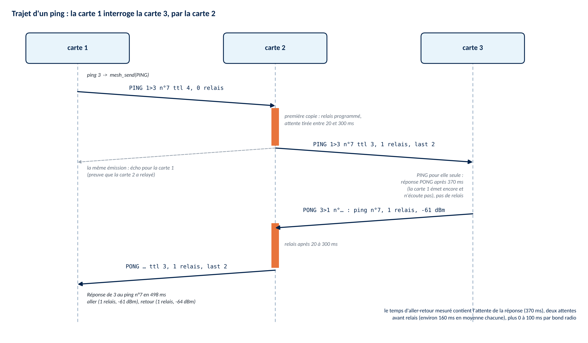</td>
</tr>
</table>

<p align="center">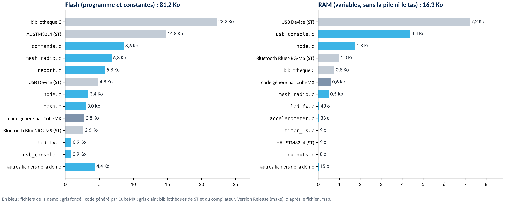</p>

La [documentation du programme](Doc/Documentation_Programme_BLE_Mesh_ObCP.pdf) détaille tout
cela : déroulement, protocole, dialogue avec le module Bluetooth (dont le « mode 4 »), référence
des fonctions, paramètres de `app_config.h`, codes d'erreur, lignes JSON, et recettes pour
ajouter une commande, un type de message ou un réglage.

## Tests sur PC

```bash
make test            # ou : cd Tests puis make
```

Trois programmes compilés avec gcc, AddressSanitizer et UBSan, le matériel étant remplacé par
des doublures (HAL, module Bluetooth, USB, EEPROM, accéléromètre) :

| Programme | Vérifie | Vérifications |
|-----------|---------|--------------:|
| `test_unit` | trames (codage, décodage, cas refusés), publicités abîmées, adresses, réglages, toutes les commandes, CRC de l'EEPROM, versions de pile, version USB ou OTA, temps de la radio face aux règles du mode 4 | 192 |
| `test_network` | réseau de cartes simulées, vrai code de `mesh.c` : ligne, TTL, ping et trace, coût de l'inondation et suppression, groupes, réseaux séparés, filtres, HELLO et voisins, conflits de numéro, files pleines, grille 6 × 6 avec pertes et collisions | 160 |
| `test_app` | programme complet sur une carte simulée : terminal, réception et relais, LED, ping et trace, mesures, réglages, JSON, journal, modes alterné et simultané, repli après un refus du module, redémarrage du module, EEPROM, bouton, `#ota`, les deux modules, module absent | 235 |

Le **simulateur** (découverte 4) envoie une trame à tous dans un réseau de cartes simulées
(vrai code de `mesh.c`, avec pertes et collisions) et affiche quand et après combien de relais
chaque carte la reçoit, puis le coût de la diffusion :

```bash
cd Tests
make simu ARGS="topo=grille n=16 ttl=4"
```

<p align="center">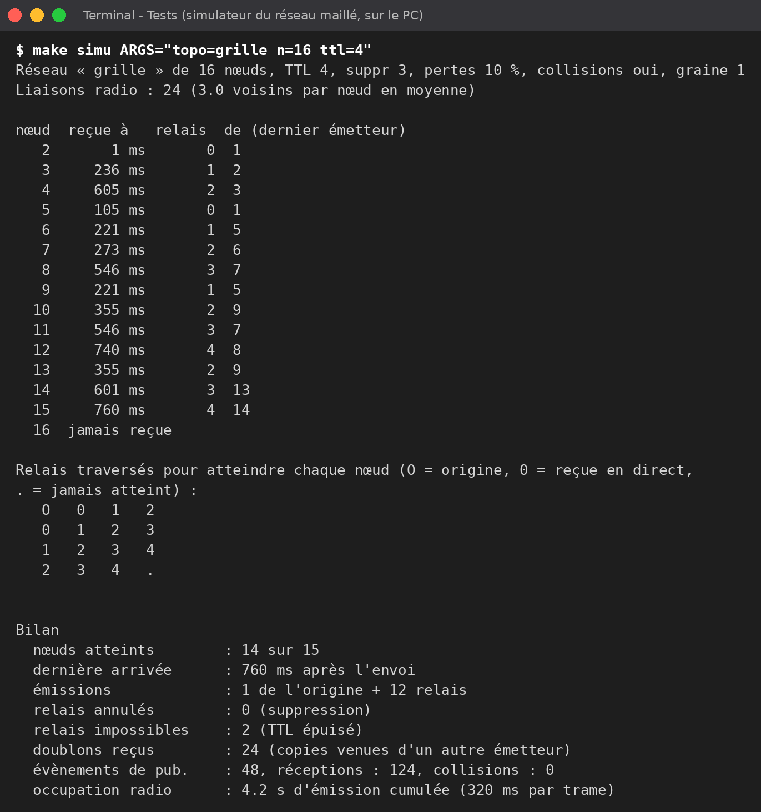</p>

## Contenu du dépôt

```text
ObCP_BLE_Mesh_Demo.ioc      configuration STM32CubeMX (CubeMX 6.11.1, STM32Cube FW_L4 V1.18.1,
                            X-CUBE-BLE1 6.2.3)
Core/Src, Core/Inc          fichiers générés (main.c, gpio.c, spi.c…) et fichiers de la démo :
  app.c, commands.c,          démarrage et boucle principale, commandes du terminal,
  node.c, report.c,           réactions de la carte, textes et lignes JSON,
  mesh.c, mesh_pdu.c,         réseau maillé (sans accès au matériel),
  mesh_radio.c, …             module Bluetooth, réglages, EEPROM, LED, port COM virtuel
BlueNRG-MS/Target/          interface du module Bluetooth, générée par CubeMX (X-CUBE-BLE1)
USB_DEVICE/                 généré par CubeMX : USB device, classe CDC
Drivers/, Middlewares/      HAL STM32L4, CMSIS, bibliothèques BlueNRG-MS et USB device de ST
STM32L476RGTX_FLASH.ld      édition de liens, version USB (0x08000000)
STM32L476RGTX_FLASH_OTA.ld  édition de liens, version OTA (0x08080000)
Tests/                      tests sur PC, doublures du matériel, simulateur du réseau
Tools/                      verif_cubemx.py, obcp_mesh_monitor.py (outil de supervision)
Binaries/                   programme précompilé : version USB (.hex, .bin, .elf) et version OTA
Doc/                        guide de découverte et documentation du programme (PDF)
  images/                   illustrations de ce README et des deux documents
Makefile                    compilation en ligne de commande (facultatif)
```

## État de validation

| Version | État |
|---------|------|
| 1.0 | compilée sans avertissement, vérifiée sur PC (cartes, réseau et module Bluetooth simulés) |
| 1.1 | idem avec les deux modules simulés (piles 7.1e et 7.2), 547 vérifications sur PC |
| 1.2.0 | essayée sur une carte (BlueNRG-M0, pile 7.3) : le module refusait toute émission pendant l'écoute |
| 1.2.1 | corrige ce refus ; compilée sans avertissement avec `make` (options des configurations Debug et Release de STM32CubeIDE), projet vérifié par `Tools/verif_cubemx.py`, 587 vérifications sur PC réussies ; **essai sur cartes à faire** |

## Versions

| Version | Contenu |
|---------|---------|
| 1.0.0 | Réseau maillé par inondation contrôlée (TTL, mémoire des trames, suppression des relais inutiles) ; commandes du terminal, LED, vague, ping, trace, mesures, réglages à distance et EEPROM ; outil de supervision, simulateur et tests sur PC ; sujet de TP |
| 1.1.0 | Compatibilité SPBTLE-RF et BlueNRG-M0 : version de la pile lue au démarrage, « mode 4 » (écoute pendant l'émission) quand la pile le permet, sinon mode alterné ; tests des deux modules |
| 1.2.0 | Projet à découvrir en autonomie : guide de découverte et documentation du programme ; organisation commune aux démonstrateurs du dépôt ; projet STM32CubeIDE en Debug et Release, version OTA reconnue à l'exécution ; code commenté pour débutants |
| 1.2.1 | Radio : mode alterné par défaut avec écoute continue, `radio simultane` conforme aux règles de temps de ST, retour automatique au mode alterné en cas de refus, code de refus affiché, base de temps du module dans `radio` |

## Licences

| Composant | Licence |
|-----------|---------|
| Code écrit pour ce projet (fichiers de la démo dans `Core/`, sections USER CODE, `Tests/`, `Tools/`) | voir `LICENSE` |
| Fichiers générés par STM32CubeMX, HAL STM32L4 | BSD-3-Clause (STMicroelectronics), `Core/LICENSE_ST.md` |
| Bibliothèque BlueNRG-MS (X-CUBE-BLE1), fichiers générés de `BlueNRG-MS/Target/` | SLA0077 (STMicroelectronics) |
| STM32 USB Device Library, fichiers générés de `USB_DEVICE/` | SLA0044 (STMicroelectronics) |
| CMSIS | Apache 2.0 |

Programme modèle, chargeur Bluetooth ObCP-OTA et documents de fabrication de l'ObCP :
[LAB_ObCP_L476_STM32CubeIDE](https://github.com/jimbaud/LAB_ObCP_L476_STM32CubeIDE). Documentation
des composants (modules Bluetooth, PM0237, UM1865, LIS3DH) : dossier
[`Datasheets`](https://github.com/jimbaud/LAB_ObCP_L476_STM32CubeIDE/tree/main/OBCP_template_2026/Datasheets)
du programme modèle.
