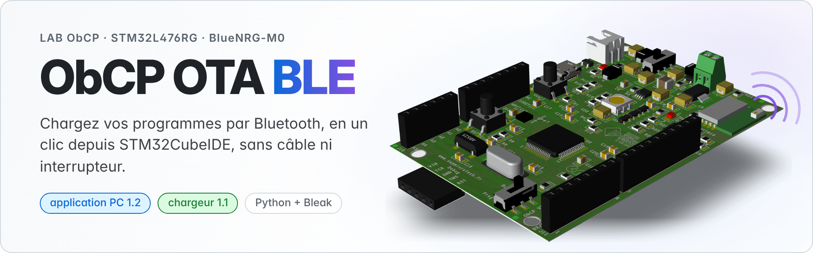
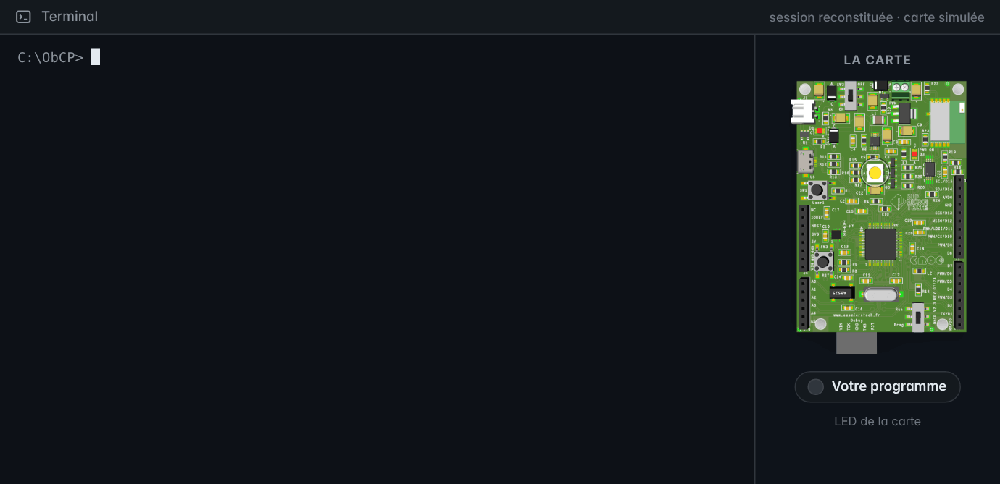
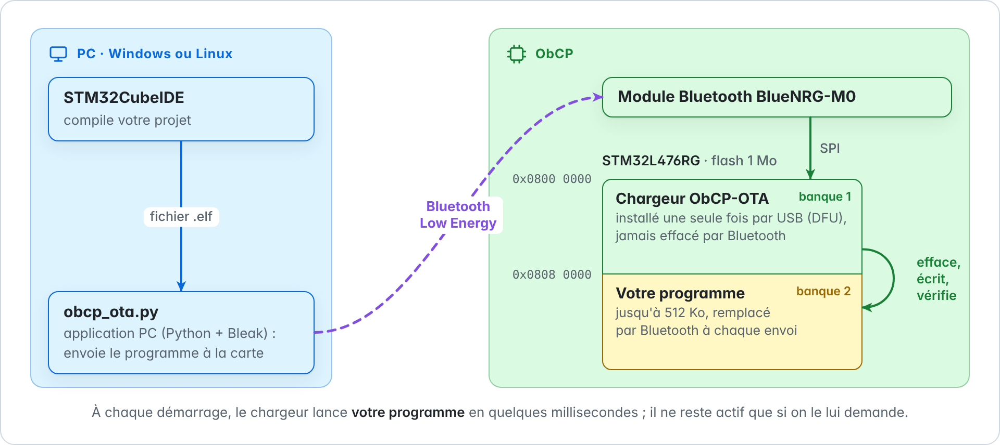
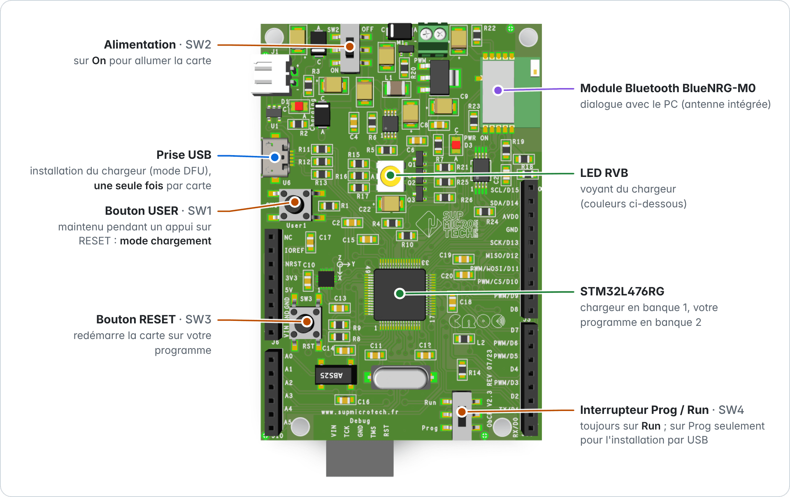
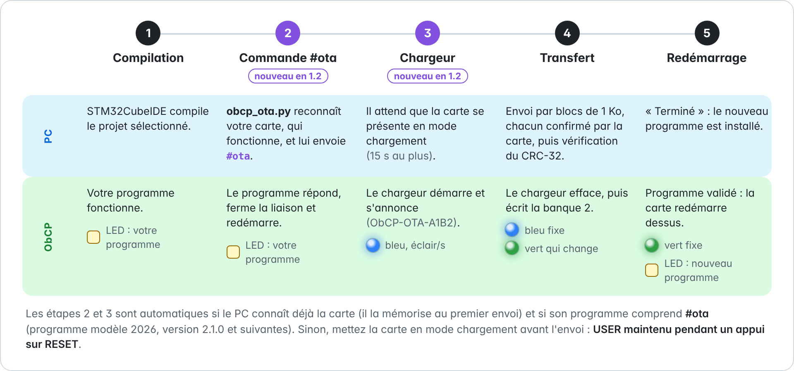
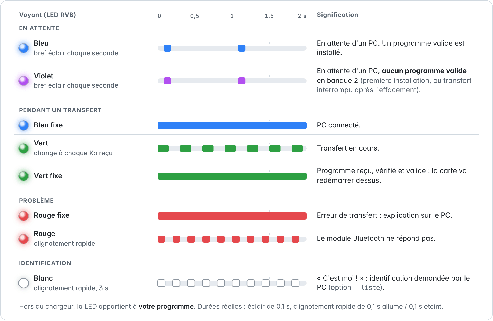
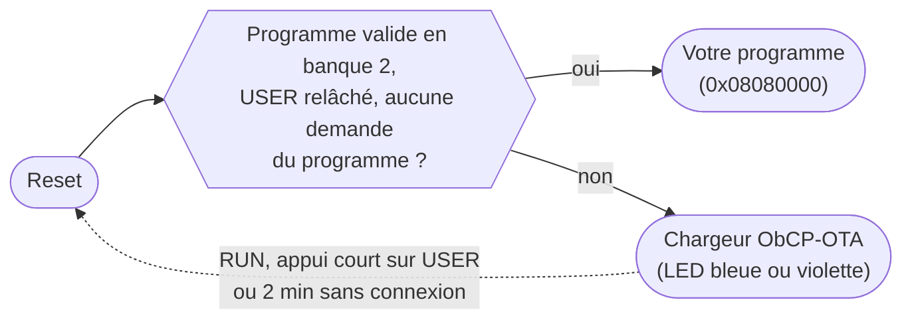
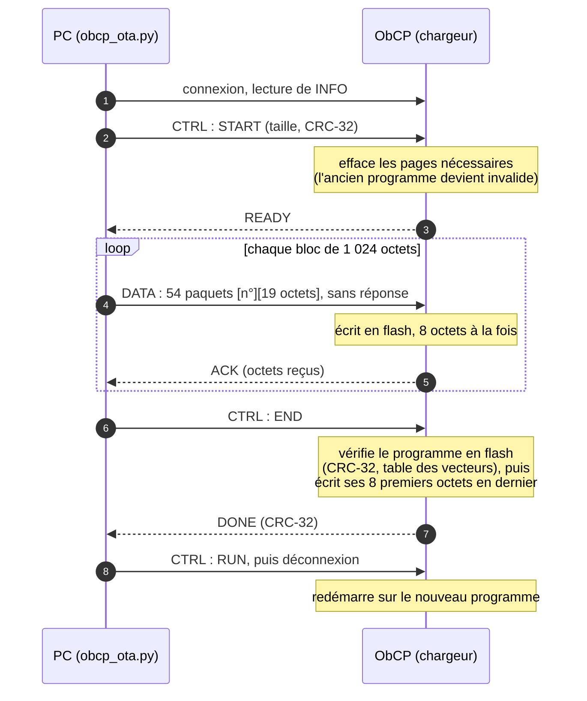

<picture>
  <source media="(prefers-color-scheme: dark)" srcset="Documentation/images/banniere-sombre.png">
  
</picture>

**Version 1.2** (novembre 2026) · chargeur 1.1 · application PC 1.2 · Windows et Linux · [guide complet (PDF)](Documentation/ObCP_OTA_BLE_Guide.pdf)

L'ObCP n'a pas de sonde ST-LINK : jusqu'ici, chaque nouveau programme passait par l'USB en mode DFU (SW4 sur « Prog », RESET, STM32CubeProgrammer, SW4 sur « Run », RESET). **ObCP OTA BLE** ajoute le chargement **par Bluetooth** (*OTA, over the air*) : un clic dans STM32CubeIDE compile votre projet et l'envoie à la carte, sans câble de données ni interrupteur.

<p align="center">
  
</p>
<p align="center"><sub>Session reconstituée : sortie réelle de <code>obcp_ota.py</code> 1.2 face à la carte simulée des tests, avec des durées réglées sur celles d'une vraie ObCP (débit mesuré : 6,8 Ko/s). La carte fait tourner le programme modèle 2026 ; l'application PC lui envoie elle-même <code>#ota</code>.</sub></p>

## Sommaire

- [En bref](#-en-bref)
- [Le principe](#-le-principe)
- [Repères sur la carte](#-repères-sur-la-carte)
- [Démarrage rapide](#-démarrage-rapide)
- [Passer en mode chargement](#-passer-en-mode-chargement)
- [Les voyants du chargeur](#-les-voyants-du-chargeur)
- [Rendre votre programme compatible](#-rendre-votre-programme-compatible)
- [L'application PC obcp_ota.py](#-lapplication-pc-obcp_otapy)
- [Comment ça marche](#-comment-ça-marche)
- [Contenu du dossier](#-contenu-du-dossier) · [Tests](#-tests) · [État des essais](#-état-des-essais) · [Dépannage](#-dépannage) · [Versions](#-versions) · [Documentation](#-documentation-et-liens)

---

## ✨ En bref

- **Un clic dans STM32CubeIDE** : *Run › External Tools › ObCP OTA - compiler et transferer* compile le projet sélectionné, trouve votre carte et lui envoie le programme.
- **Sans toucher la carte** (nouveau en 1.2) : si son programme comprend la commande `#ota` (programme modèle 2026, version 2.1.0 et suivantes), l'application PC la fait passer elle-même en mode chargement.
- **Sûr** : le chargeur n'est jamais effacé par Bluetooth ; chaque paquet est numéroté et le programme entier est vérifié (CRC-32, table des vecteurs) avant d'être lancé. Un transfert interrompu ne lance jamais un programme incomplet.
- **Robuste** : si la liaison radio tombe, l'application PC se reconnecte et reprend d'elle-même.
- **Fait pour apprendre** : code commenté en français, projets régénérables par STM32CubeMX, tests sur PC sans carte, guide détaillé.

## 🧭 Le principe

<picture>
  <source media="(prefers-color-scheme: dark)" srcset="Documentation/images/principe-sombre.png">
  
</picture>

La mémoire flash du STM32L476RG (1 Mo) est partagée en deux banques de 512 Ko. Le **chargeur ObCP-OTA** occupe la première : il s'installe une fois pour toutes par l'USB. **Votre programme** vit dans la seconde : c'est lui que l'on remplace par Bluetooth. À chaque démarrage, le chargeur lance votre programme en quelques millisecondes ; il ne reste actif que si on le lui demande ([mode chargement](#-passer-en-mode-chargement)).

## 📍 Repères sur la carte

<picture>
  <source media="(prefers-color-scheme: dark)" srcset="Documentation/images/carte-reperes-sombre.png">
  
</picture>

## 🚀 Démarrage rapide

### 1. Préparer le PC (une fois)

1. Installer [Python](https://www.python.org/downloads/) 3.10 ou plus récent. Sous Windows, cocher **Add python.exe to PATH** dans la première fenêtre de l'installateur.
2. Installer la bibliothèque Bluetooth [Bleak](https://github.com/hbldh/bleak) dans un terminal :
   ```
   python -m pip install bleak
   ```
3. Activer le Bluetooth du PC (Windows 10 ou 11, ou Linux avec BlueZ). Vérification : `python ObCP_OTA_Tools/obcp_ota.py --version` affiche `obcp_ota 1.2`.

### 2. Installer le chargeur dans l'ObCP (une fois par carte, par l'USB)

Avec [STM32CubeProgrammer](https://www.st.com/en/development-tools/stm32cubeprog.html), comme pour n'importe quel programme de l'ObCP (voir le [README du dépôt](../README.md)) :

1. câble USB de données ; **SW4 sur Prog**, appui sur **RESET (SW3)** ;
2. dans STM32CubeProgrammer : **USB**, **Connect** ; onglet *Erasing & programming* : **Full chip erase**, puis le fichier [`Binaires/ObCP_Chargeur_et_Demo.hex`](Binaires/) (chargeur et démonstration), **Start Programming** ;
3. **SW4 sur Run**, appui sur **RESET** : la LED clignote en vert, la démonstration fonctionne.

En ligne de commande, l'étape 2 s'écrit :

```
STM32_Programmer_CLI -c port=usb1 -e all -w Binaires/ObCP_Chargeur_et_Demo.hex -v -s
```

> [!IMPORTANT]
> Ensuite, ne programmez plus l'ObCP en DFU avec un programme ordinaire (lié à `0x08000000`) : il écraserait le chargeur. Le programme modèle 2026 a son propre fichier « chargeur + programme » : [`OBCP_template_2026_OTA/BIN/OBCP_template_2026_et_chargeur.hex`](../OBCP_template_2026_OTA/BIN/).

### 3. Importer les projets dans STM32CubeIDE

*File › Import › General › Existing Projects into Workspace*, choisir le dossier `ObCP_OTA_BLE`, cocher **ObCP_OTA_Tools** et **ObCP_OTA_Demo** (et `ObCP_BLE_Loader` pour modifier le chargeur), puis **Finish**.

`ObCP_OTA_Tools` n'est pas un programme pour la carte : il apporte l'application PC et trois commandes, dans le menu *Run › External Tools* :

| Commande | Rôle |
|---|---|
| **ObCP OTA - compiler et transferer** | compile le projet sélectionné, puis envoie son programme à la carte |
| **ObCP OTA - choisir ma carte** | liste les cartes en mode chargement et mémorise la vôtre (sa LED clignote en blanc) |
| **ObCP OTA - verifier le projet** | vérifie qu'un projet est prêt pour le chargement par Bluetooth |

> [!TIP]
> Si les commandes n'apparaissent pas dans le menu, elles sont dans *Run › External Tools › External Tools Configurations…*, rubrique *Program*. Si Python n'est pas dans le PATH, remplacer `${system_path:python}` (champ *Location*) par le chemin complet de `python.exe`.

### 4. Premier envoi

1. Mettre la carte en **mode chargement** : maintenir **USER**, appui bref sur **RESET**, relâcher USER. La LED bleue émet un bref éclair chaque seconde.
2. Dans [`ObCP_OTA_Demo/Core/Src/demo.c`](ObCP_OTA_Demo/Core/Src/demo.c), remplacer `#define DEMO_VERSION 1` par `#define DEMO_VERSION 2`.
3. Sélectionner le projet `ObCP_OTA_Demo` dans *Project Explorer*, puis **Run › External Tools › ObCP OTA - compiler et transferer**.

La console affiche les quatre étapes, puis la carte redémarre : la LED clignote maintenant **en bleu**, le nouveau programme a remplacé l'ancien. Le PC a mémorisé la carte pour les envois suivants.

> [!NOTE]
> En salle de TP, plusieurs cartes peuvent être en mode chargement en même temps : lancez d'abord **ObCP OTA - choisir ma carte** ; la LED de la carte choisie clignote en blanc pendant 3 s.

### 5. Les envois suivants

- Programme qui comprend `#ota` (programme modèle [`OBCP_template_2026_OTA`](../OBCP_template_2026_OTA/), version 2.1.0) : **rien à faire sur la carte**, le clic suffit, comme dans l'animation plus haut.
- Autre programme : mode chargement (USER + RESET), puis le même clic. La démonstration accepte aussi un appui long (2 s) sur USER.

Sans STM32CubeIDE, depuis le dossier `ObCP_OTA_Tools` :

```
python obcp_ota.py ..\ObCP_OTA_Demo                   projet : son .elf le plus récent
python obcp_ota.py ..\Binaires\ObCP_OTA_Demo_v2.elf   fichier .elf, .hex ou .bin
python obcp_ota.py programme.elf --carte A1B2         vise une carte précise
python obcp_ota.py --liste                            choisit sa carte
```

## 🔁 Passer en mode chargement

Pour recevoir un programme, la carte doit être dans son chargeur. Depuis la version 1.2, l'application PC s'en occupe elle-même quand c'est possible :

<picture>
  <source media="(prefers-color-scheme: dark)" srcset="Documentation/images/ota-auto-sombre.png">
  
</picture>

| Comment | Avec quel programme | LED |
|---|---|---|
| **Automatique** : `obcp_ota.py` envoie lui-même `#ota` | programme qui comprend `#ota` ; carte déjà jointe depuis ce PC avec la version 1.2 ; Windows ou Linux | bleue |
| Commande **`#ota`** tapée dans un terminal (port COM virtuel ou Bluetooth) | programme qui comprend `#ota` | bleue |
| **USER** maintenu pendant un appui sur **RESET** | n'importe lequel | bleue |
| Appui long (2 s) sur **USER** | démonstration `ObCP_OTA_Demo` | bleue |
| Aucun programme valide en banque 2 (carte neuve, transfert interrompu) | — | violette |

Pour revenir au programme sans rien envoyer : appui court sur USER, appui sur RESET seul, ou 2 minutes sans connexion.

> [!NOTE]
> Le passage automatique demande aussi qu'aucun téléphone ne soit connecté à la carte (une carte connectée n'annonce plus) ; il ne vise jamais une autre carte que la vôtre. Sous macOS, Bleak ne donne pas les adresses Bluetooth : passez par USER + RESET. Dans le chargeur, le port COM virtuel disparaît du PC (le chargeur n'utilise pas l'USB) : un terminal ouvert signale une erreur, c'est normal.

## 🚦 Les voyants du chargeur

<picture>
  <source media="(prefers-color-scheme: dark)" srcset="Documentation/images/voyants-sombre.png">
  
</picture>

<details>
<summary>Version texte</summary>

| LED | Signification |
|---|---|
| bleue, bref éclair chaque seconde | attente d'une connexion ; un programme valide est installé |
| violette, bref éclair chaque seconde | attente d'une connexion ; aucun programme valide en banque 2 |
| bleue fixe | PC connecté |
| verte, change à chaque Ko reçu | transfert en cours |
| verte fixe | programme reçu, vérifié et validé : la carte va redémarrer dessus |
| rouge fixe | erreur de transfert (l'explication s'affiche sur le PC) |
| rouge, clignotement rapide | le module Bluetooth ne répond pas |
| blanche, clignotement rapide (3 s) | identification demandée par le PC (`--liste`) |

Hors du chargeur, la LED appartient à votre programme.

</details>

## 🧩 Rendre votre programme compatible

N'importe quel projet STM32CubeIDE pour l'ObCP peut être chargé par Bluetooth, sans une ligne de code Bluetooth : c'est le chargeur qui reçoit le programme et l'écrit en flash.

**1. Indispensable : placer le programme en banque 2.** Dans le fichier `STM32L476RGTX_FLASH.ld`, à la racine du projet, bloc `MEMORY` :

```diff
-  FLASH    (rx)    : ORIGIN = 0x8000000,   LENGTH = 1024K
+  FLASH    (rx)    : ORIGIN = 0x8080000,   LENGTH = 512K
```

En cas d'oubli, rien n'est cassé : `obcp_ota.py` refuse d'envoyer un programme lié à `0x08000000` et rappelle la modification à faire.

**2. Recommandé : indiquer au processeur la table des interruptions du programme.** Copier [`ObCP_OTA_Demo/Core/Inc/obcp_ota_request.h`](ObCP_OTA_Demo/Core/Inc/obcp_ota_request.h) dans `Core/Inc`, puis dans `main.c` :

```c
/* USER CODE BEGIN Includes */
#include "obcp_ota_request.h"
/* USER CODE END Includes */

int main(void)
{
  /* USER CODE BEGIN 1 */
  obcp_ota_init_vectors();      /* VTOR = table des vecteurs de CE programme */
  /* USER CODE END 1 */
  HAL_Init();
```

Le chargeur le fait déjà avant de lancer le programme ; cette ligne le rend autonome, par exemple pour le déboguer avec une sonde.

**3. Facultatif : revenir au chargeur par logiciel.** `obcp_ota_enter_loader()` redémarre la carte en mode chargement, par exemple sur un appui long ou à la réception de `#ota`. Le programme modèle [`OBCP_template_2026_OTA`](../OBCP_template_2026_OTA/) (version 2.1.0) fait déjà tout cela, commande `#ota` comprise.

**4. Vérifier :** sélectionner le projet, puis **Run › External Tools › ObCP OTA - verifier le projet** (`verif_cubemx.py`), notamment après chaque génération du code par STM32CubeMX.

> [!WARNING]
> Programme de 512 Ko au plus. Ne pas utiliser les 16 derniers octets de la SRAM2 (`0x10007FF0` à `0x10007FFF`, la « boîte aux lettres » du chargeur). Ne pas effacer toute la flash (*Full chip erase*) ni modifier les octets d'option du STM32 (BFB2) : le chargeur serait effacé ou ignoré.

## 💻 L'application PC obcp_ota.py

| Option | Effet |
|---|---|
| `source` | fichier `.elf`, `.hex` ou `.bin`, ou dossier d'un projet (son `.elf` le plus récent) |
| `--carte NOM` | carte visée (`A1B2` ou `ObCP-OTA-A1B2`) ; sinon : la carte mémorisée, ou la seule présente |
| `--liste` | cherche les cartes en mode chargement et mémorise la vôtre |
| `--oublier` | oublie la carte mémorisée |
| `--sans-lancer` | ne redémarre pas la carte après le transfert |
| `--attente S` | temps laissé pour trouver la carte (30 s par défaut) |
| `--forcer` | envoie le `.elf` même s'il est plus ancien que les sources |
| `--version` | version de l'application |
| `-h` | aide |

- La carte choisie est mémorisée dans le fichier `.obcp_ota.json` du dossier personnel : son nom (`ObCP-OTA-A1B2`, d'après la fin de son adresse Bluetooth) et l'adresse de son chargeur, dont se déduit celle de son programme (premier octet modifié : `C0:…` pour le chargeur, `C1:…` pour le programme).
- Avant d'effacer quoi que ce soit, le programme est vérifié (adresse, taille, table des vecteurs). Si un fichier source est plus récent que le `.elf`, c'est que la compilation a échoué : l'envoi s'arrête.
- Les fichiers `.elf`, `.hex` et `.bin` d'un même programme donnent la même image, donc le même CRC-32. Un `.bin` ne contient pas d'adresse : il est supposé commencer à `0x08080000`, préférez le `.elf`.
- Code de retour 0 si le transfert a réussi, 1 sinon : la commande peut servir dans un script.

## 🔧 Comment ça marche

### Carte mémoire

| Zone | Début | Taille | Contenu |
|---|---|---|---|
| Flash, banque 1 | `0x08000000` | 512 Ko | chargeur ObCP-OTA (environ 14 Ko), installé par l'USB |
| Flash, banque 2 | `0x08080000` | 512 Ko | votre programme, remplacé par Bluetooth |
| Fin de la SRAM2 | `0x10007FF0` | 16 octets | boîte aux lettres : demande de passage au chargeur |

### Au démarrage : votre programme ou le chargeur ?



La « demande du programme » est un mot déposé dans la boîte aux lettres par `obcp_ota_enter_loader()` (commande `#ota`, appui long de la démonstration), juste avant un reset logiciel ; le chargeur le lit puis l'efface à chaque démarrage.

### Le transfert

Le chargeur expose un service Bluetooth à trois caractéristiques : **CTRL** (commandes du PC, réponses de la carte), **DATA** (le programme, par paquets de 20 octets : un numéro et 19 octets) et **INFO** (version du chargeur, programme présent, raison du démarrage…). La carte accuse réception tous les 1 024 octets, ce qui règle le débit sur ce qu'elle sait écrire en flash.

<details>
<summary>Le dialogue entre le PC et la carte, pas à pas</summary>



| Élément | Valeur |
|---|---|
| Service « ObCP OTA » | `9e090001-33d3-4337-976a-6f024ca6b676` |
| CTRL : écriture avec réponse, notifications | `9e090002-…` (même fin) |
| DATA : écriture sans réponse | `9e090003-…` |
| INFO : lecture | `9e090004-…` |
| Commandes du PC | START `0x01`, END `0x02`, ABORT `0x03`, RUN `0x04`, IDENTIFY `0x05` |
| Réponses de la carte | READY `0x10`, ACK `0x11`, DONE `0x12`, erreurs `0x20` à `0x28` |

Le détail (format des messages, codes d'erreur, contrôle de flux) est au chapitre 7 du [guide](Documentation/ObCP_OTA_BLE_Guide.pdf).

</details>

**Ce qui protège la carte :**

- le chargeur n'efface et n'écrit que la banque 2 ; il ne se modifie jamais lui-même ;
- chaque paquet porte un numéro : un paquet perdu est repéré aussitôt et le transfert recommence (3 essais) ;
- à la fin, la carte relit le programme en flash et compare son CRC-32 à celui annoncé par le PC ;
- les 8 premiers octets du programme (pile initiale, adresse de départ) sont écrits en dernier : tant qu'ils manquent, le programme est considéré comme absent et n'est jamais lancé.

> [!CAUTION]
> En mode chargement, le chargeur accepte un programme de n'importe quel PC à portée : il n'y a ni authentification ni chiffrement. C'est acceptable en TP, puisque le mode chargement demande une action volontaire et s'arrête après 2 minutes sans connexion ; un produit réel vérifierait une signature du programme.

## 📁 Contenu du dossier

```
ObCP_OTA_BLE/
├── ObCP_BLE_Loader/    projet STM32CubeIDE / CubeMX du chargeur (code ajouté dans Loader/)
├── ObCP_OTA_Demo/      démonstration : LED clignotante, appui long sur USER = retour au chargeur
├── ObCP_OTA_Tools/     application PC obcp_ota.py, verif_cubemx.py, commandes pour STM32CubeIDE
├── Binaires/           programmes compilés : chargeur, démonstration v1 et v2, les deux réunis
├── Tests/              tests sur PC, sans carte (run_tests.sh)
├── Documentation/      guide complet (PDF), images de ce README et leurs sources
└── README.md           ce fichier
```

## 🧪 Tests

Sur PC, sans carte (Linux ou WSL, avec gcc et Python 3) :

```
cd Tests
./run_tests.sh
```

- **1 679 vérifications** en C du cœur du transfert (`ota.c`, `crc32.c`, `app_image.c` : les vrais fichiers du chargeur), avec une flash simulée qui respecte les règles du STM32L4, sous AddressSanitizer et UBSan ;
- **66 vérifications** de la partie Bluetooth du chargeur (`ble_ota.c`), avec un faux module BlueNRG ;
- **52 tests Python**, dont des transferts complets entre l'application PC et le vrai code du chargeur : paquets perdus, octets abîmés, pannes de flash, coupures et reconnexions, envoi de `#ota` à une carte qui fonctionne.

Si `arm-none-eabi-gcc` est installé, `run_tests.sh` compile d'abord les deux projets comme STM32CubeIDE ; sinon, il utilise les programmes du dossier `Binaires`.

## ✅ État des essais

| Vérification | Résultat |
|---|---|
| Compilation des deux projets (Debug et Release) | ✅ aucun avertissement |
| Tests sur PC | ✅ 1 679 + 66 vérifications C, 52 tests Python |
| Premier essai sur une vraie ObCP (version 1.0, Windows) | ✅ connexion, effacement, envoi d'un programme de 4,6 Ko à 6,8 Ko/s<br>⚠️ erreur à la toute fin (commande RUN), corrigée en 1.1 |
| Versions 1.1 et 1.2 sur une vraie ObCP | ⏳ à faire : fin de transfert, reconnexion, envoi automatique de `#ota`, Linux, commandes External Tools, régénération par CubeMX |

Le chapitre 9 du [guide](Documentation/ObCP_OTA_BLE_Guide.pdf) donne une procédure de premiers essais, étape par étape.

## 🩺 Dépannage

| Symptôme | Solution |
|---|---|
| « aucune carte en mode chargement trouvée » | USER + RESET (LED bleue), activer le Bluetooth du PC, se rapprocher |
| « la bibliothèque Python bleak n'est pas installée » | `python -m pip install bleak` |
| CubeIDE : « Variable references empty selection: ${project_loc} » | cliquer sur le projet dans *Project Explorer*, puis relancer |
| CubeIDE : « The file does not exist for the external tool » | Python introuvable : chemin complet de `python.exe` dans le champ *Location* |
| « le programme commence à l'adresse 0x08000000 » | modifier le script `.ld` ([voir plus haut](#-rendre-votre-programme-compatible)) |
| « … a été modifié après la dernière compilation réussie » | la compilation a échoué : corriger l'erreur (onglet *Problems*) |
| « … n'est pas passée dans son chargeur » | le programme ne connaît pas `#ota` : USER + RESET, puis relancer |
| « connexion impossible au programme de la carte … » | déconnecter le téléphone, se rapprocher ; ou USER + RESET |
| LED violette après un transfert interrompu | normal (l'ancien programme est effacé) : relancer le transfert |
| LED rouge, clignotement rapide | module Bluetooth muet : vérifier le module ; un appui court sur USER relance le programme |
| Windows : connexion refusée, service OTA introuvable | supprimer l'appareil ObCP-OTA des paramètres Bluetooth de Windows, puis relancer |
| la question posée dans la console ne réagit pas | cliquer dans la console de CubeIDE, taper la réponse, puis Entrée |

Le tableau complet est au chapitre 10 du [guide](Documentation/ObCP_OTA_BLE_Guide.pdf).

## 📜 Versions

### 1.2 : application PC (novembre 2026)

- **Passage automatique au chargeur** : quand la carte mémorisée fonctionne normalement, `obcp_ota.py` la reconnaît, lui envoie `#ota`, attend qu'elle se présente en mode chargement (15 s au plus), puis transfère. Il faut un programme qui comprend `#ota` (programme modèle 2026, version 2.1.0), Windows ou Linux.
- L'adresse Bluetooth du chargeur est mémorisée avec le nom de la carte, à chaque transfert ou par `--liste`.
- Les fichiers `.elf`, `.hex` et `.bin` d'un même programme donnent exactement la même image (octets d'alignement entre sections à 0), donc le même CRC-32.
- Le chargeur ne change pas (1.1) : rien à reprogrammer sur la carte.

### 1.1 : chargeur et application PC

- **Fin de transfert** : le chargeur 1.0 coupait la liaison dès la commande RUN, avant que l'accusé de réception parvienne au PC ; Windows affichait alors « opération annulée » alors que le programme était installé. Le chargeur 1.1 laisse le PC se déconnecter, et l'application PC tolère cette coupure.
- **Coupures de liaison** : l'application PC se reconnecte d'elle-même ; si la carte avait déjà validé le programme, le transfert est terminé, sinon il recommence. La carte indique la cause de la coupure.
- **Chargeur plus robuste** : envois SPI protégés contre l'interruption du module Bluetooth, réinitialisation automatique si le module redémarre seul.
- Pour en profiter côté carte, reprogrammer le chargeur par l'USB ([étape 2](#2-installer-le-chargeur-dans-lobcp-une-fois-par-carte-par-lusb)) ; l'application PC 1.1 fonctionne aussi avec un chargeur 1.0.

### 1.0 : première version

Chargeur Bluetooth en banque 1, service GATT « ObCP OTA », application PC `obcp_ota.py` (Python + Bleak), commandes STM32CubeIDE, démonstration, tests sur PC et guide.

## 📚 Documentation et liens

- [Guide complet (PDF)](Documentation/ObCP_OTA_BLE_Guide.pdf) : installation, utilisation, compatibilité STM32CubeMX, fonctionnement détaillé (démarrage, protocole, écriture en flash), description du code, tests, dépannage.
- [Programme modèle 2026, version 2.1.0](../OBCP_template_2026_OTA/) : prêt pour le chargement par Bluetooth, avec la commande `#ota`.
- [Présentation de l'ObCP et programmation par l'USB (DFU)](../README.md).
- Outils : [STM32CubeIDE](https://www.st.com/en/development-tools/stm32cubeide.html), [STM32CubeProgrammer](https://www.st.com/en/development-tools/stm32cubeprog.html), [Bleak](https://github.com/hbldh/bleak).
- Composants : [STM32L476RG](https://www.st.com/en/microcontrollers-microprocessors/stm32l476rg.html), [BlueNRG-M0](https://www.st.com/en/wireless-connectivity/bluenrg-m0.html).
- Images de ce README : sources et outils dans [`Documentation/sources/readme/`](Documentation/sources/readme/).

---

Joël IMBAUD — SUPMICROTECH-ENSMM. Projet destiné à l'enseignement et à l'apprentissage. Les bibliothèques de ST (dossiers `Drivers/` et `Middlewares/` des projets) gardent leur propre licence.
