<p align="center">
  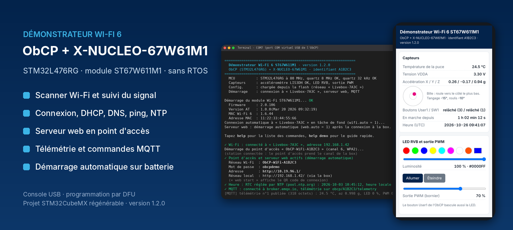
</p>

<p align="center">
  
  
  
  
  
  
</p>

# Démonstrateur Wi-Fi 6 — ObCP + X-NUCLEO-67W61M1

Programme de démonstration « bare-metal » pour l'**ObCP** (Objet Connecté Personnel de
SUPMICROTECH-ENSMM, STM32L476RG) équipé de la carte d'extension **X-NUCLEO-67W61M1**
(module Wi-Fi 6 / Bluetooth LE **ST67W611M1** de STMicroelectronics).

Quatre démonstrations se pilotent depuis un simple terminal série, sans recompiler : scanner
Wi-Fi, services réseau, serveur web en point d'accès, télémétrie MQTT. La LED RVB, la sortie
PWM et l'accéléromètre de l'ObCP sont mis à contribution, et la carte peut démarrer seule ses
services lorsqu'elle est alimentée sur batterie.

> 📘 **Documentation** : [guide d'utilisation](Doc/Guide_Demonstrateur_WiFi6_ObCP.docx)
> (montage, programmation, démos pas à pas, dépannage) et
> [documentation du programme](Doc/Documentation_Programme_ObCP.docx) (organisation du code,
> schémas de déroulement, référence des 470 fonctions).

## Sommaire

- [Les démonstrations](#les-démonstrations)
- [Nouveautés de la version 1.2](#nouveautés-de-la-version-12)
- [Matériel](#matériel)
- [Démarrage rapide](#démarrage-rapide)
- [Tour d'horizon](#tour-dhorizon)
- [Utilisation sur batterie](#utilisation-sur-batterie-démarrage-automatique)
- [Mise à jour du module Wi-Fi](#mise-à-jour-du-module-wi-fi)
- [Compiler et modifier le projet](#compiler-et-modifier-le-projet)
- [Lire le code](#lire-le-code)
- [Tests sur PC](#tests-sur-pc)
- [Contenu du dépôt](#contenu-du-dépôt)
- [État de validation](#état-de-validation) · [Versions](#versions) · [Licences](#licences)

## Les démonstrations

| Démo | Ce que l'on montre | Commandes |
|------|--------------------|-----------|
| **1. Scanner Wi-Fi** | réseaux visibles (RSSI, canal, sécurité, Wi-Fi 6), occupation des canaux 1 à 13, suivi du signal en direct (couleur de la LED RVB, export CSV) | `scan`, `channels`, `track` |
| **2. Connexion et services** | connexion à une box, DHCP ou IP fixe, DNS, ping, RTC mise à l'heure par SNTP (fuseau, heure d'été), reconnexion automatique | `connect`, `status`, `ip`, `dns`, `ping`, `ntp` |
| **3. Serveur web** | point d'accès propre à la carte (QR code de connexion), tableau de bord : accéléromètre et bille qui roule, LED RVB, sortie PWM, réseaux voisins, configuration Wi-Fi, API JSON | `web start`, `web status` |
| **4. Télémétrie MQTT** | état JSON périodique vers un broker, commandes à distance (LED, couleur, PWM…), évènements des boutons, présence (LWT) | `mqtt start`, `mqtt pub`, `mqtt sub` |

S'y ajoutent `led`, `pwm` et `sensors` pour les périphériques de l'ObCP, `module ota` pour
mettre à jour le firmware du module par le terminal et `module boot` pour sa première
programmation, l'ObCP servant de passerelle USB ↔ UART.

## Nouveautés de la version 1.2

- **Démarrage automatique** pour une utilisation sur batterie, sans terminal : connexion à la
  box enregistrée, point d'accès et serveur web (`web.auto`, nouveau), télémétrie MQTT
  (`mqtt.auto`) — commande `auto`, carte « Démarrage automatique » de la page web,
  `GET /api/auto`.
- **Code commenté pour un lecteur débutant** : chaque fichier résume son rôle, chaque fonction
  publique est décrite dans son en-tête.
- **Documentation du programme** (Word, 85 pages) : carte des fichiers, schémas de
  déroulement, dialogue avec le module, mémoire, brochage, référence des fonctions, recettes.
- Configuration enregistrée par la version 1.1 relue sans perte.

## Matériel

<p align="center">
  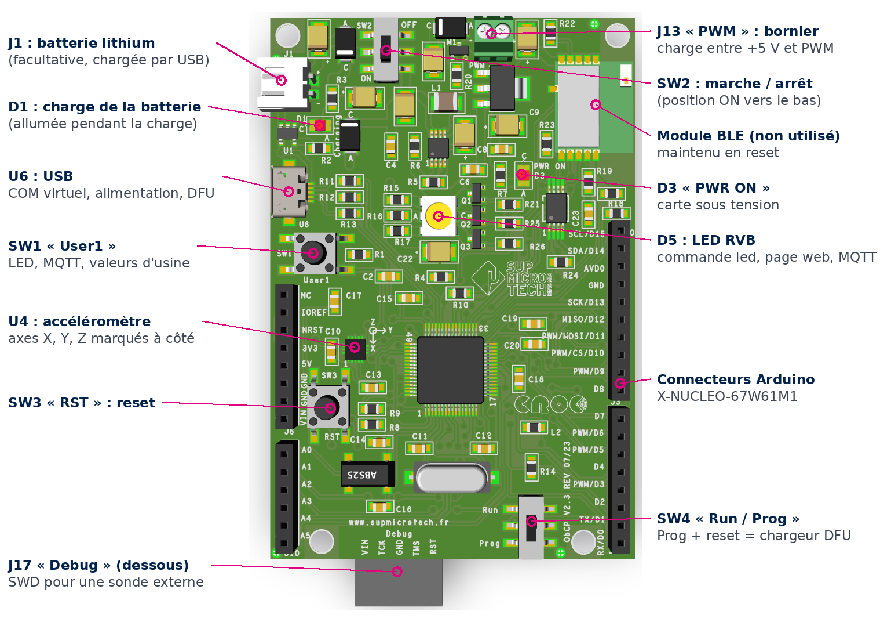
</p>

- une carte **ObCP** (version 2.3 ou ultérieure) et une carte **X-NUCLEO-67W61M1**, enfichée
  sur les connecteurs Arduino (cavaliers JP1 et JP2 en place) ;
- un câble USB **de données** ; facultatif : une batterie lithium sur J1 ;
- un point d'accès Wi-Fi **2,4 GHz** (box, routeur de TP, partage de connexion) ;
- sur le PC : [STM32CubeProgrammer](https://www.st.com/en/development-tools/stm32cubeprog.html),
  un terminal série (PuTTY, Tera Term, picocom…) et, pour modifier le programme,
  STM32CubeIDE.

<p align="center">
  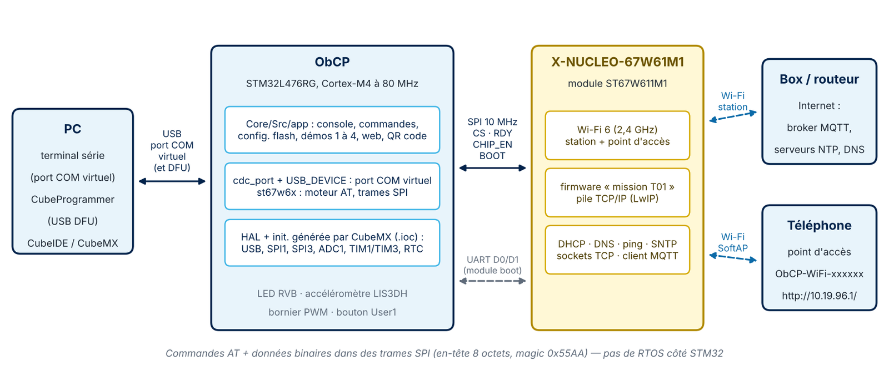
</p>

La pile TCP/IP, le DHCP, le DNS, le SNTP et le client MQTT tournent **dans le module**
(firmware « mission T01 ») ; le STM32 lui parle par **commandes AT transportées dans des
trames SPI**. Côté PC, l'ObCP se présente comme un port COM virtuel USB (classe CDC).

<details>
<summary><b>Brochage utilisé</b></summary>

| Fonction | Arduino | STM32L476 | Étiquette CubeMX |
|----------|---------|-----------|------------------|
| SPI SCK / MISO / MOSI (SPI1, 10 MHz, mode 0) | D13 / D12 / D11 | PA5 / PA6 / PA7 | `NCP_SCK` / `NCP_MISO` / `NCP_MOSI` |
| SPI CS (actif haut) | D10 | PB6 | `NCP_CS` |
| SPI RDY | D3 | PB3 | `NCP_RDY` |
| CHIP_EN / BOOT | D5 / D6 | PB4 / PB10 | `NCP_CHIP_EN` / `NCP_BOOT` |
| Bouton SW1 (X-NUCLEO) | D8 | PA9 | `NCP_SW1` |
| UART du module (pendant `module boot`) | D0 / D1 | PA3 / PA2 (USART2) | `NCP_UART_RX` / `NCP_UART_TX` |
| Console (port COM virtuel) | – | PA11 / PA12 (USB OTG FS) | – |
| LED RVB D5 | – | PC6 / PC8 / PC9 (TIM3, 1 kHz) | `Led_Red` / `Led_Green` / `Led_Blue` |
| Sortie PWM, bornier J13 (2,5 W max.) | – | PB1 (TIM1_CH3N, 1 kHz) | `PWM_Motor` |
| Accéléromètre U4 (LIS3DH ou LIS3DSH) | – | SPI3 PC10 / PC11 / PC12, CS PC5 | `ACC_SCK` / `ACC_MISO` / `ACC_MOSI`, `ACC_CS` |
| Bouton User1 | – | PC13 | `User1` |
| Module BLE (maintenu en reset) | – | PC2 | `BLE_Reset` |

<p align="center">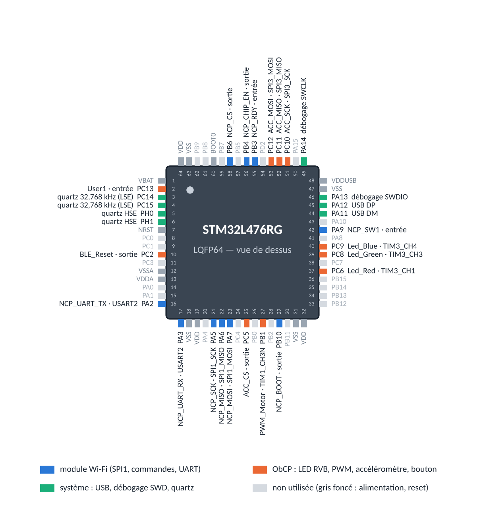</p>
</details>

## Démarrage rapide

**1. Programmer l'ObCP** par USB DFU (aucune sonde nécessaire) : interrupteur **SW4 sur Prog**
puis **RST** (ou commande `dfu` si le démonstrateur tourne déjà), puis :

```bash
STM32_Programmer_CLI -c port=usb1 -w Binaries/ObCP_WiFi_Demo.hex -v -s
```

Remettre SW4 sur **Run** et appuyer sur RST. Avec l'interface graphique de
STM32CubeProgrammer : interface **USB**, *Connect*, *Erasing & programming*, fichier `.hex`.

**2. Ouvrir le terminal** : « Périphérique série USB (COMx) » sous Windows, `/dev/ttyACM0` sous
Linux ; débit indifférent, UTF-8, au moins 100 colonnes. La bannière s'affiche à l'ouverture :

<p align="center">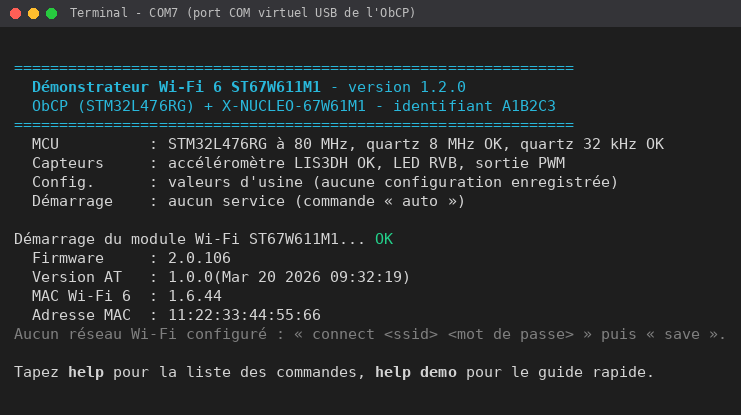</p>

**3. Vérifier le firmware du module** : la bannière doit indiquer *mission T01* 2.0.x
(2.0.106 conseillé), sinon voir [Mise à jour du module](#mise-à-jour-du-module-wi-fi).

**4. Essayer** :

```text
help demo                         guide rapide
led rouge 30 · pwm 50 · sensors   périphériques de l'ObCP
scan                              démo 1
connect "Ma Box" motdepasse       démo 2, puis « save » pour s'y reconnecter au démarrage
web start                         démo 3 : rejoindre ObCP-WiFi-<id> (obcpdemo), ouvrir http://10.19.96.1/
mqtt start                        démo 4 : broker.emqx.io, topics obcp/<id>/...
auto web on · auto mqtt on · save services lancés seuls à la mise sous tension
```

## Tour d'horizon

<table>
<tr>
<td width="50%"><b>Guide rapide</b><br>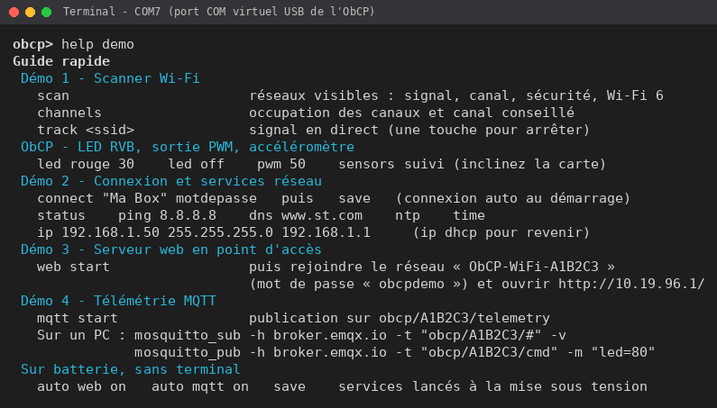</td>
<td width="50%"><b>LED RVB, sortie PWM, accéléromètre</b><br>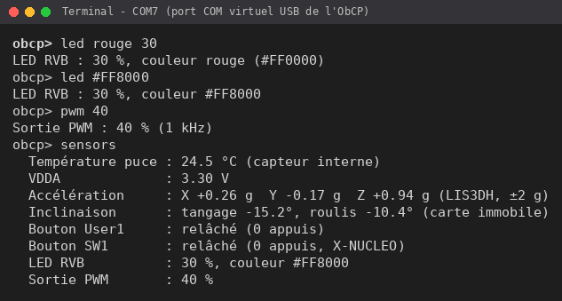</td>
</tr>
<tr>
<td><b>Démo 1 — balayage des réseaux</b><br>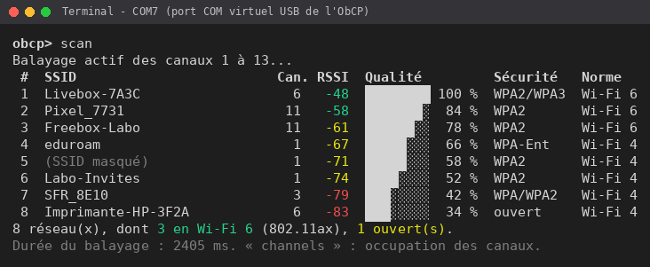</td>
<td><b>Démo 1 — occupation des canaux</b><br>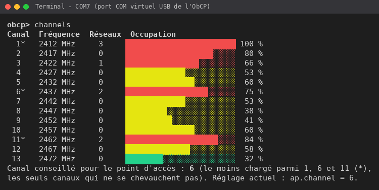</td>
</tr>
<tr>
<td><b>Démo 1 — suivi du signal en direct</b><br>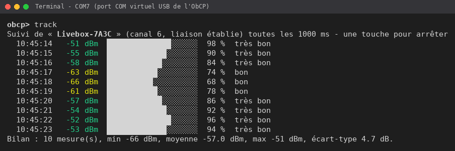</td>
<td><b>Démo 2 — connexion et heure NTP</b><br>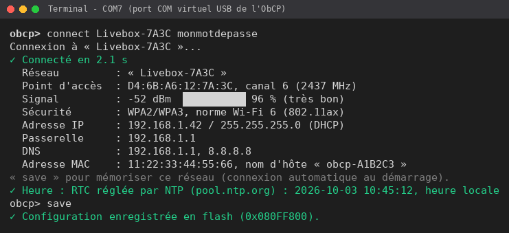</td>
</tr>
<tr>
<td><b>Démo 2 — ping, DNS, heure</b><br>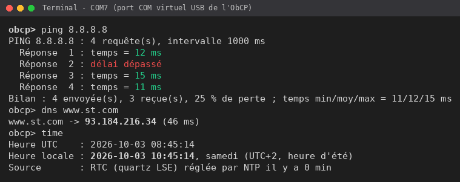</td>
<td><b>Démo 3 — point d'accès et QR code</b><br>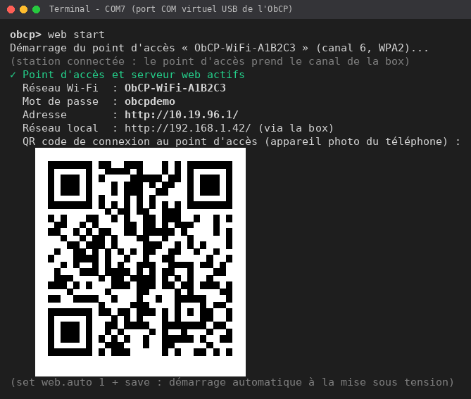</td>
</tr>
</table>

### La page web (démo 3)

Stockée dans la flash du STM32 (environ 10 Ko, sans ressource externe : elle fonctionne sans
Internet), elle s'adapte au téléphone et au thème clair ou sombre.

<p align="center">
  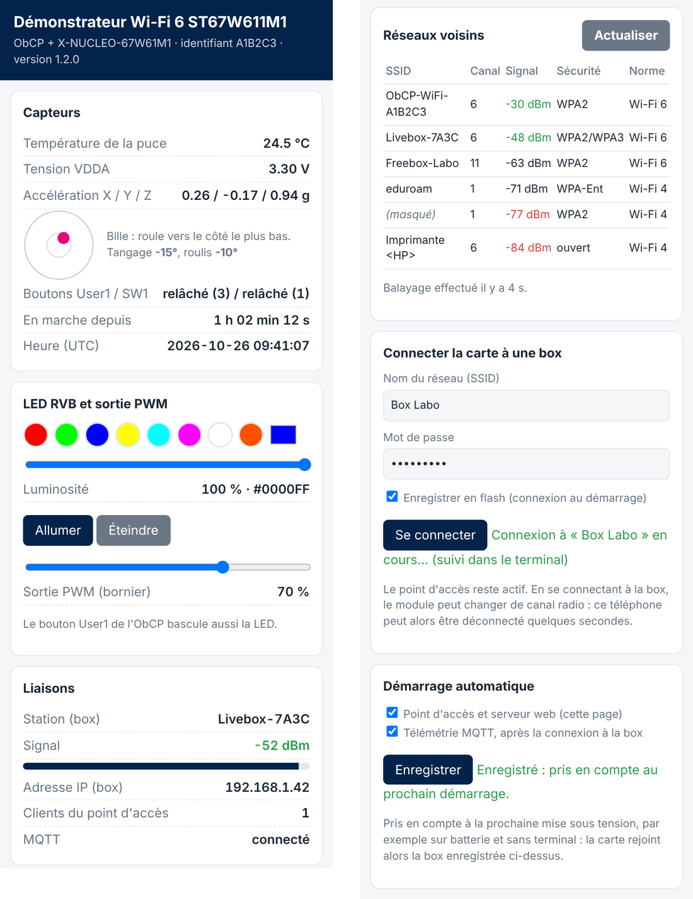
  &nbsp;
  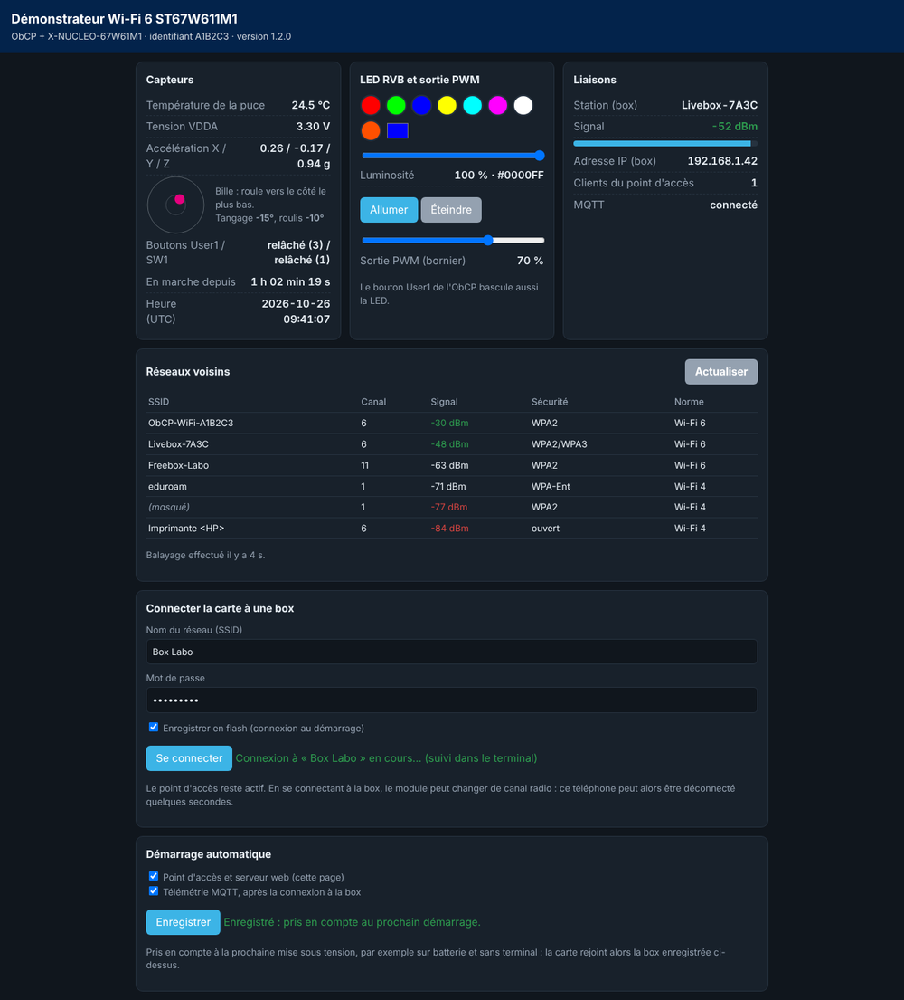
</p>

| Requête | Réponse |
|---------|---------|
| `GET /api/status` | état de la carte en JSON (même contenu que la télémétrie MQTT) |
| `GET /api/led?v=75&c=FF8000` | luminosité et/ou couleur de la LED RVB |
| `GET /api/pwm?v=30` | rapport cyclique de la sortie PWM |
| `GET /api/scan[?refresh=1]` | réseaux voisins |
| `POST /api/wifi` | `ssid`, `pass`, `save=1` : connexion de la carte à une box |
| `GET /api/auto[?web=1&mqtt=1]` | démarrage automatique (lu, ou modifié et enregistré en flash) |

### Télémétrie MQTT (démo 4)

<p align="center">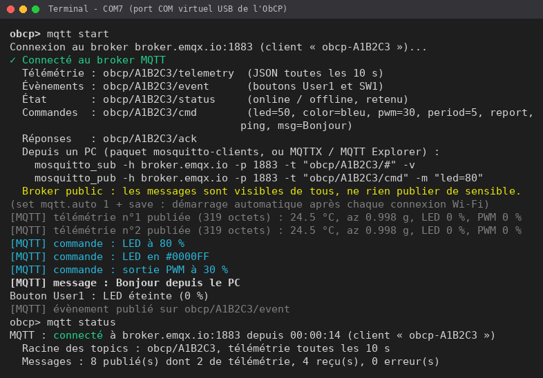</p>

```bash
mosquitto_sub -h broker.emqx.io -t "obcp/<id>/#" -v
mosquitto_pub -h broker.emqx.io -t "obcp/<id>/cmd" -m "color=vert"
mosquitto_pub -h broker.emqx.io -t "obcp/<id>/cmd" -m "pwm=50"
```

## Utilisation sur batterie (démarrage automatique)

Sur batterie, sans PC ni terminal, la carte lance seule à la mise sous tension les services
choisis, avec la connexion enregistrée en flash.

| Paramètre | Commande | Défaut | Démarre seul |
|-----------|----------|:------:|--------------|
| `wifi.auto` | `auto wifi on` | 1 | connexion à la box enregistrée, reconnexion après une coupure |
| `web.auto` | `auto web on` | 0 | point d'accès ObCP-WiFi-&lt;id&gt; et serveur web, une fois la tentative de connexion à la box terminée (35 s au plus ; aussitôt sans box) |
| `mqtt.auto` | `auto mqtt on` | 0 | télémétrie MQTT, dès que la carte a obtenu son adresse sur la box |

```text
connect "Ma Box" motdepasse       une fois, avec le terminal
auto web on                       et/ou  auto mqtt on   (off pour retirer)
save                              puis alimenter la carte par sa batterie (J1, SW2 sur ON)
```

<p align="center">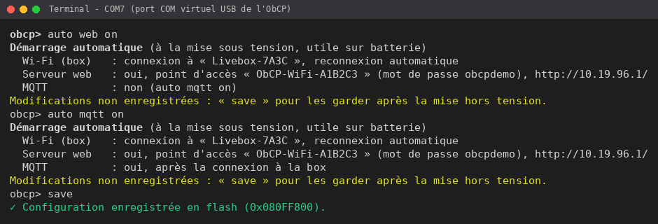</p>

<details>
<summary><b>Ce qui s'affiche à la mise sous tension</b></summary>
<p align="center">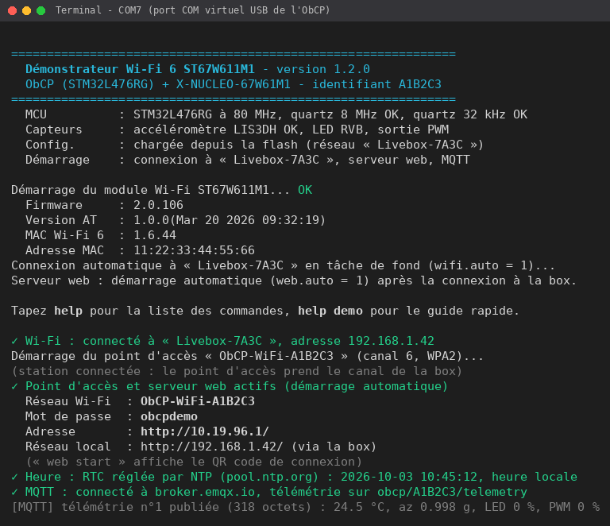</p>
<p align="center">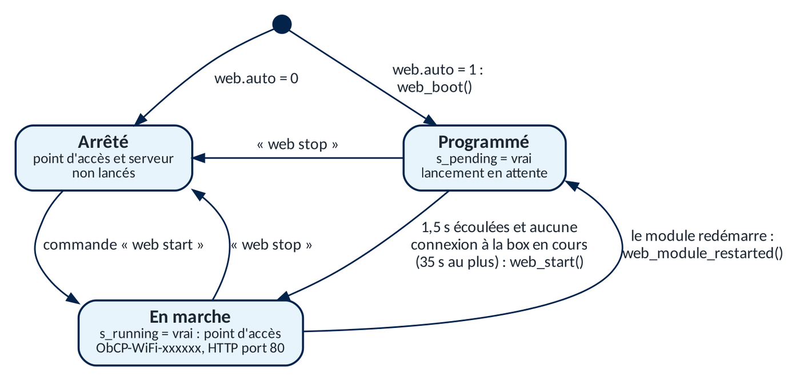</p>
</details>

Le même réglage se fait depuis la page web (carte « Démarrage automatique »). Pour reprendre
la main : `auto web off`, `auto mqtt off`, `save`, ou **User1** maintenu pendant un reset
(valeurs d'usine). ⚠️ Changer le mot de passe du point d'accès (`set ap.pass …` puis `save`)
avant de laisser une carte ainsi réglée sans surveillance.

## Mise à jour du module Wi-Fi

Un seul fichier suffit, dans le dossier
[NCP_Binaries](https://github.com/STMicroelectronics/x-cube-st67w61/tree/main/Projects/ST67W6X_Scripts/Binaries/NCP_Binaries)
du dépôt X-CUBE-ST67W61 de ST :
[`st67w611m_mission_t01_v2.0.106.xz.ota`](https://github.com/STMicroelectronics/x-cube-st67w61/raw/main/Projects/ST67W6X_Scripts/Binaries/NCP_Binaries/st67w611m_mission_t01_v2.0.106.xz.ota)
(860 Ko). Il part du PC en YMODEM sur le port COM virtuel ; le STM32 le transmet au module par
le lien SPI, qui vérifie l'empreinte SHA-256 avant de redémarrer dessus.

```text
Tera Term :   module ota   puis Fichier › Transfert › YMODEM › Envoyer
Script PC :   python Tools/maj_module_ota.py --port COM7 st67w611m_mission_t01_v2.0.106.xz.ota
```

<p align="center">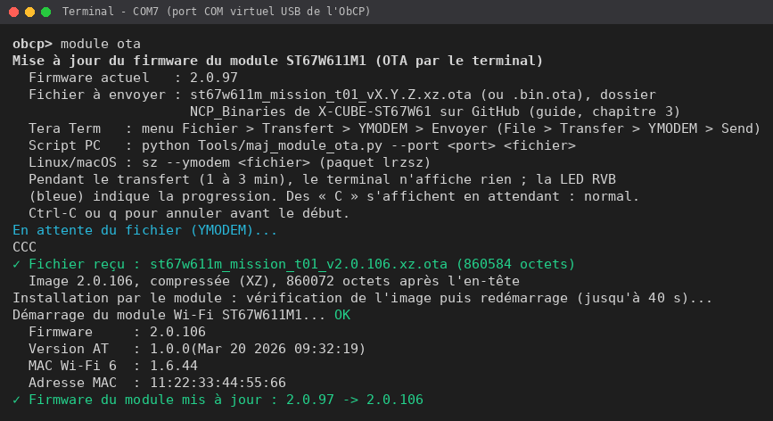</p>

<details>
<summary><b>Première programmation du module par l'ObCP (<code>module boot</code>)</b></summary>

Pour un module d'usine trop ancien (en-tête SPI `0x5501`) ou en firmware T02 : `module boot`
relaie le port COM virtuel vers l'UART du module, et l'outil QConn_Flash de ST programme le
module à travers l'ObCP, sans adaptateur.

1. Dans `Projects/ST67W6X_Scripts/Binaries/NCP_Binaries` de X-CUBE-ST67W61, copier
   `mission_t01_flash_prog_cfg.ini` en `cfg_obcp.ini` et, section `[FW]`, remplacer
   `st67w611m_mission_t01_vxxx.bin` par `st67w611m_mission_t01_v2.0.106.bin`.
2. Terminal : `module boot`, puis **fermer le terminal**.
3. Dans le dossier `Binaries` :
   `QConn_Flash\QConn_Flash_Cmd.exe --port COM7 --config NCP_Binaries\cfg_obcp.ini --efuse=NCP_Binaries\efusedata.bin`
4. Rouvrir le terminal **sans rien taper** : la passerelle s'arrête après 2 s de silence et le
   module redémarre sur le nouveau firmware.

Détails et dépannage : guide d'utilisation, chapitre 3.
</details>

## Compiler et modifier le projet

- **STM32CubeIDE** : *File › Import › Existing Projects into Workspace*, puis compiler (Debug
  ou Release). Le débogage pas à pas demande une sonde SWD externe sur le connecteur J17.
- **Ligne de commande** (GCC Arm) : `make` (`build/ObCP_WiFi_Demo.elf`, `.hex`, `.bin`),
  `make flash` (USB DFU), `make test` (tests sur PC).

Le projet est décrit par **`ObCP_WiFi_Demo.ioc`** et se **régénère avec STM32CubeMX sans
casser la démo** : le code de la démo est dans ses propres fichiers sous `Core/`, relié au code
généré par quelques lignes placées dans des sections `USER CODE`. Après chaque régénération :

```bash
python3 Tools/verif_cubemx.py
```

<details>
<summary><b>Accroches dans les fichiers générés et règles à respecter</b></summary>

<p align="center">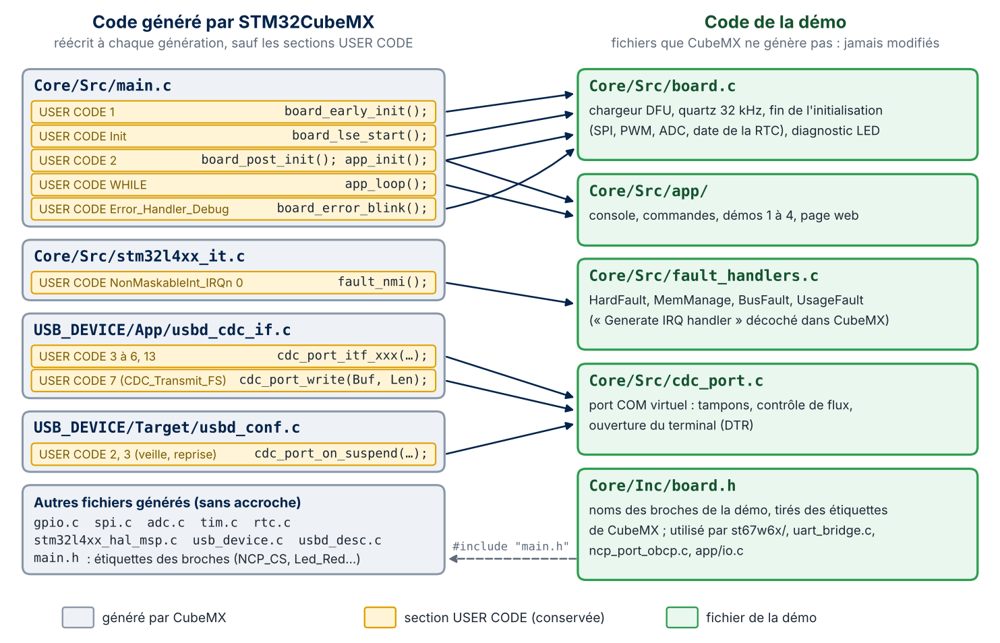</p>

| Fichier généré | Section USER CODE | Contenu |
|----------------|-------------------|---------|
| `Core/Src/main.c` | `1` | `board_early_init();` (saut éventuel dans le chargeur DFU) |
| | `Init` | `board_lse_start();` (quartz 32 kHz) |
| | `2` | `board_post_init();` puis `app_init();` |
| | `WHILE` | `app_loop();` |
| | `Error_Handler_Debug` | `board_error_blink();` (diagnostic par la LED rouge) |
| `Core/Src/stm32l4xx_it.c` | `NonMaskableInt_IRQn 0` | `fault_nmi();` |
| `USB_DEVICE/App/usbd_cdc_if.c` | `3` à `7`, `13` | appels de `cdc_port.c` |
| `USB_DEVICE/Target/usbd_conf.c` | `2`, `3` | veille / reprise de l'USB |

- n'écrire dans les fichiers générés qu'entre `USER CODE BEGIN` et `USER CODE END` ;
- garder les **étiquettes** des broches (`NCP_CS`, `Led_Red`, `User1`…) ;
- laisser décochée la génération des gestionnaires *Hard fault*, *Memory management*,
  *Prefetch fault* et *Undefined instruction* (ils sont dans `fault_handlers.c`) ;
- ne pas désactiver SPI1, SPI3, ADC1, TIM1, TIM3, RTC ni USB_DEVICE, et ne pas activer
  l'USART2 (réservé à `module boot`).
</details>

Ressources (Release) : environ 137 Ko de flash sur 1 Mo, 49 Ko de RAM sur 96 Ko (pile et tas
compris).

## Lire le code

Ordre de lecture conseillé :

1. `Core/Src/main.c` — initialisation générée par CubeMX, puis `app_init()` et `app_loop()` ;
2. `Core/Src/app/app.c` — démarrage, boucle principale, tâches de fond (`app_idle()`) ;
3. `Core/Src/app/cli.c` — table des commandes `s_cmds[]` ;
4. une démo — `demo_scan.c`, `demo_net.c`, `demo_web.c`, `demo_mqtt.c` ;
5. le pilote du module — `Core/Src/st67w6x/ncp_at.c` (commandes AT), puis `ncp_spi.c` (trames SPI).

<table>
<tr>
<td width="50%"><b>Carte du programme</b><br>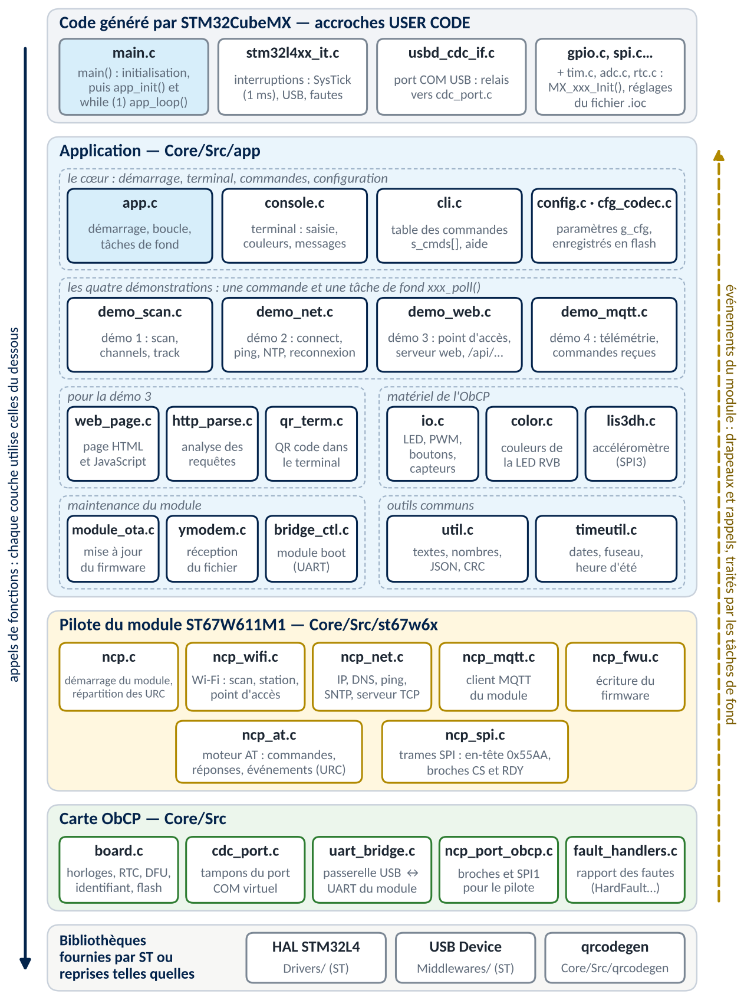</td>
<td width="50%"><b>Boucle principale</b><br>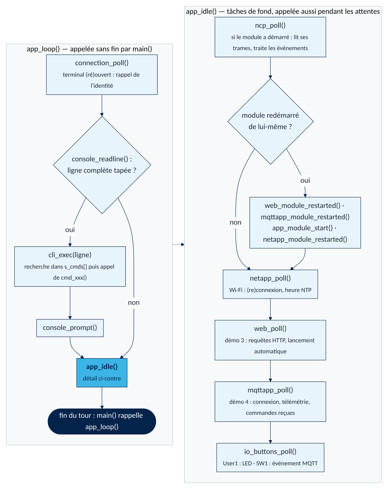</td>
</tr>
<tr>
<td><b>Trajet d'une requête web</b><br>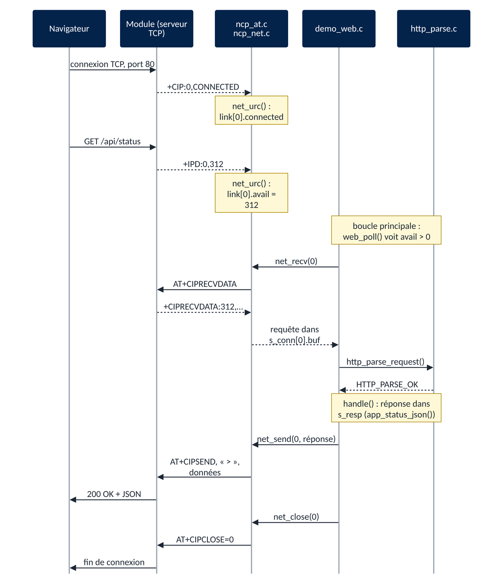</td>
<td><b>Occupation de la mémoire</b><br>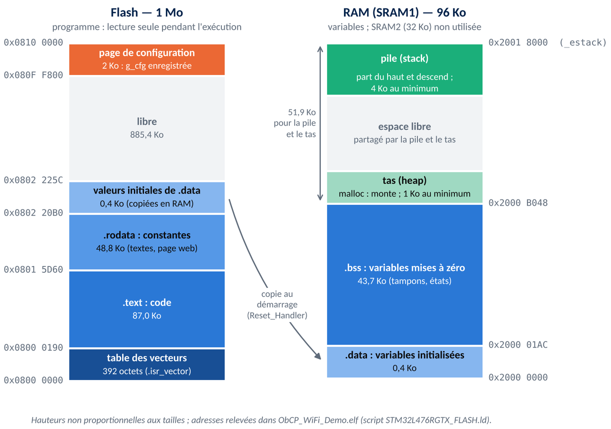</td>
</tr>
</table>

La [documentation du programme](Doc/Documentation_Programme_ObCP.docx) détaille tout cela :
dialogue avec le module, machines à états, référence des fonctions, paramètres, codes
d'erreur, et recettes pour ajouter une commande, un paramètre, une adresse au serveur web, une
mesure ou un périphérique.

## Tests sur PC

```bash
make -C Tests        # ou : make test
```

Cinq programmes compilés avec gcc, AddressSanitizer et UBSan, face à un module ST67W611M1
simulé :

| Programme | Vérifie | Vérifications |
|-----------|---------|--------------:|
| `test_driver` | pilote : trames SPI, rx_stall, flux AT, MQTT, mise à jour du module | 193 |
| `test_app` | calendrier, JSON, HTTP, configuration et sa migration, YMODEM, LED, accéléromètres simulés, passerelle | 325 |
| `test_usb` | port COM virtuel face à une classe CDC simulée | 115 |
| `test_sim` | application complète, quatre démos (journal : `Tests/build/sim_transcript.txt`) | 284 |
| `test_boot` | mises sous tension avec configuration enregistrée (démarrage automatique) | 87 |

S'y ajoutent la validation du JSON et du JavaScript de la page web, un essai de bout en bout
de `Tools/maj_module_ota.py` sur pseudo-terminal, et `Tools/verif_cubemx.py`.

## Contenu du dépôt

```text
ObCP_WiFi_Demo.ioc        configuration STM32CubeMX (CubeMX 6.11.1, STM32Cube FW_L4 V1.18.1)
Core/Src, Core/Inc        fichiers générés (main.c, gpio.c, spi.c…) et fichiers de la démo :
  board.c, cdc_port.c,      chargeur DFU, quartz, port COM virtuel, fautes du processeur,
  fault_handlers.c, …       passerelle module boot, adaptation du pilote
Core/Src/app/             console, commandes, configuration en flash, démarrage automatique,
                          LED RVB, accéléromètre, démos 1 à 4, page web, QR code, mise à jour
Core/Src/st67w6x/         pilote du ST67W611M1 : trames SPI, moteur AT, Wi-Fi, réseau, MQTT
Core/Src/qrcodegen/       QR codes (Project Nayuki, MIT)
USB_DEVICE/               généré par CubeMX : USB device, classe CDC
Drivers/, Middlewares/    HAL STM32L4, CMSIS, bibliothèque USB device de ST
Tests/                    tests sur PC
Tools/                    verif_cubemx.py, maj_module_ota.py, rssi_logger.py
Binaries/                 programme précompilé (.hex, .bin, .elf) à charger par USB DFU
Doc/                      guide d'utilisation et documentation du programme (Word)
Doc/images/              illustrations de ce README
```

## État de validation

| Version | État |
|---------|------|
| 1.0 | essayée sur ObCP : fonctionne |
| 1.1 | essayée sur ObCP, avant et après une régénération effective par STM32CubeMX : fonctionne |
| 1.2 | compilée sans avertissement (Makefile, Debug et Release de STM32CubeIDE), 1 004 vérifications sur PC réussies ; essai sur carte à confirmer |

## Versions

| Version | Contenu |
|---------|---------|
| 1.0.0 | Version ObCP du démonstrateur NUCLEO-L476RG : console USB (CDC), programmation par DFU, LED RVB, sortie PWM, accéléromètre, passerelle `module boot` |
| 1.1.0 | Projet STM32CubeMX régénérable sans perte, code de la démo sous `Core/` relié par des sections USER CODE, `Tools/verif_cubemx.py`, diagnostic des quartz par la LED rouge |
| 1.2.0 | Démarrage automatique sur batterie (`web.auto`, commande `auto`, carte de la page web, `/api/auto`), code commenté pour débutants, documentation du programme, tests de mise sous tension |

## Licences

| Composant | Licence |
|-----------|---------|
| Code écrit pour ce projet (`Core/Src/app/`, fichiers de la démo dans `Core/`, `Tests/`, `Tools/`, sections USER CODE) | voir `LICENSE` |
| Pilote `Core/Src/st67w6x` (protocole repris du pilote ST) | notice BSD-3-Clause de ST, `Core/Src/st67w6x/LICENSE.md` |
| Fichiers générés par STM32CubeMX, HAL STM32L4 | BSD-3-Clause (STMicroelectronics), `Core/LICENSE_ST.md` |
| STM32 USB Device Library, fichiers générés de `USB_DEVICE/` | SLA0044 (STMicroelectronics) |
| CMSIS | Apache 2.0 |
| QR-Code-generator (Project Nayuki) | MIT |

Les binaires du module ST67W611M1 et l'outil QConn_Flash ne sont pas inclus : ils sont fournis
par STMicroelectronics dans [X-CUBE-ST67W61](https://github.com/STMicroelectronics/x-cube-st67w61).
Documents de fabrication et programme modèle de l'ObCP :
[LAB_ObCP_L476_STM32CubeIDE](https://github.com/jimbaud/LAB_ObCP_L476_STM32CubeIDE).
