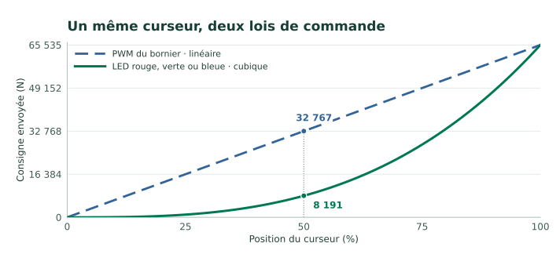
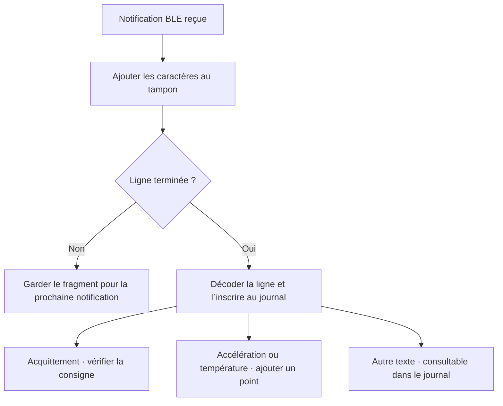

# Fonctionnement d’ObCP Control Web

[Retour à la mise en œuvre](../README.md)

Lorsqu’on déplace un curseur, le navigateur prend l’initiative et le STM32 applique la nouvelle consigne. Lorsqu’une mesure arrive, c’est la carte qui a pris l’initiative. Ces deux échanges utilisent le même service Bluetooth. Ils permettent de suivre le fonctionnement de la page depuis un geste à l’écran jusqu’à la LED, puis dans l’autre sens, depuis le capteur jusqu’au graphique.

## Le navigateur et la carte

Le serveur HTTPS distribue des fichiers statiques. Une fois la page chargée, les commandes, l’historique et les graphiques s’exécutent sur l’appareil qui affiche la page. Le Bluetooth de cet appareil établit la liaison avec l’ObCP. Les données du capteur vont directement de la carte au navigateur.

En **mode démo**, un objet JavaScript nommé `DemoDevice` joue le rôle du périphérique. Il accepte le même texte de commande, produit des acquittements et génère des trames de mesure. Le décodeur et les graphiques traitent ces trames comme celles d’une carte réelle. En **mode connecté**, le module BlueNRG de l’ObCP assure la liaison radio. Dans le firmware 2026, il échange avec le STM32 par le bus SPI2.

## Comment la connexion Bluetooth s’établit

En Bluetooth Low Energy, le périphérique expose des **services**. Un service regroupe des **caractéristiques** auxquelles on peut, selon leurs propriétés, écrire ou s’abonner. Chaque service et chaque caractéristique possèdent ici un identifiant de 128 bits appelé **UUID**. Le **GATT** (*Generic Attribute Profile*) définit la manière dont le client, ici le navigateur, accède à ces données sur le serveur, ici la carte.

| Élément du profil ObCP | UUID complet | Utilisation |
|---|---|---|
| Service de communication | `6e400001-b5a3-f393-e0a9-e50e24dcca9e` | Regroupe les deux sens de l’échange |
| Caractéristique de commande | `6e400003-b5a3-f393-e0a9-e50e24dcca9e` | Le navigateur y écrit les commandes destinées au STM32 |
| Caractéristique de retour | `6e400002-b5a3-f393-e0a9-e50e24dcca9e` | Le navigateur s’y abonne pour recevoir les réponses et les mesures |

Le clic sur **Connecter une carte** ouvre le sélecteur d’appareils du navigateur. Le service de communication peut être découvert après la sélection, même si la carte annonce seulement son nom. Une fois la liaison ouverte, `openGatt()` retrouve les deux caractéristiques, vérifie leurs propriétés puis active les notifications. Une **notification** est un envoi que la carte peut déclencher dès que le navigateur s’est abonné.

Après la connexion, la page initialise un nouvel historique et affiche **À régler** pour chaque sortie. Le protocole de l’application ne permet pas de relire les quatre consignes au moment de la connexion. Le navigateur attend donc un réglage explicite avant d’afficher un pourcentage. Une coupure annule les écritures en attente. Les dernières courbes restent consultables. Sur le modèle 2026, le firmware arrête également la minuterie et coupe les sorties lors d’une déconnexion BLE. [Client GATT](../dist/protocol.js) · [Gestion des sessions](../dist/app.js) · [Service BLE du firmware](https://github.com/jimbaud/LAB_ObCP_L476_STM32CubeIDE/blob/629321b0d62c887bb05bfbf4498d6dc54ca6ffc2/OBCP_template_2026/Core/Src/ble_uart.c)

## Du pourcentage au rapport cyclique

La LED tricolore D5 possède trois composantes indépendantes. Pour chacune, le STM32 produit un signal périodique qui allume et éteint rapidement la composante. La fraction de la période pendant laquelle elle est allumée est le **rapport cyclique**. Cette technique est la modulation de largeur d’impulsion, ou **PWM**. Le bornier J13 fournit une quatrième sortie PWM indépendante.

Le curseur affiche un pourcentage $p$ compris entre 0 et 100. Le protocole transporte une valeur entière $N$ entre 0 et 65 535, soit l’étendue d’un entier non signé sur 16 bits. Les LED utilisent une loi cubique qui rend le réglage plus fin aux faibles intensités. J13 utilise une loi linéaire. Les symboles de partie entière indiquent qu’on conserve l’entier inférieur.

$$
N_{\mathrm{LED}}=\left\lfloor 65535\left(\frac{p}{100}\right)^3\right\rfloor
\qquad
N_{\mathrm{J13}}=\left\lfloor 65535\frac{p}{100}\right\rfloor
$$



À **50 %**, la moitié élevée au cube vaut 0,125. La composante rouge reçoit donc **8 191**, soit environ 12,5 % de la pleine échelle. Pour J13, la même position donne **32 767**, soit environ 50 %. Les pourcentages des curseurs et l’aperçu RVB représentent les consignes choisies. La luminosité réelle dépend aussi de la LED et du firmware.

**Différence entre les modèles 2024 et 2026.** Sur le modèle 2026, le timer TIM3 de la LED compte de 0 à 65 535. Sur le modèle 2024, il compte de 0 à 6 399. À 46 % au curseur rouge, le navigateur envoie déjà 6 378. À 47 %, il envoie 6 804, au-delà de la période du modèle 2024. La LED de cette version atteint alors sa pleine luminosité. Les deux firmwares peuvent ainsi répondre `Red = 8191` pour des luminosités différentes. La plage de J13 est la même sur les deux versions. [Réglages des minuteries et comparaison des firmwares](https://github.com/jimbaud/LAB_ObCP_L476_STM32CubeIDE/tree/629321b0d62c887bb05bfbf4498d6dc54ca6ffc2/OBCP_template_2026)

## Ce qui se passe lors d’une commande

Pendant le déplacement du curseur rouge, la page actualise l’affichage local. Au relâchement, elle attend 100 ms pour regrouper des réglages rapprochés sur cette voie. Pour 50 %, `setpoint("r", 50)` prépare `r8191`. La lettre désigne la sortie et les chiffres donnent la consigne en décimal. Le texte représente cinq octets ASCII, `72 38 31 39 31` en hexadécimal. La page les écrit en une fois sur la caractéristique `6e400003-…`, sans terminaison de ligne.

Le firmware lit la lettre `r`, convertit les chiffres et applique la valeur au registre de comparaison de **TIM3, voie 1**, relié à la composante rouge de D5. Il envoie ensuite `Red = 8191` sur la caractéristique `6e400002-…`. Cette réponse textuelle est l’**acquittement applicatif**. L’indication **Acquitté** signifie que la page a reçu la valeur attendue. L’observation de D5, ou une mesure sur J13 pour la quatrième voie, renseigne sur l’effet physique de la consigne.

| Texte envoyé par la page | Action dans le modèle STM32 | Retour attendu |
|---|---|---|
| `rN`, `vN`, `bN` | D5 rouge, verte, bleue, respectivement sur PC6, PC8, PC9 et les voies 1, 3, 4 de TIM3 | `Red = N`, `Green = N`, `Blue = N` |
| `mN` | Sortie PWM du bornier J13 sur PB1, voie complémentaire 3N de TIM1 | `PWM = N` |
| `start timer` | Démarre les mesures périodiques, cadencées par TIM7 dans le modèle 2026 | Les mesures reçues signalent que l’acquisition fonctionne |
| `stop timer` | Arrête la minuterie d’acquisition | Aucune réponse dédiée |
| `#rst` | Coupe les sorties et arrête la minuterie. La liaison reste ouverte et les courbes sont conservées | Aucune réponse dédiée |

Dans le journal, **TX** signifie « émis par le navigateur » et **RX** « reçu par le navigateur ». La file d’écriture prépare l’attente de la réponse avant d’envoyer la commande afin de reconnaître même une réponse immédiate. Chaque consigne attend l’acquittement de sa propre voie et de sa propre valeur. En l’absence d’acquittement après une écriture, elle peut être réémise jusqu’à **cinq essais au total**, avec une attente de **500 ms par essai**. Les commandes du timer et `#rst` sont envoyées une seule fois. [File des commandes](../dist/protocol.js) · [Interpréteur du STM32](https://github.com/jimbaud/LAB_ObCP_L476_STM32CubeIDE/blob/629321b0d62c887bb05bfbf4498d6dc54ca6ffc2/OBCP_template_2026/Core/Src/commands.c) · [Sorties PWM](https://github.com/jimbaud/LAB_ObCP_L476_STM32CubeIDE/blob/629321b0d62c887bb05bfbf4498d6dc54ca6ffc2/OBCP_template_2026/Core/Src/outputs.c)

## Du capteur au graphique

Après `start timer`, le firmware modèle lit le capteur U4 au rythme d’une seconde. Il transmet deux messages lorsque les deux lectures réussissent. Le premier contient les trois composantes de l’accélération. Le second contient la température mesurée par le capteur.

```text
X0.02Y-0.98Z0.15
T = 24
```

Dans cet exemple, la page trace le triplet **(0,02 g, −0,98 g, 0,15 g)** et affiche **24,0 °C**. Le firmware 2026 transmet ici un entier pour la température. La décimale vient du format d’affichage de la page. Chaque ligne se termine par un saut de ligne suivi d’un retour chariot, soit `0A 0D` en hexadécimal. Les lettres `X`, `Y` et `Z` séparent les axes même lorsque leurs signes changent.

Le module peut partager une ligne entre deux notifications BLE de 20 octets au maximum. Si une notification se termine par `…Z0.` et la suivante commence par `15`, le lecteur `FrameReader` conserve le fragment pour reconstituer `0.15`. Il peut aussi extraire plusieurs lignes d’une même réception. `parseLine()` oriente ensuite chaque ligne complète vers son destinataire.



L’axe horizontal compte les **échantillons reçus**. Les trois axes d’accélération partagent le même indice. La température possède son propre compteur. Une perte de trame peut donc décaler les indices des deux courbes. Le journal indique l’heure de réception sur le poste. Le firmware ne transmet pas d’horodatage dans ces messages.

La page conserve jusqu’à **3 000 échantillons par graphique**, soit environ 50 minutes à 1 Hz si la réception est continue. À l’ouverture, chaque graphique présente 60 points, avec un zoom réglable de 10 à 600 points. **Suivi direct** revient à l’extrémité la plus récente. Le journal conserve les **250 derniers événements**. Recharger la page ouvre une nouvelle session de démonstration et efface les historiques de la session précédente. [Production des mesures](https://github.com/jimbaud/LAB_ObCP_L476_STM32CubeIDE/blob/629321b0d62c887bb05bfbf4498d6dc54ca6ffc2/OBCP_template_2026/Core/Src/app.c) · [Affichage des courbes](../dist/charts.js)

## Organisation du logiciel

| Fichier | Rôle |
|---|---|
| [dist/index.html](../dist/index.html) et [dist/styles.css](../dist/styles.css) | Structure et présentation des écrans Pilotage, Journal et Guide, sur ordinateur ou écran tactile |
| [dist/app.js](../dist/app.js) | Relie les boutons aux commandes, gère les sessions, les indicateurs, les dernières valeurs et le journal |
| [dist/protocol.js](../dist/protocol.js) | Définit les UUID, convertit les consignes, gère la liaison GATT, les acquittements et les trames. Contient aussi le simulateur |
| [dist/charts.js](../dist/charts.js) | Stocke les séries d’échantillons, trace les courbes et gère le zoom et les déplacements |
| [dist/manifest.webmanifest](../dist/manifest.webmanifest) et [dist/sw.js](../dist/sw.js) | Décrivent la version installable et conservent ses fichiers pour un prochain lancement hors ligne après une première visite réussie |
| [tools/make_portable.py](../tools/make_portable.py) | Produit le fichier HTML autonome en incorporant les scripts, le style et les images de la version web |
| [tests/protocol.test.cjs](../tests/protocol.test.cjs) | Vérifie les conversions, la découverte du service, les trames, la file d’écriture et les coupures à l’aide d’un périphérique simulé |

L’application se sert directement depuis `dist/`, sans compilation. Après une modification des sources, `python3 tools/make_portable.py ObCP_Control_Web_v1.0.0.html` régénère le fichier autonome depuis le dossier contenant le README. Sous Windows, la commande Python peut commencer par `py`. La vérification logicielle s’effectue avec `node --test tests/protocol.test.cjs` (Node.js 20 ou ultérieur). Le cache hors ligne contient les fichiers de l’application. Les mesures restent dans la mémoire de l’onglet.

Les liens vers le code du STM32 pointent vers la révision `629321b0d62c887bb05bfbf4498d6dc54ca6ffc2`. [Application Android d’origine](https://github.com/jimbaud/LAB_ObCP_L476_STM32CubeIDE/tree/629321b0d62c887bb05bfbf4498d6dc54ca6ffc2/Android/ObCP_Control) · [Firmware modèle 2026](https://github.com/jimbaud/LAB_ObCP_L476_STM32CubeIDE/tree/629321b0d62c887bb05bfbf4498d6dc54ca6ffc2/OBCP_template_2026)
