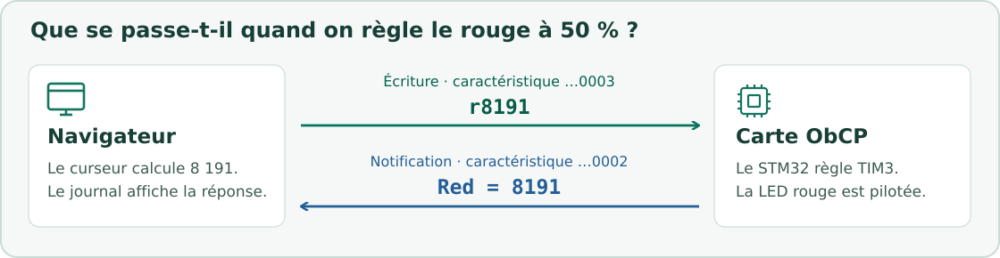
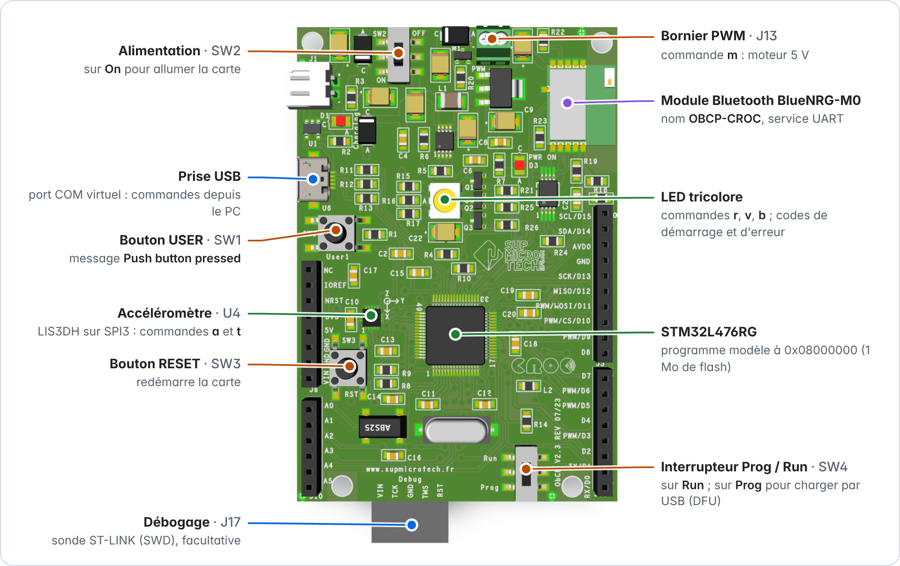

# ObCP Control Web — piloter la carte ObCP depuis un navigateur

**ObCP Control Web 1.0.0** reprend les fonctions de l’application Android du projet ObCP. La page commande la LED tricolore D5 et la sortie PWM du bornier J13. Elle affiche aussi l’accélération suivant trois axes et la température du capteur. La liaison Bluetooth Low Energy (BLE) s’établit directement entre la carte STM32L476RG et l’ordinateur, le téléphone ou la tablette qui affiche la page.

| Pour… | Point de départ |
|---|---|
| Ouvrir le simulateur sans installation | [Télécharger le fichier HTML autonome](ObCP_Control_Web_v1.0.0.html) |
| Piloter une carte physique | Suivre les étapes 1 à 3 ci-dessous avec une ObCP et un navigateur compatible |
| Comprendre les commandes, les mesures et le code source | [Fonctionnement de l’application](Doc/FONCTIONNEMENT.md) |



## Ouvrir la page sans carte

Ouvrez `ObCP_Control_Web_v1.0.0.html` dans un navigateur récent. Si vous partez de GitHub, sélectionnez le fichier puis **Download raw file** pour le télécharger. Le fichier s’ouvre hors ligne et contient toute l’application. Au démarrage, le badge **Mode démo** identifie les données simulées. Les courbes affichent déjà 72 échantillons, puis reçoivent un nouveau point par seconde. Les curseurs, le journal et les commandes d’acquisition utilisent ce simulateur tant qu’aucune carte physique n’est connectée.

## 1. Préparer la carte et le navigateur

La carte doit exécuter le firmware de commande ObCP. Le modèle classique **OBCP_template_2026** et le modèle 2024 utilisent les commandes décrites ici. Si le firmware est déjà chargé, alimentez la carte, placez **SW4 sur Run**, **SW2 sur On**, puis appuyez sur **SW3**. Le modèle 2026 donne un éclat vert lorsque le capteur et le module Bluetooth sont prêts. Le nom annoncé par défaut est **OBCP-CROC**.

<details>
<summary>Voir les repères sur la carte</summary>



Illustration de Joël IMBAUD, issue du dossier OBCP_template_2026.

</details>

<details>
<summary>Charger le firmware classique 2026 par USB si la carte doit être programmée</summary>

1. Récupérez `OBCP_template_2026.bin` dans le dossier `BIN/` du modèle classique. Cette procédure écrit l’application au début de la mémoire flash. Une carte équipée du chargeur **ObCP-OTA** utilise la procédure propre à cette variante. [Binaire du modèle classique](https://github.com/jimbaud/LAB_ObCP_L476_STM32CubeIDE/tree/main/OBCP_template_2026/BIN) · [Variante ObCP-OTA](https://github.com/jimbaud/LAB_ObCP_L476_STM32CubeIDE/tree/main/OBCP_template_2026_OTA)
2. Branchez le câble USB, placez **SW4 sur Prog**, **SW2 sur On** et appuyez sur **SW3**. Dans **STM32CubeProgrammer**, choisissez **USB**, actualisez la liste puis cliquez sur **Connect**.
3. Dans **Erasing & programming**, ouvrez le fichier `.bin`, indiquez `0x08000000` puis cliquez sur **Start Programming**. Après confirmation de l’écriture, replacez **SW4 sur Run** et appuyez sur **SW3**. [Procédure illustrée du dépôt](https://github.com/jimbaud/LAB_ObCP_L476_STM32CubeIDE/tree/main/OBCP_template_2026#charger-le-programme)

</details>

| Poste | Navigateur pour la liaison BLE |
|---|---|
| Windows 10/11 ou macOS | Chrome ou Edge avec le Bluetooth du poste activé |
| Android ou ChromeOS | Chrome avec l’autorisation d’accéder au périphérique |
| Linux | La disponibilité de Web Bluetooth dépend du navigateur Chromium, de sa configuration et de la pile Bluetooth installée |
| iPhone ou iPad | Bluefy est un navigateur iOS qui expose Web Bluetooth. La connexion ObCP avec Bluefy reste à vérifier sur appareil |

La démonstration fonctionne également dans des navigateurs comme Safari ou Firefox. Pour une connexion physique, le navigateur doit proposer l’API **Web Bluetooth**. [Compatibilité par navigateur](https://caniuse.com/web-bluetooth) · [Documentation Chrome](https://developer.chrome.com/docs/capabilities/bluetooth) · [Bluefy pour iOS](https://apps.apple.com/fr/app/bluefy-web-ble-browser/id1492822055)

## 2. Ouvrir la page pour utiliser le Bluetooth

**Avec un lien HTTPS**, ouvrez l’adresse de l’application dans un onglet du navigateur compatible, sur l’appareil qui sera à proximité de la carte. C’est la méthode la plus simple sur téléphone. La page du code source sur GitHub sert à consulter et télécharger les fichiers. La section « Intégration dans le dépôt » explique comment obtenir une adresse qui lance l’application.

**En local sur ordinateur**, ouvrez un terminal dans `Web/ObCP_Control/`, à côté de ce README. Avec Python 3 installé, lancez l’une des commandes ci-dessous, puis ouvrez **http://localhost:8000/** sur ce même ordinateur. Laissez le terminal ouvert pendant l’utilisation. `Ctrl+C` arrête le serveur.

**Windows · PowerShell**

```powershell
py -m http.server 8000 --bind 127.0.0.1 --directory dist
```

**macOS ou Linux**

```sh
python3 -m http.server 8000 --bind 127.0.0.1 --directory dist
```

Le navigateur autorise l’accès BLE dans un contexte sécurisé comme HTTPS ou `localhost`. Sur un téléphone, `localhost` désigne le téléphone lui-même. Une adresse HTTP privée du type `http://192.168.1.10:8000/` ne bénéficie pas de l’exception accordée à `localhost`. [Contextes sécurisés des navigateurs](https://developer.mozilla.org/en-US/docs/Web/Security/Defenses/Secure_Contexts)

## 3. Connecter l’ObCP et utiliser le tableau de bord

1. Si l’application Android occupe déjà la liaison, déconnectez-la. Cliquez sur **Connecter une carte**, sélectionnez **OBCP-CROC** dans la fenêtre du navigateur et validez. Si plusieurs cartes sont présentes, le champ **Filtrer la recherche par début de nom** se trouve dans **Guide**.
2. Quand le nom de la carte remplace **Mode démo**, la liaison est établie. Les données simulées disparaissent. Les curseurs indiquent **À régler** et **— %** jusqu’à votre première consigne sur chaque voie.
3. Réglez une sortie dans **Pilotage**. Par exemple, relâcher **LED rouge** à **50 %** envoie `r8191`. Quand le STM32 répond `Red = 8191`, la page affiche **Acquitté**. Dans **Journal**, **TX** désigne le texte envoyé par le navigateur et **RX** le texte reçu. La ligne la plus récente figure en haut.
4. Cliquez sur **Démarrer l’acquisition**. L’indication **Démarrage demandé** passe à **Mesures reçues** dès la première mesure. Le firmware modèle transmet chaque seconde un triplet d’accélération en **g** et la température du capteur en **°C**. Lorsque la carte est immobile, la norme de l’accélération est généralement proche de 1 g. Incliner la carte modifie sa répartition entre X, Y et Z.

| Commande d’interface | Effet |
|---|---|
| **Arrêter l’acquisition** | Demande au STM32 d’arrêter les mesures périodiques. La LED garde son réglage et les dernières courbes restent visibles |
| **Effacer les courbes** | Vide l’historique dans le navigateur. Si la carte envoie encore des mesures, la courbe reprend à l’échantillon 0 |
| **Suivi direct** | Ramène les graphiques aux derniers points après un zoom ou un déplacement dans l’historique |
| **Remise à zéro** | Après confirmation, envoie `#rst`. Le firmware coupe les quatre sorties et arrête l’acquisition. Les courbes restent consultables |
| **Déconnecter** | Libère la liaison BLE. Le bouton **Connecter une carte** permet d’ouvrir une nouvelle session |

Le guide technique explique pourquoi le curseur rouge à 50 % produit **8 191**, alors que le curseur PWM au même réglage produit **32 767**. Il décrit aussi le traitement d’un acquittement et la construction des courbes. [Fonctionnement de l’application](Doc/FONCTIONNEMENT.md)

## Dépannage

| Symptôme | Vérification |
|---|---|
| Le sélecteur Bluetooth ne s’ouvre pas | Ouvrir la page en HTTPS ou sur `localhost`, dans un onglet du navigateur compatible. Vérifier les autorisations Bluetooth du navigateur et du système |
| OBCP-CROC n’apparaît pas | Vérifier l’alimentation, **Run**, le démarrage et l’absence de connexion Android active. Effacer le filtre de nom. Sur le modèle 2026, trois éclats rouges au démarrage signalent que le module BLE ne répond pas |
| Une carte est détectée, mais le service est introuvable ou les sorties restent **Sans réponse** | Vérifier le firmware chargé. Le modèle de commande reçoit du texte comme `r8191`. L’exemple distinct `OBCP_BLE_UART` pilote une LED avec `0` ou `1`. Le journal permet de voir les commandes et leurs réponses |
| Les LED répondent, mais les graphiques restent vides | Vérifier dans le journal l’envoi de `start timer`, puis la réception de `X…Y…Z…` et de `T = …`. Sur le modèle 2026, deux éclats rouges au démarrage signalent que le capteur ne répond pas |
| La LED atteint presque son maximum vers le milieu du curseur | Le modèle 2024 emploie une période PWM plus courte pour D5. Le guide explique la différence avec le modèle 2026. [Lois de commande et rôle de TIM3](Doc/FONCTIONNEMENT.md#du-pourcentage-au-rapport-cyclique) |


**Projet d’origine.** Carte et application Android ObCP de Joël IMBAUD, SUPMICROTECH–ENSMM, option CROC. [Dépôt ObCP](https://github.com/jimbaud/LAB_ObCP_L476_STM32CubeIDE) · [Application Android de référence](https://github.com/jimbaud/LAB_ObCP_L476_STM32CubeIDE/tree/main/Android/ObCP_Control)
